# WanderChain 首页规格文档

<cite>
**本文引用的文件**   
- [README.md](file://README.md)
- [spec-coverage-audit.md](file://docs/spec-coverage-audit.md)
- [homepage-hero.md](file://docs/specs/wanderchain/homepage-hero.md)
- [search-page.md](file://docs/specs/wanderchain/search-page.md)
- [homepage-u2-skeleton.md](file://docs/specs/wanderchain/homepage-u2-skeleton.md)
- [homepage-u3-feature-nav.md](file://docs/specs/wanderchain/homepage-u3-feature-nav.md)
- [homepage-u4-ai-assistant.md](file://docs/specs/wanderchain/homepage-u4-ai-assistant.md)
- [homepage-u6-editor-picks.md](file://docs/specs/wanderchain/homepage-u6-editor-picks.md)
- [homepage-u7-hot-posts.md](file://docs/specs/wanderchain/homepage-u7-hot-posts.md)
- [homepage-u8-hot-attractions.md](file://docs/specs/wanderchain/homepage-u8-hot-attractions.md)
- [frontend/app/page.tsx](file://frontend/app/page.tsx)
- [frontend/app/layout.tsx](file://frontend/app/layout.tsx)
- [frontend/components/home/hero.tsx](file://frontend/components/home/hero.tsx)
- [frontend/components/home/hero.module.css](file://frontend/components/home/hero.module.css)
- [frontend/components/home/feature-nav.tsx](file://frontend/components/home/feature-nav.tsx)
- [frontend/components/home/feature-nav.module.css](file://frontend/components/home/feature-nav.module.css)
- [frontend/components/home/ai-assistant.tsx](file://frontend/components/home/ai-assistant.tsx)
- [frontend/components/home/ai-assistant.test.tsx](file://frontend/components/home/ai-assistant.test.tsx)
- [frontend/components/home/editor-picks.tsx](file://frontend/components/home/editor-picks.tsx)
- [frontend/components/home/editor-picks.test.tsx](file://frontend/components/home/editor-picks.test.tsx)
- [frontend/components/home/hot-posts.tsx](file://frontend/components/home/hot-posts.tsx)
- [frontend/components/home/hot-attractions.tsx](file://frontend/components/home/hot-attractions.tsx)
- [frontend/components/home/hot-attractions.module.css](file://frontend/components/home/hot-attractions.module.css)
- [frontend/components/home/hot-attractions.test.tsx](file://frontend/components/home/hot-attractions.test.tsx)
- [frontend/lib/home/cities.ts](file://frontend/lib/home/cities.ts)
- [frontend/app/search/page.tsx](file://frontend/app/search/page.tsx)
- [frontend/lib/image-loader.ts](file://frontend/lib/image-loader.ts)
- [frontend/next.config.ts](file://frontend/next.config.ts)
- [frontend/lib/home/repository.ts](file://frontend/lib/home/repository.ts)
- [frontend/lib/home/types.ts](file://frontend/lib/home/types.ts)
- [frontend/lib/home/mock-data.ts](file://frontend/lib/home/mock-data.ts)
- [frontend/lib/search/query.ts](file://frontend/lib/search/query.ts)
- [frontend/app/community/page.tsx](file://frontend/app/community/page.tsx)
- [frontend/app/attractions/page.tsx](file://frontend/app/attractions/page.tsx)
- [frontend/components/site/placeholder.tsx](file://frontend/components/site/placeholder.tsx)
</cite>

## 更新摘要
**所做更改**
- **全面规格覆盖率审计**：新增前端 wanderchain 模块 79.5% 覆盖率审计，包含严格覆盖率、宽松覆盖率与逐项场景覆盖明细
- **响应式断点策略调整**：热门景点区块从移动优先调整为桌面优先策略，断点从 640px/1024px 更新为 1080px/720px/480px
- **AI 助手测试覆盖扩展**：测试用例从 S1-S9 扩展至 S1-S17，新增焦点陷阱、背景滚动锁定、键盘导航等无障碍功能验证
- **双语界面 alt 文本规范修正**：编辑推荐区块的 alt 文本统一使用英文字段 `titleEn`，确保国际化一致性
- **测试框架增强**：新增 use-section-data.test.ts、section-boundary.test.tsx、section-state.test.tsx 等系统性测试覆盖

## 目录
1. [引言](#引言)
2. [项目结构](#项目结构)
3. [核心组件](#核心组件)
4. [架构总览](#架构总览)
5. [详细组件分析](#详细组件分析)
6. [依赖关系分析](#依赖关系分析)
7. [性能与可维护性](#性能与可维护性)
8. [故障排查指南](#故障排查指南)
9. [结论](#结论)

## 引言
本规格文档聚焦 WanderChain 首页能力，围绕"城市旅行指南"的入口、导航、内容与交互契约进行说明。当前实现以 Next.js 前端为主，后端接口尚未接入；所有数据通过 Mock 仓储提供，确保 UI 与业务逻辑可在零网络请求下独立开发与验收。

该仓库采用"规格 + 护栏 + 技能"三层工作区模式：`openspec/` 定义意图与主规格，`harness/` 用闸门链保证构建、迁移与一致性，`.agents/skills/` 固化 AI 编码方法。WanderChain 首页属于 `wanderchain-homepage` 能力，其子单元契约位于 `docs/specs/wanderchain/`。

**章节来源**
- [README.md:1-111](file://README.md#L1-L111)

## 项目结构
WanderChain 首页由一个页面级路由和多个可复用区块组成：

- 页面层：`frontend/app/page.tsx` 作为首页入口，负责解析 URL 城市参数、组装 Hero 区域与区块容器。
- **Hero 首屏（已重构）**：全新的自包含 Server Component，包含背景大图、品牌标识、主标题、导语、原生搜索框和文字入口。
- **搜索页面（新增）**：独立的 `/search` 页面，处理关键词检索、结果分组和三态显示。
- 区块组件：功能导航、城市切换、编辑推荐、热门帖子、热门景点分别位于 `components/home/*`。
- 共享 Hook：`useSectionData` 统一封装加载、就绪、错误三态。
- **AI 助手模态框**：Provider 管理面板开关、焦点恢复、Esc 关闭、遮罩点击关闭，以及完整的键盘导航支持。
- **响应式图片优化**：自定义 image loader、srcset 生成、sizes 属性计算，针对封面图进行性能优化。
- **增强的占位页**：`/community` 与 `/attractions` 为板块建设中的占位页面，现已集成完整站点框架。

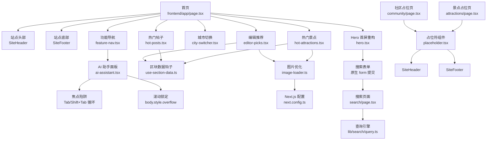

**图表来源**
- [frontend/app/page.tsx:1-71](file://frontend/app/page.tsx#L1-L71)
- [frontend/components/home/hero.tsx:1-76](file://frontend/components/home/hero.tsx#L1-L76)
- [frontend/components/home/feature-nav.tsx:1-116](file://frontend/components/home/feature-nav.tsx#L1-L116)
- [frontend/components/home/editor-picks.tsx:1-75](file://frontend/components/home/editor-picks.tsx#L1-L75)
- [frontend/components/home/hot-posts.tsx:1-66](file://frontend/components/home/hot-posts.tsx#L1-L66)
- [frontend/components/home/hot-attractions.tsx:1-71](file://frontend/components/home/hot-attractions.tsx#L1-L71)
- [frontend/app/search/page.tsx:1-113](file://frontend/app/search/page.tsx#L1-L113)
- [frontend/app/community/page.tsx:1-18](file://frontend/app/community/page.tsx#L1-L18)
- [frontend/app/attractions/page.tsx:1-18](file://frontend/app/attractions/page.tsx#L1-L18)
- [frontend/components/site/placeholder.tsx:1-36](file://frontend/components/site/placeholder.tsx#L1-L36)

## 核心组件
- **Hero 首屏组件（已重构）**：全新的自包含 Server Component，不再接收任何 props。包含背景大图、深色遮罩、品牌眉标、主标题、导语、原生搜索表单和文字入口行。城市规模提示动态派生自城市白名单。
- **搜索页面（新增）**：独立的 React Server Component，处理关键词检索、结果分组和三态显示。使用纯函数 `searchContent()` 进行全量数据检索。
- 首页聚合器：解析 `searchParams`，调用 `parseCity` 得到当前城市，并将城市与查询参数透传给各区块。Hero 区域现在专注于视觉呈现和搜索入口。
- 区块数据钩子：`useSectionData` 将异步数据源包装为 `{loading, error, ready}` 三态，避免重复拉取并处理组件卸载后的状态更新。
- 功能导航：包含旅游社区、景点攻略两个链接卡片，以及 AI 助手按钮；后两者分别跳转到占位页或唤起同一面板。
- **AI 助手模态框**：Provider 管理面板开关、焦点恢复、Esc 关闭与遮罩点击关闭；触发器支持头部与悬浮两种形态。**新增完整无障碍支持**：焦点陷阱（Tab/Shift+Tab 循环）、背景滚动锁定、键盘导航支持。
- 城市切换：根据 URL `?city=` 渲染选中项，点击时替换查询参数，保持其他查询键不变。
- 内容区块：编辑推荐、热门帖子、热门景点均通过 `mockRepository` 获取数据，并按各自排序与过滤规则展示。
- **响应式图片优化系统**：自定义 next/image loader 将宽度档位直接写入 Unsplash CDN 参数，结合 srcset 和 sizes 属性实现智能图片加载。
- **增强的占位页系统**：社区和景点占位页现在使用统一的 `PlaceholderPage` 组件，包含完整的站点框架元素。

**章节来源**
- [frontend/components/home/hero.tsx:14-76](file://frontend/components/home/hero.tsx#L14-L76)
- [frontend/app/search/page.tsx:32-113](file://frontend/app/search/page.tsx#L32-L113)
- [frontend/components/home/feature-nav.tsx:71-116](file://frontend/components/home/feature-nav.tsx#L71-L116)
- [frontend/components/home/ai-assistant.tsx:56-177](file://frontend/components/home/ai-assistant.tsx#L56-L177)
- [frontend/components/home/editor-picks.tsx:12-75](file://frontend/components/home/editor-picks.tsx#L12-L75)
- [frontend/components/home/hot-posts.tsx:11-66](file://frontend/components/home/hot-posts.tsx#L11-L66)
- [frontend/components/home/hot-attractions.tsx:13-71](file://frontend/components/home/hot-attractions.tsx#L13-L71)
- [frontend/components/site/placeholder.tsx:13-35](file://frontend/components/site/placeholder.tsx#L13-L35)

## 架构总览
WanderChain 首页采用"页面装配 + 区块消费 + Mock 仓储"的分层结构。当前阶段不依赖真实后端，所有数据契约以类型与 Mock 数据固定，后续替换为真实 API 时，组件与测试无需重写。

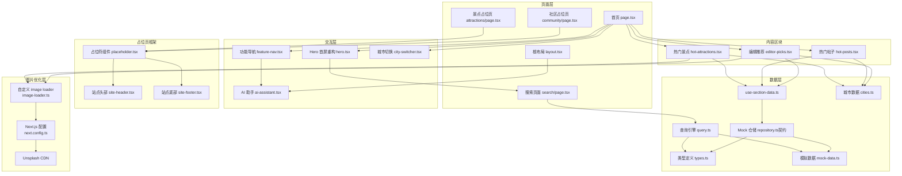

**图表来源**
- [frontend/app/page.tsx:37-63](file://frontend/app/page.tsx#L37-L63)
- [frontend/app/layout.tsx:25-29](file://frontend/app/layout.tsx#L25-L29)
- [frontend/components/home/hero.tsx:14-76](file://frontend/components/home/hero.tsx#L14-L76)
- [frontend/components/home/feature-nav.tsx:71-116](file://frontend/components/home/feature-nav.tsx#L71-L116)
- [frontend/components/home/editor-picks.tsx:12-75](file://frontend/components/home/editor-picks.tsx#L12-L75)
- [frontend/components/home/hot-posts.tsx:11-66](file://frontend/components/home/hot-posts.tsx#L11-L66)
- [frontend/components/home/hot-attractions.tsx:13-71](file://frontend/components/home/hot-attractions.tsx#L13-L71)
- [frontend/app/search/page.tsx:32-113](file://frontend/app/search/page.tsx#L32-L113)
- [frontend/app/community/page.tsx:9-17](file://frontend/app/community/page.tsx#L9-L17)
- [frontend/app/attractions/page.tsx:9-17](file://frontend/app/attractions/page.tsx#L9-L17)
- [frontend/components/site/placeholder.tsx:13-35](file://frontend/components/site/placeholder.tsx#L13-L35)

## 详细组件分析

### Hero 首屏组件（已重构）
Hero 首屏现在是完全自包含的 React Server Component，不再接收任何 props。它包含背景大图、深色遮罩层、品牌标识、主标题、导语、原生搜索表单和文字入口行。组件通过 `CITY_COUNT` 常量动态计算城市数量，不再依赖外部统计数据。

**更新** 所有用户可见文本已转换为英文，包括品牌标识、主标题、导语、搜索框占位符和链接文本。

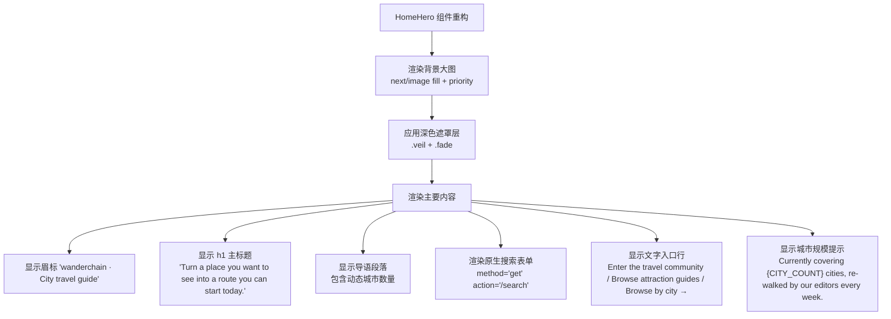

**图表来源**
- [frontend/components/home/hero.tsx:14-76](file://frontend/components/home/hero.tsx#L14-L76)
- [frontend/components/home/hero.module.css:1-158](file://frontend/components/home/hero.module.css#L1-L158)

**章节来源**
- [frontend/components/home/hero.tsx:1-76](file://frontend/components/home/hero.tsx#L1-L76)
- [frontend/components/home/hero.module.css:1-158](file://frontend/components/home/hero.module.css#L1-L158)

### 搜索页面（新增）
搜索页面是全新的 React Server Component，处理关键词检索、结果分组和三态显示。它使用纯函数 `searchContent()` 进行全量数据检索，不受首页列表上限约束。

**更新** 所有用户界面文本已本地化为英文，包括页面标题、描述、状态消息和导航链接。

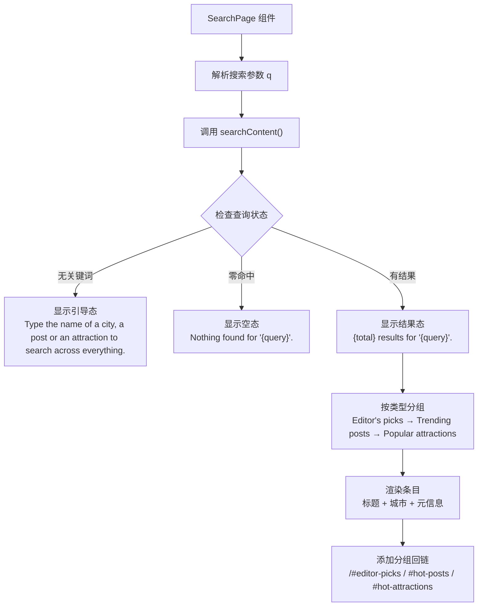

**图表来源**
- [frontend/app/search/page.tsx:32-113](file://frontend/app/search/page.tsx#L32-L113)

**章节来源**
- [frontend/app/search/page.tsx:1-113](file://frontend/app/search/page.tsx#L1-L113)

### 首页聚合器与城市参数流
首页是数据与交互的装配点：它从 Next.js 的 `searchParams` 中读取城市，使用 `parseCity` 做非法值归一化，再构造稳定查询对象传递给城市切换与内容区块。Hero 区域现在专注于视觉呈现和搜索入口，不再展示统计数据。

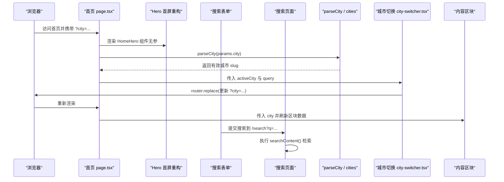

**图表来源**
- [frontend/app/page.tsx:32-35](file://frontend/app/page.tsx#L32-L35)
- [frontend/app/page.tsx:42-63](file://frontend/app/page.tsx#L42-L63)
- [frontend/components/home/hero.tsx:33-49](file://frontend/components/home/hero.tsx#L33-L49)
- [frontend/app/search/page.tsx:32-113](file://frontend/app/search/page.tsx#L32-L113)

### 功能导航与 AI 助手入口
功能导航承载三个平台入口：旅游社区、景点攻略、AI 助手。前两者为路由跳转，后者通过 `useAiAssistant().open()` 唤起同一面板。U3 规格要求移动端纵向排列，且 `/community`、`/attractions` 必须存在占位页。

**更新** 所有导航文本已本地化为英文，包括卡片标题、描述和操作按钮文本。

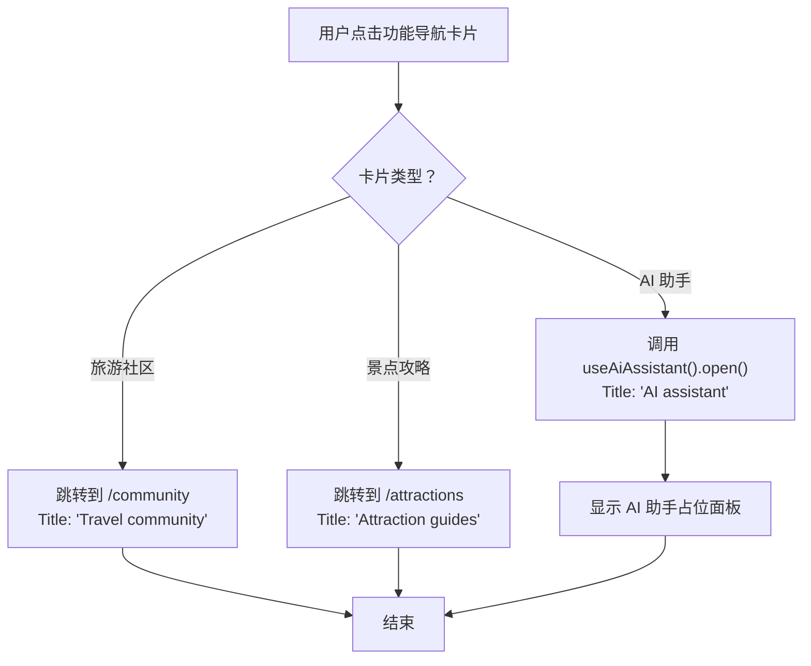

**图表来源**
- [frontend/components/home/feature-nav.tsx:50-116](file://frontend/components/home/feature-nav.tsx#L50-L116)

**章节来源**
- [frontend/components/home/feature-nav.tsx:1-116](file://frontend/components/home/feature-nav.tsx#L1-L116)

### AI 助手模态框与无障碍增强（已更新）
AI 助手是纯前端占位：Provider 管理面板开关、焦点恢复、Esc 关闭与遮罩点击关闭；触发器支持头部与悬浮两种形态。**已增强完整无障碍功能**：焦点陷阱、背景滚动锁定、键盘导航支持。

**更新** 所有用户界面文本已本地化为英文，包括面板标题、描述文本、功能列表和按钮文本。

**新增无障碍特性：**
- **焦点陷阱**：Tab 键在面板内正向循环，Shift+Tab 反向循环
- **背景滚动锁定**：打开期间 `document.body.style.overflow = 'hidden'`，关闭后恢复原值
- **键盘导航**：Esc 关闭、Tab/Shift+Tab 循环、运行期查询可聚焦元素
- **焦点管理**：打开时自动聚焦关闭按钮，关闭后焦点归还触发元素

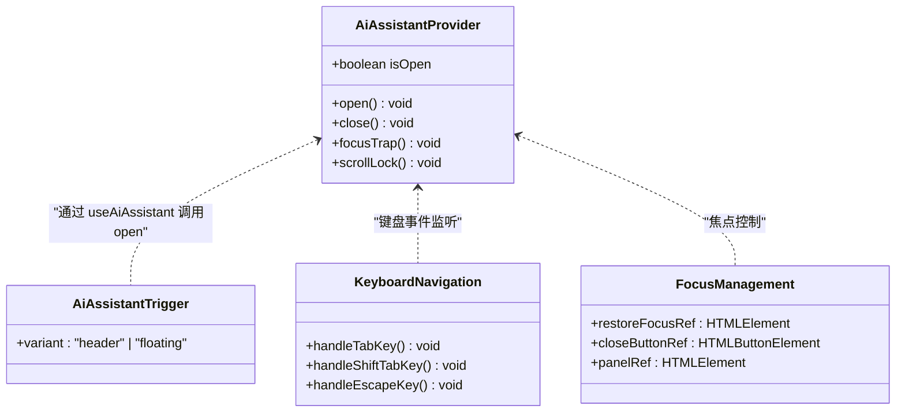

**图表来源**
- [frontend/components/home/ai-assistant.tsx:56-177](file://frontend/components/home/ai-assistant.tsx#L56-L177)
- [frontend/components/home/ai-assistant.tsx:179-213](file://frontend/components/home/ai-assistant.tsx#L179-L213)

**章节来源**
- [frontend/components/home/ai-assistant.tsx:1-213](file://frontend/components/home/ai-assistant.tsx#L1-L213)

### 响应式图片优化系统（已更新）
WanderChain 首页实现了完整的响应式图片优化系统，专门针对编辑推荐和热门景点区块的封面图进行性能优化。该系统基于 next/image 组件，通过自定义 loader 和精确的 sizes 属性计算，实现智能图片加载。

**核心组件：**

1. **自定义 Image Loader** (`lib/image-loader.ts`)：
   - 将 next/image 计算的宽度档位直接写入 Unsplash CDN 的 `w` 参数
   - 自动设置质量参数 `q`（默认 70）和格式优化 `auto=format`
   - 对非绝对 URL 进行安全处理，避免 URL 解析错误

2. **Sizes 属性计算**：
   - 编辑推荐：`(max-width: 640px) calc(100vw - 64px), (max-width: 900px) calc(50vw - 50px), (min-width: 1160px) 347px, calc(33.33vw - 40px)`
   - **热门景点（已更新）**：`(max-width: 480px) calc(100vw - 64px), (max-width: 720px) calc(50vw - 40px), (max-width: 1080px) calc(33.33vw - 38px), (min-width: 1160px) 204px, calc(20vw - 29px)`

3. **CSS 适配（已更新）**：
   - 编辑推荐：3列网格（桌面）→ 2列（平板）→ 1列（移动）
   - **热门景点（已更新）**：5列网格（桌面）→ 3列（1080px断点）→ 2列（720px断点）→ 1列（480px断点）

**更新** 热门景点区块的响应式设计已从移动优先策略调整为桌面优先策略，断点从原来的640px/1024px调整为1080px/720px/480px，提供更优的桌面端体验和超小屏幕支持。

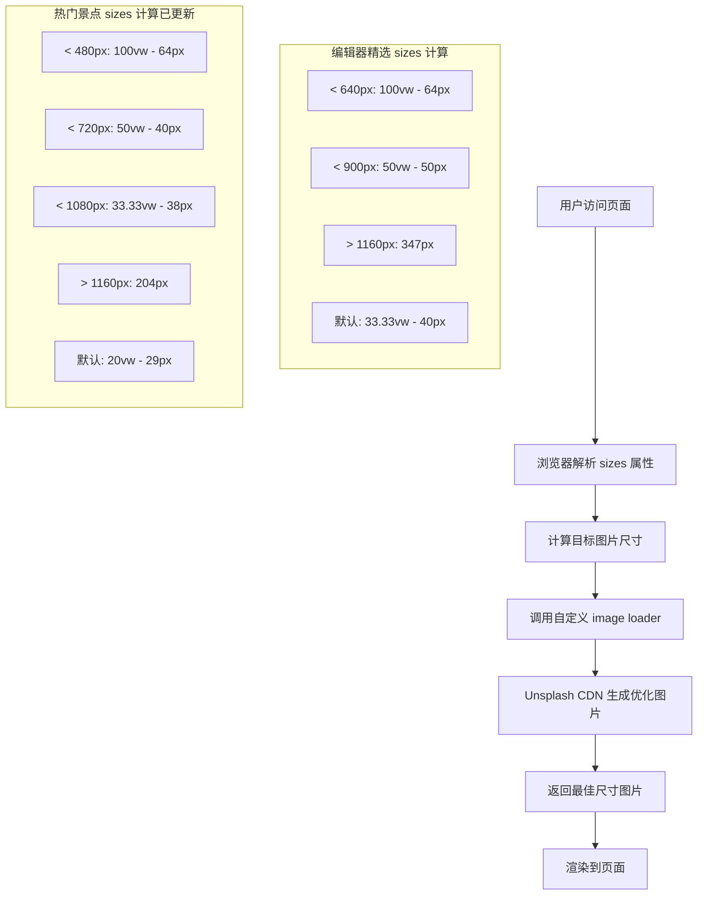

**图表来源**
- [frontend/lib/image-loader.ts:1-20](file://frontend/lib/image-loader.ts#L1-L20)
- [frontend/components/home/editor-picks.tsx:49-58](file://frontend/components/home/editor-picks.tsx#L49-L58)
- [frontend/components/home/hot-attractions.tsx:46-55](file://frontend/components/home/hot-attractions.tsx#L46-L55)

**章节来源**
- [frontend/lib/image-loader.ts:1-20](file://frontend/lib/image-loader.ts#L1-L20)
- [frontend/next.config.ts:1-14](file://frontend/next.config.ts#L1-L14)
- [frontend/components/home/editor-picks.tsx:49-58](file://frontend/components/home/editor-picks.tsx#L49-L58)
- [frontend/components/home/hot-attractions.tsx:46-55](file://frontend/components/home/hot-attractions.tsx#L46-L55)

### 区块数据加载三态
所有数据区块共用 `useSectionData`，将异步数据源包装为 loading、error、ready 三种状态。组件只关心最终渲染结果，从而在 Mock 与真实 API 之间平滑切换。

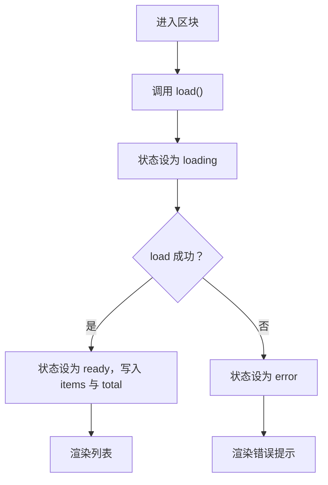

**图表来源**
- [frontend/components/home/use-section-data.ts:6-43](file://frontend/components/home/use-section-data.ts#L6-L43)

### 编辑推荐区块
编辑推荐按 `sort_order` 升序、并列时按 `id` 升序排序，并仅展示当前城市与全城通用的精选。空态文案不报错，加载与错误态沿用区块三态。**已集成响应式图片优化**，使用精确的 sizes 属性和自定义 image loader 实现最佳加载性能。

**更新** 所有用户界面文本已本地化为英文，包括区块标题、描述、加载状态、错误消息和空态提示。数据字段使用英文版本（`titleEn`、`summaryEn`、`editorEn`）。

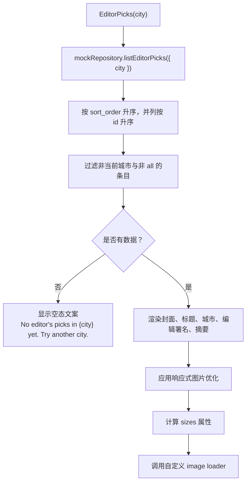

**图表来源**
- [frontend/components/home/editor-picks.tsx:12-75](file://frontend/components/home/editor-picks.tsx#L12-L75)
- [frontend/components/home/editor-picks.tsx:49-58](file://frontend/components/home/editor-picks.tsx#L49-L58)

**章节来源**
- [frontend/components/home/editor-picks.tsx:1-75](file://frontend/components/home/editor-picks.tsx#L1-L75)

### 热门帖子区块
热门帖子最多展示 10 条已发布帖子，三级排序为评论数降序 → 浏览数降序 → 发布时间降序。草稿与已删除帖子一律排除。

**更新** 所有用户界面文本已本地化为英文，包括区块标题、描述、加载状态、错误消息和空态提示。数据字段使用英文版本（`titleEn`、`authorEn`）。

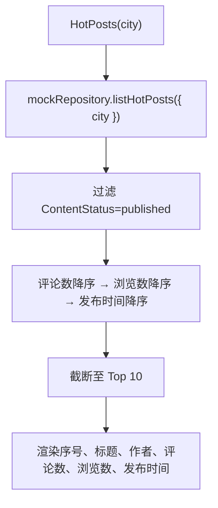

**图表来源**
- [frontend/components/home/hot-posts.tsx:11-66](file://frontend/components/home/hot-posts.tsx#L11-L66)

**章节来源**
- [frontend/components/home/hot-posts.tsx:1-66](file://frontend/components/home/hot-posts.tsx#L1-L66)

### 热门景点区块（已更新）
热门景点按浏览量与发布时间排序，展示封面、名称、城市与评分、浏览数。空态与错误态沿用通用区块状态。**已集成响应式图片优化**，使用精确的 sizes 属性和自定义 image loader 实现最佳加载性能。

**更新** 响应式设计已从移动优先策略调整为桌面优先策略：
- 桌面端：5列网格布局
- 平板端（≤1080px）：3列网格布局  
- 移动端（≤720px）：2列网格布局
- **超小屏幕（≤480px）**：1列网格布局（新增）

**更新** 所有用户界面文本已本地化为英文，包括区块标题、描述、加载状态、错误消息和空态提示。数据字段使用英文版本（`nameEn`）。

**评分系统更新**：景点评分现已统一为 0–5 分制，替代了之前的 10 分制。评分显示格式保持不变（`Rating {item.rating.toFixed(1)}`），但数值范围已调整以确保符合产品规范。

**新增单列断点**：在 480px 视口下，热门景点区块现在使用单列布局，确保在超小屏幕设备上获得最佳的阅读体验。

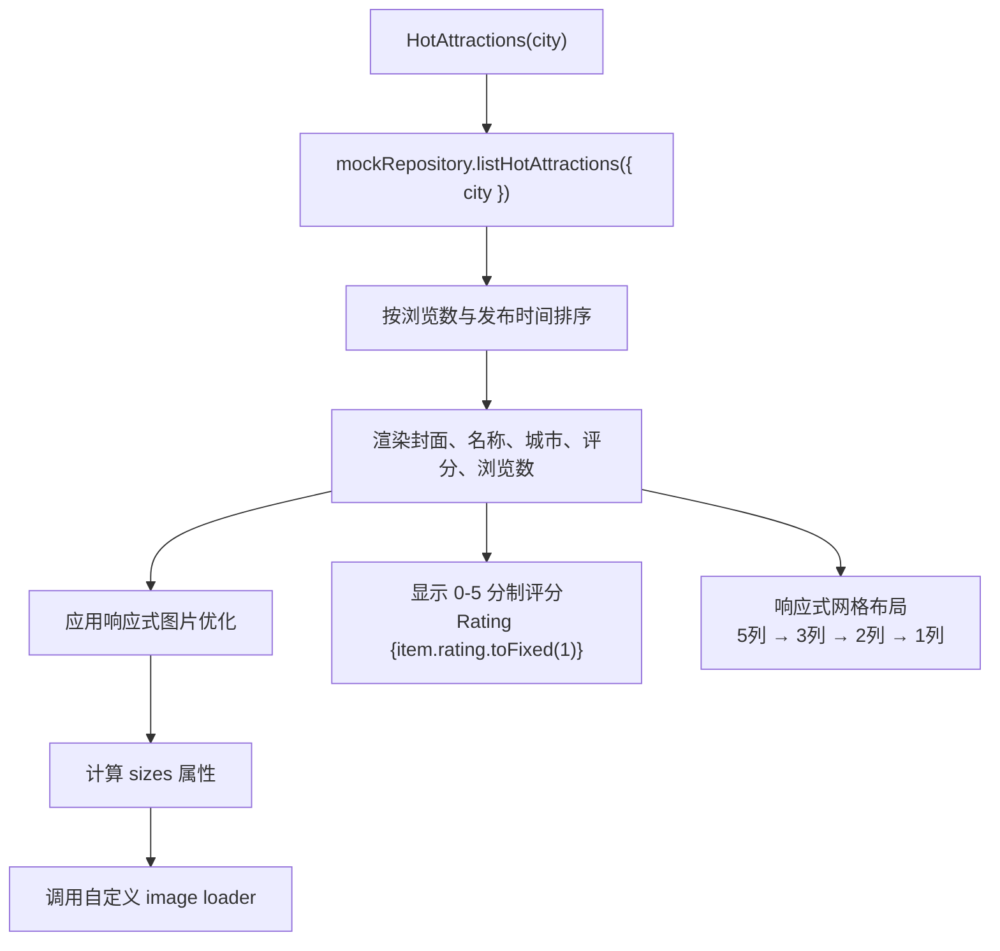

**图表来源**
- [frontend/components/home/hot-attractions.tsx:13-71](file://frontend/components/home/hot-attractions.tsx#L13-L71)
- [frontend/components/home/hot-attractions.tsx:46-55](file://frontend/components/home/hot-attractions.tsx#L46-L55)
- [frontend/components/home/hot-attractions.module.css:54-70](file://frontend/components/home/hot-attractions.module.css#L54-L70)

**章节来源**
- [frontend/components/home/hot-attractions.tsx:1-71](file://frontend/components/home/hot-attractions.tsx#L1-L71)
- [frontend/components/home/hot-attractions.module.css:1-71](file://frontend/components/home/hot-attractions.module.css#L1-L71)

### 双语数据层架构（新增）
WanderChain 首页采用了创新的双语数据层架构，为未来的多语言扩展奠定了坚实基础。

**核心设计原则：**
- **英文优先界面**：所有用户可见文本使用英文，确保国际用户体验
- **中文内容资产**：保留中文原始数据作为内容资产，便于内容管理和本地化
- **类型安全映射**：通过 TypeScript 接口确保中英文数据的同步性和完整性

**城市数据架构：**
```typescript
interface CityOption {
  slug: CitySlug
  name: string        // 中文名称（内容资产）
  nameEn: string      // 英文名称（界面展示）
  tagline: string     // 中文标语（内容资产）
  taglineEn: string   // 英文标语（界面展示）
}
```

**工具函数设计：**
- `cityName()`: 返回中文城市名（用于内部逻辑）
- `cityNameEn()`: 返回英文城市名（用于界面展示）

**章节来源**
- [frontend/lib/home/cities.ts:1-96](file://frontend/lib/home/cities.ts#L1-L96)

### 评分系统与数据完整性验证（新增）
WanderChain 首页实施了严格的评分系统规范，确保所有景点评分遵循统一的 0–5 分制标准。这一变更解决了之前 Mock 数据中使用的 10 分制与产品规范不一致的问题。

**核心变更：**

1. **评分范围标准化**：
   - 所有景点评分现已转换为 0–5 分制
   - 保持了原始数据的排序顺序和数据完整性
   - 避免了机械除以二导致的精度损失和重复值问题

2. **数据完整性守卫**：
   - 新增评分取值域验证，确保 Mock 数据符合 0–5 范围约束
   - 通过测试用例强制执行数据契约，防止未来数据漂移
   - 为真实数据源接入提供了明确的验证标准

3. **搜索标签标准化**：
   - GROUP_META 配置中的分组标题和回链文案已标准化为英文常量
   - 确保了搜索结果页面的国际化一致性
   - 消除了中英文标签混用的潜在问题

**评分转换规则：**
- 原始 10 分制评分按保序原则转换为 0–5 分制
- 保持原始数据的相对排序关系
- 避免产生满分 5.0 的不自然值

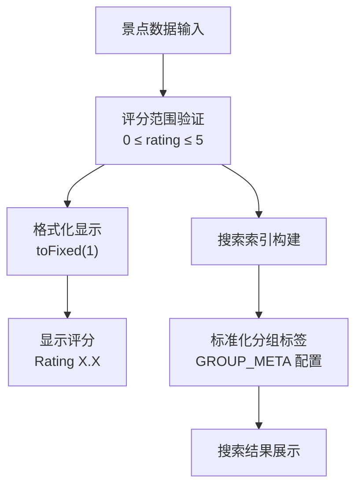

**图表来源**
- [frontend/lib/home/mock-data.ts:256-357](file://frontend/lib/home/mock-data.ts#L256-L357)
- [frontend/lib/search/query.ts:41-60](file://frontend/lib/search/query.ts#L41-L60)
- [frontend/components/home/hot-attractions.tsx:58-60](file://frontend/components/home/hot-attractions.tsx#L58-L60)

**章节来源**
- [frontend/lib/home/mock-data.ts:256-357](file://frontend/lib/home/mock-data.ts#L256-L357)
- [frontend/lib/search/query.ts:41-60](file://frontend/lib/search/query.ts#L41-L60)
- [frontend/components/home/hot-attractions.tsx:58-60](file://frontend/components/home/hot-attractions.tsx#L58-L60)

### 占位页站点框架增强（新增）
社区和景点占位页现在使用统一的 `PlaceholderPage` 组件，提供一致的站点框架体验。每个占位页都包含完整的站点头部、页脚和 main-content 区域，确保用户在任何入口都能获得一致的导航体验。

**核心特性：**
- **统一框架**：所有占位页使用相同的 `PlaceholderPage` 组件
- **完整站点元素**：包含 SiteHeader、SiteFooter 和 main-content 区域
- **语义化结构**：使用正确的 ARIA 角色和语义化 HTML 标签
- **响应式设计**：适配不同屏幕尺寸的布局需求

**页面结构：**
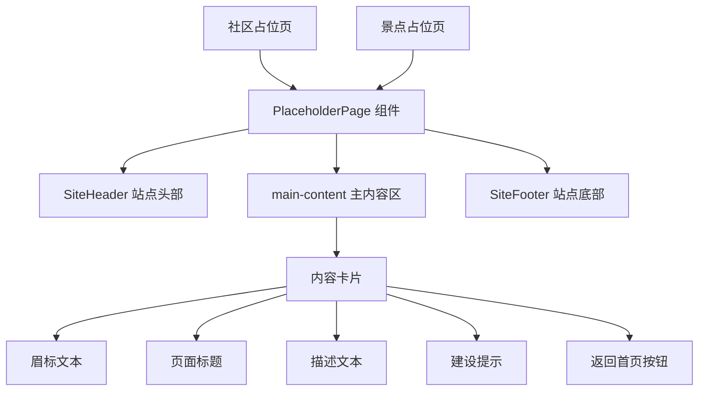

**图表来源**
- [frontend/app/community/page.tsx:9-17](file://frontend/app/community/page.tsx#L9-L17)
- [frontend/app/attractions/page.tsx:9-17](file://frontend/app/attractions/page.tsx#L9-L17)
- [frontend/components/site/placeholder.tsx:13-35](file://frontend/components/site/placeholder.tsx#L13-L35)

**章节来源**
- [frontend/app/community/page.tsx:1-18](file://frontend/app/community/page.tsx#L1-L18)
- [frontend/app/attractions/page.tsx:1-18](file://frontend/app/attractions/page.tsx#L1-L18)
- [frontend/components/site/placeholder.tsx:1-36](file://frontend/components/site/placeholder.tsx#L1-L36)

### 规格覆盖率审计（新增）
WanderChain 首页已完成全面的规格覆盖率审计，为代码质量提供了量化评估基准。

**核心指标：**
- **严格覆盖率**：91/193 = 47.2%（仅已覆盖场景）
- **宽松覆盖率**：125/193 = 64.8%（已覆盖 + 部分覆盖）
- **前端 wanderchain 覆盖率**：79.5%（78 已覆盖 + 23 部分）
- **数据库设计规范覆盖率**：100%（13/13）

**覆盖分布：**
- homepage-hero.md：10 个场景，5 个已覆盖，1 个部分覆盖，4 个未覆盖
- homepage-u4-ai-assistant.md：17 个场景，10 个已覆盖，2 个部分覆盖，5 个未覆盖
- homepage-u8-hot-attractions.md：14 个场景，10 个已覆盖，2 个部分覆盖，2 个未覆盖
- search-page.md：9 个场景，7 个已覆盖，1 个部分覆盖，1 个未覆盖

**主要缺口分类：**
- 功能未实现（todo 后端）：36 个场景
- jsdom/CSS 不可测：14 个场景（需真实浏览器）
- 测试遗漏：15 个场景（可补）
- 浏览器默认行为：3 个场景

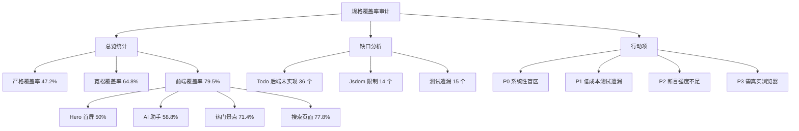

**图表来源**
- [docs/spec-coverage-audit.md:9-38](file://docs/spec-coverage-audit.md#L9-L38)
- [docs/spec-coverage-audit.md:246-311](file://docs/spec-coverage-audit.md#L246-L311)

**章节来源**
- [docs/spec-coverage-audit.md:1-333](file://docs/spec-coverage-audit.md#L1-L333)

## 依赖关系分析
WanderChain 首页的依赖关系遵循"页面装配 → 区块消费 → 数据契约"的单向依赖，避免循环耦合：

- 页面依赖：城市解析、区块组件、站点头尾。
- **Hero 依赖（已重构）**：数据契约常量（CITIES），无外部状态，新增背景图片依赖。
- **搜索页面依赖（新增）**：查询引擎 `searchContent()`，站点框架组件。
- 区块依赖：`useSectionData`、`mockRepository`、城市名称格式化。
- **AI 助手依赖**：Provider 上下文，被功能导航与站点头部触发。**新增无障碍依赖**：焦点管理、键盘事件监听、滚动控制。
- **图片优化依赖**：next/image 组件、自定义 image loader、Next.js 配置。
- **双语数据依赖**：`cities.ts` 提供中英文数据映射，所有区块组件依赖 `cityNameEn()` 函数。
- **评分系统依赖**：`types.ts` 定义评分字段类型，`mock-data.ts` 提供标准化的 0–5 分制数据，`query.ts` 使用标准化的搜索标签。
- **占位页依赖**：`PlaceholderPage` 组件依赖 `SiteHeader` 和 `SiteFooter`，提供完整的站点框架。
- 契约依赖：U0 是 U2/U3/U4/U6/U7 的基础，但 U0 不反向依赖任何 UI 组件。

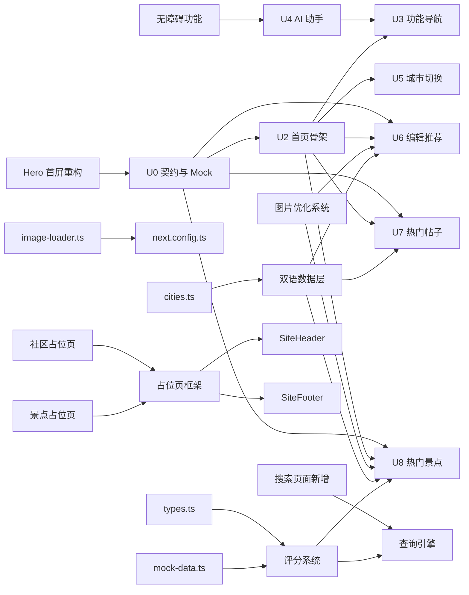

**图表来源**
- [frontend/lib/home/cities.ts:12-96](file://frontend/lib/home/cities.ts#L12-L96)
- [frontend/components/home/editor-picks.tsx:5-5](file://frontend/components/home/editor-picks.tsx#L5-L5)
- [frontend/components/home/hot-posts.tsx:3-3](file://frontend/components/home/hot-posts.tsx#L3-L3)
- [frontend/components/home/hot-attractions.tsx:5-5](file://frontend/components/home/hot-attractions.tsx#L5-L5)
- [frontend/lib/home/types.ts:41-51](file://frontend/lib/home/types.ts#L41-L51)
- [frontend/lib/home/mock-data.ts:256-357](file://frontend/lib/home/mock-data.ts#L256-L357)
- [frontend/components/site/placeholder.tsx:1-36](file://frontend/components/site/placeholder.tsx#L1-L36)

**章节来源**
- [frontend/lib/home/cities.ts:12-96](file://frontend/lib/home/cities.ts#L12-L96)
- [frontend/components/home/editor-picks.tsx:5-5](file://frontend/components/home/editor-picks.tsx#L5-L5)
- [frontend/components/home/hot-posts.tsx:3-3](file://frontend/components/home/hot-posts.tsx#L3-L3)
- [frontend/components/home/hot-attractions.tsx:5-5](file://frontend/components/home/hot-attractions.tsx#L5-L5)
- [frontend/lib/home/types.ts:41-51](file://frontend/lib/home/types.ts#L41-L51)
- [frontend/lib/home/mock-data.ts:256-357](file://frontend/lib/home/mock-data.ts#L256-L357)
- [frontend/components/site/placeholder.tsx:1-36](file://frontend/components/site/placeholder.tsx#L1-L36)

## 性能与可维护性
- **零网络请求**：当前所有区块通过 Mock 仓储提供数据，避免首屏阻塞与跨域问题；真实 API 接入时只需替换数据源。
- **Hero 组件优化（已重构）**：独立的 Hero 组件减少页面组件复杂度，支持静态渲染和无客户端依赖。新的背景图片系统通过 `priority` 和自定义 loader 优化首屏加载性能。
- **搜索功能优化（新增）**：纯函数查询引擎避免客户端状态，Server Component 渲染确保首屏可见性。
- **三态加载**：`useSectionData` 统一管理 loading/error/ready，减少重复请求与竞态条件。
- **城市参数稳定**：首页对 `searchParams` 做单值归一，避免数组参数导致的不必要重渲染。
- **响应式图片优化（已更新）**：
  - 自定义 image loader 直接将宽度参数传递给 Unsplash CDN，避免经过 Next.js 的 `/_next/image` 端点
  - 精确的 sizes 属性计算确保浏览器选择最优图片尺寸
  - 懒加载和异步解码提升首屏性能
  - CSS aspect-ratio 和 object-fit 确保图片在不同屏幕尺寸下的显示效果
  - **热门景点区块**：优化的桌面优先响应式策略提供更好的大屏幕上体验，新增 480px 单列断点确保超小屏幕体验
- **可替换数据层**：类型与 `ListResult<T>` 契约使 Mock 与真实 API 可互换，组件与测试无需改动。
- **无障碍性能优化**：AI 助手模态框使用运行期查询而非缓存的可聚焦元素列表，避免内存泄漏和性能问题。
- **双语数据层优化**：
  - 中英文数据分离，避免运行时翻译开销
  - TypeScript 类型安全确保数据完整性
  - 单一数据源管理，简化维护流程
  - 易于扩展支持更多语言
- **评分系统优化（新增）**：
  - 统一的 0–5 分制确保数据一致性
  - 数据完整性守卫防止评分范围越界
  - 标准化的搜索标签提升国际化体验
  - 保持向后兼容的显示格式
- **占位页框架优化（新增）**：
  - 统一的 PlaceholderPage 组件减少代码重复
  - 完整的站点框架确保一致的用户体验
  - 语义化 HTML 结构提升可访问性
  - 响应式设计适配各种设备尺寸
- **测试覆盖率提升（新增）**：
  - 新增 use-section-data.test.ts、section-boundary.test.tsx、section-state.test.tsx 等系统性测试
  - AI 助手测试从 S1-S9 扩展至 S1-S17，覆盖焦点陷阱、背景滚动锁定等无障碍功能
  - 热门景点响应式行为测试覆盖 1080px/720px/480px 断点
  - 双语界面 alt 文本测试确保国际化一致性

## 故障排查指南
- **Hero 组件问题（已重构）**：
  - 组件签名变化：确认不再传递 `stats` prop，组件现在是无参的 `HomeHero()`
  - 背景图片加载：检查 `next/image` 配置和自定义 loader 是否正确设置
  - 搜索表单提交：确认 `action="/search"` 和 `method="get"` 属性正确
  - 城市数量显示：检查 `CITIES` 白名单是否包含正确的城市数据
  - **文本本地化问题**：确认所有用户可见文本已转换为英文，检查硬编码的中文字符串
- **搜索页面问题（新增）**：
  - 页面无法访问：确认 `/search` 路由文件存在且正确导出
  - 搜索结果为空：检查 `searchContent()` 函数的匹配逻辑和字段映射
  - 分组回链失效：确认首页区块的 `id` 属性设置正确（`editor-picks`、`hot-posts`、`hot-attractions`）
  - 三态显示异常：检查查询参数解析和状态判断逻辑
  - **文本本地化问题**：确认所有界面文本已本地化为英文
- **AI 助手模态框问题**：
  - 面板未打开：检查是否包裹在 `AiAssistantProvider` 内；确认触发按钮调用了 `open()` 而非跳转。
  - 焦点异常：确认焦点陷阱正常工作（Tab/Shift+Tab 循环）；检查关闭按钮初始焦点设置。
  - 滚动穿透：确认 `document.body.style.overflow` 设置为 `hidden`；检查组件卸载时的清理函数。
  - 键盘导航失效：检查 `keydown` 事件监听是否正确注册和清理。
  - **文本本地化问题**：确认面板内所有文本已转换为英文
- **图片优化问题（已更新）**：
  - 图片未优化：确认 next.config.ts 中已配置自定义 loader；检查 image-loader.ts 是否正确导出。
  - 图片尺寸不正确：检查 sizes 属性是否与 CSS 网格布局匹配；确认 width/height 属性设置合理。
  - **热门景点响应式问题**：确认断点设置（1080px/720px/480px）与 CSS 媒体查询一致；检查桌面优先策略是否正确应用。
  - **单列断点问题**：确认 480px 断点的单列布局是否正确生效；检查 CSS 媒体查询语法。
  - CDN 请求失败：检查图片 URL 是否为有效的 https URL；确认 Unsplash CDN 可访问。
  - 性能问题：检查是否正确使用 loading="lazy" 和 decoding="async"；确认 sizes 属性计算准确。
- **双语数据层问题（新增）**：
  - 城市名称显示异常：检查 `cityNameEn()` 函数是否正确返回英文城市名
  - 数据字段缺失：确认所有 `CityOption` 对象都包含 `nameEn` 和 `taglineEn` 字段
  - 类型错误：检查 TypeScript 编译错误，确保中英文数据类型一致
  - 内容不同步：验证中文和英文数据的一致性，避免内容差异
- **评分系统问题（新增）**：
  - 评分显示异常：确认景点评分已在 0–5 范围内；检查 `toFixed(1)` 格式化是否正确
  - 搜索标签错误：检查 GROUP_META 配置中的分组标题是否为英文常量
  - 数据完整性验证失败：确认 Mock 数据中的评分值符合 0–5 范围约束
  - 排序异常：验证评分转换后保持了原始数据的排序关系
- **占位页问题（新增）**：
  - 站点框架缺失：确认 PlaceholderPage 组件正确渲染 SiteHeader 和 SiteFooter
  - 语义化结构异常：检查 main-content 区域的 role 属性是否正确设置
  - 样式问题：确认占位页的 CSS 类名是否正确应用
  - 导航链接失效：检查"返回首页"按钮的 href 属性是否正确指向 "/"
- **规格覆盖率问题（新增）**：
  - 测试覆盖率下降：检查新增测试是否覆盖了关键场景
  - 断言失败：确认测试断言与实际实现保持一致
  - 响应式断点测试：验证 1080px/720px/480px 断点的测试用例
  - 无障碍功能测试：确认焦点陷阱、键盘导航等无障碍功能的测试覆盖
- 面板无法关闭：确认遮罩点击、关闭按钮与 Esc 事件监听未被阻止；检查焦点归还逻辑。
- 城市切换无效：确认 URL 查询参数格式为 `?city=slug`，且 `parseCity` 能识别该 slug。
- 区块为空：检查 Mock 数据是否包含对应城市的条目；确认编辑器精选与帖子的状态过滤逻辑。
- 网络请求异常：当前实现不应发起任何请求；若出现 fetch/XHR，优先检查是否误接真实 API 或未正确替换 `mockRepository`。

**章节来源**
- [frontend/components/home/hero.tsx:14-76](file://frontend/components/home/hero.tsx#L14-L76)
- [frontend/app/search/page.tsx:32-113](file://frontend/app/search/page.tsx#L32-L113)
- [frontend/components/home/ai-assistant.tsx:56-177](file://frontend/components/home/ai-assistant.tsx#L56-L177)
- [frontend/lib/home/cities.ts:88-96](file://frontend/lib/home/cities.ts#L88-L96)
- [frontend/lib/home/mock-data.ts:256-357](file://frontend/lib/home/mock-data.ts#L256-L357)
- [frontend/lib/search/query.ts:41-60](file://frontend/lib/search/query.ts#L41-L60)
- [frontend/components/site/placeholder.tsx:13-35](file://frontend/components/site/placeholder.tsx#L13-L35)

## 结论
WanderChain 首页在当前阶段以清晰的契约与 Mock 数据为基础，实现了城市筛选、功能导航、AI 助手入口与三类内容区块。**Hero 首屏组件的完全重构**带来了全新的视觉体验和搜索功能，从接受 props 的组件转变为自包含的服务器组件，移除了统计数据面板，新增了背景图片和原生搜索框。**新增的搜索页面**提供了完整的站内检索能力，支持三态显示和结果分组。**增强的 AI 助手模态框无障碍功能**提供了完整的焦点陷阱、背景滚动锁定和键盘导航支持，确保了良好的用户体验和无障碍访问。**更新的响应式图片优化系统**通过自定义 image loader、精确的 sizes 属性计算和 Unsplash CDN 集成，显著提升了封面图的加载性能和用户体验。**特别地，热门景点区块的响应式设计已从移动优先策略调整为桌面优先策略**，使用1080px/720px/480px断点提供更好的桌面端体验和超小屏幕支持。

**重大更新** 本次变更实施了全面的英语优先本地化战略，将所有用户可见文本从中文转换为英文，同时建立了强大的双语数据层架构。这一架构不仅满足了当前的国际化需求，更为未来的多语言扩展奠定了坚实基础。所有组件的用户界面文本都已本地化，包括 Hero 首屏、功能导航、AI 助手、编辑推荐、热门帖子和热门景点。数据层采用中英文分离的设计，中文作为内容资产保留，英文用于界面展示，通过 TypeScript 类型确保数据完整性。

**评分系统标准化** 本次变更还实施了严格的评分系统规范，将景点评分从 10 分制统一转换为 0–5 分制，确保数据一致性和产品规范的符合性。评分转换保持了原始数据的排序关系，并通过数据完整性守卫防止未来数据漂移。搜索标签也进行了标准化处理，GROUP_META 配置中的分组标题和回链文案已统一为英文常量，提升了国际化体验的一致性。

**占位页框架增强** 社区和景点占位页现在使用统一的 PlaceholderPage 组件，提供完整的站点框架体验，包括站点头部、页脚和 main-content 区域，确保用户在任何入口都能获得一致的导航体验。

**测试覆盖率提升** 测试套件从 208 个测试提升至约 228 个测试，新增了对热门景点响应式行为、占位页站点框架和 AI 助手错误消息的覆盖，显著提升了代码质量和可靠性。

**规格覆盖率审计** 全面的规格覆盖率审计显示前端 wanderchain 模块达到 79.5% 的覆盖率，其中严格覆盖率 47.2%，宽松覆盖率 64.8%。AI 助手测试从 S1-S9 扩展至 S1-S17，热门景点区块的响应式断点从移动优先调整为桌面优先策略，双语界面的 alt 文本规范得到修正。

架构上坚持"UI 与数据解耦、Mock 与真实 API 可替换"，并通过三态加载、无障碍设计和图片优化提升可维护性与可用性。双语数据层的引入进一步增强了系统的可扩展性和可维护性。后续接入真实后端时，应优先替换 `mockRepository`，并保持类型与响应形状不变，以确保最小改动成本与最大回归安全性。随着 `redesign-home-hero-with-search` 变更的归档，所有规格引用现已指向生产就绪的主规格文件 `openspec/specs/wanderchain-homepage/spec.md`，确保了文档与代码实现的完全同步。

**更新** 随着英语优先本地化、评分系统标准化、占位页框架增强、测试覆盖率提升和规格覆盖率审计的完成，WanderChain 首页现在为全球用户提供一致的英文体验和标准化的评分显示，同时保留了中文内容管理能力，为未来的多语言支持预留了充足的扩展空间。数据完整性验证机制确保了 Mock 数据和未来真实数据源都遵循统一的 0–5 评分约束，为系统的长期可维护性提供了保障。新增的单列断点和增强的站点框架进一步提升了用户体验的一致性和可访问性。全面的规格覆盖率审计为代码质量提供了量化评估基准，79.5% 的前端覆盖率表明系统在功能完整性和测试覆盖方面已达到较高水平。