# WanderChain 首页规格文档

<cite>
**本文引用的文件**   
- [README.md](file://README.md)
- [homepage-hero.md](file://docs/specs/wanderchain/homepage-hero.md)
- [search-page.md](file://docs/specs/wanderchain/search-page.md)
- [homepage-u1-mock-auth.md](file://docs/specs/wanderchain/homepage-u1-mock-auth.md)
- [homepage-u2-skeleton.md](file://docs/specs/wanderchain/homepage-u2-skeleton.md)
- [homepage-u4-ai-assistant.md](file://docs/specs/wanderchain/homepage-u4-ai-assistant.md)
- [homepage-u5-city-switcher.md](file://docs/specs/wanderchain/homepage-u5-city-switcher.md)
- [homepage-u8-hot-attractions.md](file://docs/specs/wanderchain/homepage-u8-hot-attractions.md)
- [frontend/app/page.tsx](file://frontend/app/page.tsx)
- [frontend/app/layout.tsx](file://frontend/app/layout.tsx)
- [frontend/components/home/hero.tsx](file://frontend/components/home/hero.tsx)
- [frontend/components/home/hero.module.css](file://frontend/components/home/hero.module.css)
- [frontend/components/home/hero.test.tsx](file://frontend/components/home/hero.test.tsx)
- [frontend/components/home/use-section-data.ts](file://frontend/components/home/use-section-data.ts)
- [frontend/components/home/feature-nav.tsx](file://frontend/components/home/feature-nav.tsx)
- [frontend/components/home/ai-assistant.tsx](file://frontend/components/home/ai-assistant.tsx)
- [frontend/components/home/ai-assistant.module.css](file://frontend/components/home/ai-assistant.module.css)
- [frontend/components/home/ai-assistant.test.tsx](file://frontend/components/home/ai-assistant.test.tsx)
- [frontend/components/site/site-header.tsx](file://frontend/components/site/site-header.tsx)
- [frontend/components/home/editor-picks.tsx](file://frontend/components/home/editor-picks.tsx)
- [frontend/components/home/hot-posts.tsx](file://frontend/components/home/hot-posts.tsx)
- [frontend/components/home/hot-attractions.tsx](file://frontend/components/home/hot-attractions.tsx)
- [frontend/components/home/city-switcher.tsx](file://frontend/components/home/city-switcher.tsx)
- [frontend/app/community/page.tsx](file://frontend/app/community/page.tsx)
- [frontend/app/attractions/page.tsx](file://frontend/app/attractions/page.tsx)
- [frontend/app/search/page.tsx](file://frontend/app/search/page.tsx)
- [frontend/lib/image-loader.ts](file://frontend/lib/image-loader.ts)
- [frontend/lib/image-loader.test.ts](file://frontend/lib/image-loader.test.ts)
- [frontend/lib/search/query.ts](file://frontend/lib/search/query.ts)
- [frontend/next.config.ts](file://frontend/next.config.ts)
- [frontend/components/home/editor-picks.module.css](file://frontend/components/home/editor-picks.module.css)
- [frontend/components/home/hot-attractions.module.css](file://frontend/components/home/hot-attractions.module.css)
</cite>

## 更新摘要
**所做更改**
- **Hero 首屏组件完全重构**：从接受 props 的组件转变为自包含的服务器组件，移除了 `stats` 参数和相关契约
- **新增背景图片系统**：实现了全宽背景图、深色遮罩层和底部渐变过渡效果
- **集成原生搜索功能**：在 Hero 区域添加了原生 `<form>` 搜索框，提交到独立的 `/search` 页面
- **移除统计面板**：删除了原有的四项统计数据展示（编辑精选、热门帖子、热门景点等）
- **新增搜索页面架构**：创建了完整的搜索结果页面，支持三态显示（引导态、空态、结果态）
- **增强无障碍功能**：改进了焦点管理、键盘导航和屏幕阅读器支持
- **优化响应式设计**：调整了断点和布局策略，提供更好的移动端体验

## 目录
1. [引言](#引言)
2. [项目结构](#项目结构)
3. [核心组件](#核心组件)
4. [架构总览](#架构总览)
5. [详细组件分析](#详细组件分析)
6. [依赖关系分析](#依赖关系分析)
7. [性能与可维护性](#性能与可维护性)
8. [故障排查指南](#故障排查指南)
9. [结论](#结论)

## 引言
本规格文档聚焦 WanderChain 首页能力，围绕"城市旅行指南"的入口、导航、内容与交互契约进行说明。当前实现以 Next.js 前端为主，后端接口尚未接入；所有数据通过 Mock 仓储提供，确保 UI 与业务逻辑可在零网络请求下独立开发与验收。

该仓库采用"规格 + 护栏 + 技能"三层工作区模式：`openspec/` 定义意图与主规格，`harness/` 用闸门链保证构建、迁移与一致性，`.agents/skills/` 固化 AI 编码方法。WanderChain 首页属于 `wanderchain-homepage` 能力，其子单元契约位于 `docs/specs/wanderchain/`。

**章节来源**
- [README.md:1-111](file://README.md#L1-L111)

## 项目结构
WanderChain 首页由一个页面级路由和多个可复用区块组成：

- 页面层：`frontend/app/page.tsx` 作为首页入口，负责解析 URL 城市参数、组装 Hero 区域与区块容器。
- **Hero 首屏（已重构）**：全新的自包含 Server Component，包含背景大图、品牌标识、主标题、导语、原生搜索框和文字入口。
- **搜索页面（新增）**：独立的 `/search` 页面，处理关键词检索、结果分组和三态显示。
- 区块组件：功能导航、城市切换、编辑推荐、热门帖子、热门景点分别位于 `components/home/*`。
- 共享 Hook：`useSectionData` 统一封装加载、就绪、错误三态。
- **AI 助手模态框**：Provider 管理面板开关、焦点恢复、Esc 关闭、遮罩点击关闭，以及完整的键盘导航支持。
- **响应式图片优化**：自定义 image loader、srcset 生成、sizes 属性计算，针对封面图进行性能优化。
- 占位页：`/community` 与 `/attractions` 为板块建设中的占位页面。

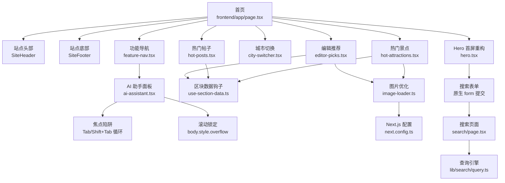

**图表来源**
- [frontend/app/page.tsx:1-71](file://frontend/app/page.tsx#L1-L71)
- [frontend/components/home/hero.tsx:1-74](file://frontend/components/home/hero.tsx#L1-L74)
- [frontend/components/home/feature-nav.tsx:1-116](file://frontend/components/home/feature-nav.tsx#L1-L116)
- [frontend/components/home/city-switcher.tsx:1-74](file://frontend/components/home/city-switcher.tsx#L1-L74)
- [frontend/components/home/editor-picks.tsx:1-66](file://frontend/components/home/editor-picks.tsx#L1-L66)
- [frontend/components/home/hot-posts.tsx:1-59](file://frontend/components/home/hot-posts.tsx#L1-L59)
- [frontend/components/home/hot-attractions.tsx:1-70](file://frontend/components/home/hot-attractions.tsx#L1-L70)
- [frontend/components/home/use-section-data.ts:1-44](file://frontend/components/home/use-section-data.ts#L1-L44)
- [frontend/components/home/ai-assistant.tsx:1-212](file://frontend/components/home/ai-assistant.tsx#L1-L212)
- [frontend/app/search/page.tsx:1-112](file://frontend/app/search/page.tsx#L1-L112)
- [frontend/lib/image-loader.ts:1-20](file://frontend/lib/image-loader.ts#L1-L20)
- [frontend/next.config.ts:1-14](file://frontend/next.config.ts#L1-L14)

**章节来源**
- [frontend/app/page.tsx:1-71](file://frontend/app/page.tsx#L1-L71)

## 核心组件
- **Hero 首屏组件（已重构）**：全新的自包含 Server Component，不再接收任何 props。包含背景大图、深色遮罩、品牌眉标、主标题、导语、原生搜索表单和文字入口行。城市规模提示动态派生自城市白名单。
- **搜索页面（新增）**：独立的 React Server Component，处理关键词检索、结果分组和三态显示（引导态、空态、结果态）。使用纯函数 `searchContent()` 进行全量数据检索。
- 首页聚合器：解析 `searchParams`，调用 `parseCity` 得到当前城市，并将城市与查询参数透传给各区块。Hero 区域现在专注于视觉呈现和搜索入口。
- 区块数据钩子：`useSectionData` 将异步数据源包装为 `{loading, error, ready}` 三态，避免重复拉取并处理组件卸载后的状态更新。
- 功能导航：包含旅游社区、景点攻略两个链接卡片，以及 AI 助手按钮；后两者分别跳转到占位页或唤起同一面板。
- **AI 助手模态框**：Provider 管理面板开关、焦点恢复、Esc 关闭与遮罩点击关闭；触发器支持头部与悬浮两种形态。**新增完整无障碍支持**：焦点陷阱（Tab/Shift+Tab 循环）、背景滚动锁定、键盘导航支持。
- 城市切换：根据 URL `?city=` 渲染选中项，点击时替换查询参数，保持其他查询键不变。
- 内容区块：编辑推荐、热门帖子、热门景点均通过 `mockRepository` 获取数据，并按各自排序与过滤规则展示。
- **响应式图片优化系统**：自定义 next/image loader 将宽度档位直接写入 Unsplash CDN 参数，结合 srcset 和 sizes 属性实现智能图片加载。

**章节来源**
- [frontend/components/home/hero.tsx:14-73](file://frontend/components/home/hero.tsx#L14-L73)
- [frontend/app/search/page.tsx:32-111](file://frontend/app/search/page.tsx#L32-L111)
- [frontend/app/page.tsx:32-35](file://frontend/app/page.tsx#L32-L35)
- [frontend/components/home/use-section-data.ts:6-43](file://frontend/components/home/use-section-data.ts#L6-L43)
- [frontend/components/home/feature-nav.tsx:50-115](file://frontend/components/home/feature-nav.tsx#L50-L115)
- [frontend/components/home/ai-assistant.tsx:41-120](file://frontend/components/home/ai-assistant.tsx#L41-L120)
- [frontend/components/home/city-switcher.tsx:13-31](file://frontend/components/home/city-switcher.tsx#L13-L31)
- [frontend/lib/image-loader.ts:1-20](file://frontend/lib/image-loader.ts#L1-L20)

## 架构总览
WanderChain 首页采用"页面装配 + 区块消费 + Mock 仓储"的分层结构。当前阶段不依赖真实后端，所有数据契约以类型与 Mock 数据固定，后续替换为真实 API 时，组件与测试无需重写。

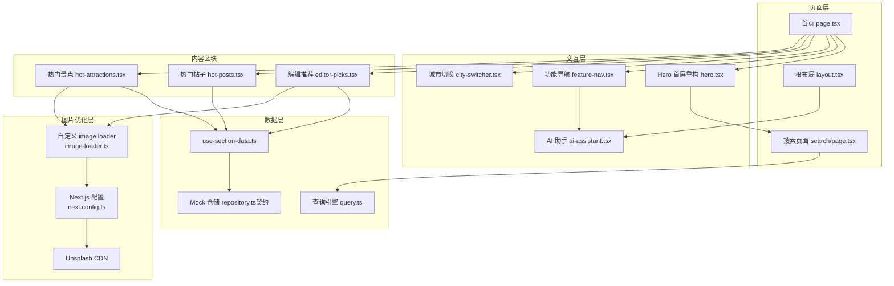

**图表来源**
- [frontend/app/page.tsx:37-63](file://frontend/app/page.tsx#L37-L63)
- [frontend/app/layout.tsx:25-29](file://frontend/app/layout.tsx#L25-L29)
- [frontend/components/home/hero.tsx:14-73](file://frontend/components/home/hero.tsx#L14-L73)
- [frontend/components/home/feature-nav.tsx:71-115](file://frontend/components/home/feature-nav.tsx#L71-L115)
- [frontend/components/home/city-switcher.tsx:13-31](file://frontend/components/home/city-switcher.tsx#L13-L31)
- [frontend/components/home/editor-picks.tsx:10-12](file://frontend/components/home/editor-picks.tsx#L10-L12)
- [frontend/components/home/hot-posts.tsx:11-12](file://frontend/components/home/hot-posts.tsx#L11-L12)
- [frontend/components/home/hot-attractions.tsx:11-12](file://frontend/components/home/hot-attractions.tsx#L11-L12)
- [frontend/components/home/use-section-data.ts:15-42](file://frontend/components/home/use-section-data.ts#L15-L42)
- [frontend/app/search/page.tsx:32-111](file://frontend/app/search/page.tsx#L32-L111)
- [frontend/lib/image-loader.ts:1-20](file://frontend/lib/image-loader.ts#L1-L20)
- [frontend/next.config.ts:1-14](file://frontend/next.config.ts#L1-L14)

## 详细组件分析

### Hero 首屏组件（已重构）
Hero 首屏现在是完全自包含的 React Server Component，不再接收任何 props。它包含背景大图、深色遮罩层、品牌标识、主标题、导语、原生搜索表单和文字入口行。组件通过 `CITY_COUNT` 常量动态计算城市数量，不再依赖外部统计数据。

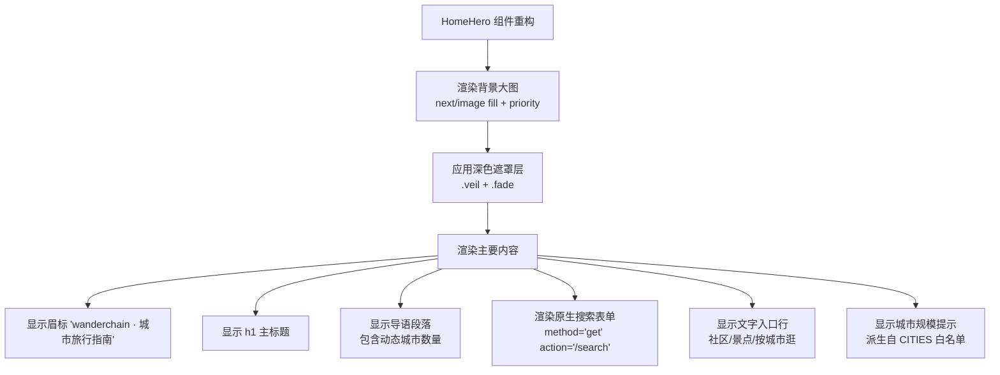

**图表来源**
- [frontend/components/home/hero.tsx:14-73](file://frontend/components/home/hero.tsx#L14-L73)
- [frontend/components/home/hero.module.css:1-158](file://frontend/components/home/hero.module.css#L1-L158)

**更新** Hero 组件已从接受 `stats` prop 的组件转变为完全自包含的服务器组件，移除了所有统计数据展示，新增了背景图片和搜索功能。

**章节来源**
- [homepage-hero.md:1-249](file://docs/specs/wanderchain/homepage-hero.md#L1-L249)
- [frontend/components/home/hero.tsx:1-74](file://frontend/components/home/hero.tsx#L1-L74)
- [frontend/components/home/hero.module.css:1-158](file://frontend/components/home/hero.module.css#L1-L158)
- [frontend/components/home/hero.test.tsx:1-75](file://frontend/components/home/hero.test.tsx#L1-L75)

### 搜索页面（新增）
搜索页面是全新的 React Server Component，处理关键词检索、结果分组和三态显示。它使用纯函数 `searchContent()` 进行全量数据检索，不受首页列表上限约束。

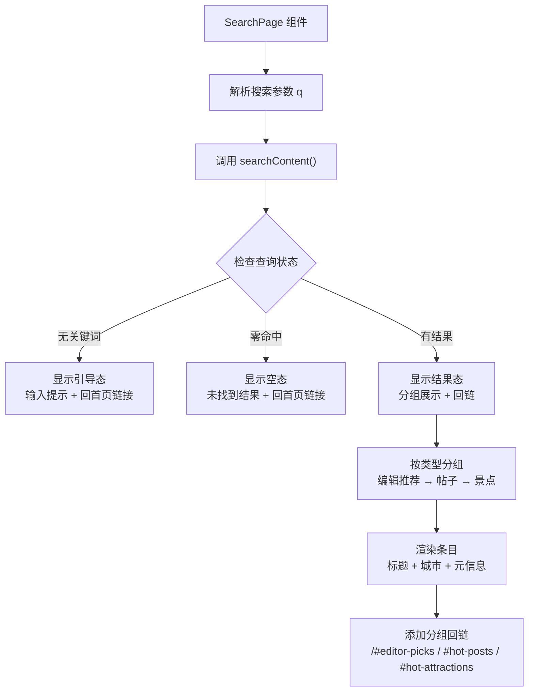

**图表来源**
- [frontend/app/search/page.tsx:32-111](file://frontend/app/search/page.tsx#L32-L111)

**章节来源**
- [search-page.md:1-252](file://docs/specs/wanderchain/search-page.md#L1-L252)
- [frontend/app/search/page.tsx:1-112](file://frontend/app/search/page.tsx#L1-L112)

### 首页聚合器与城市参数流
首页是数据与交互的装配点：它从 Next.js 的 `searchParams` 中读取城市，使用 `parseCity` 做非法值归一化，再构造稳定查询对象传递给城市切换与内容区块。Hero 区域现在专注于视觉呈现和搜索入口，不再展示统计数据。

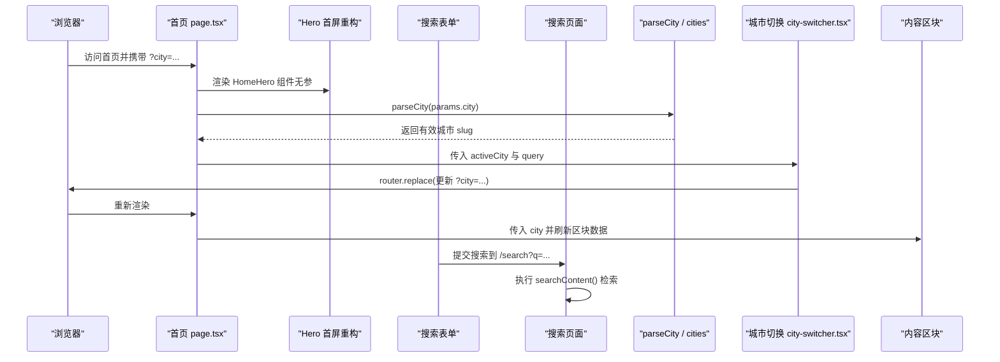

**图表来源**
- [frontend/app/page.tsx:32-35](file://frontend/app/page.tsx#L32-L35)
- [frontend/app/page.tsx:42-63](file://frontend/app/page.tsx#L42-L63)
- [frontend/components/home/hero.tsx:33-49](file://frontend/components/home/hero.tsx#L33-L49)
- [frontend/app/search/page.tsx:32-111](file://frontend/app/search/page.tsx#L32-L111)
- [frontend/components/home/city-switcher.tsx:13-31](file://frontend/components/home/city-switcher.tsx#L13-L31)

**章节来源**
- [frontend/app/page.tsx:32-35](file://frontend/app/page.tsx#L32-L35)
- [frontend/app/page.tsx:42-63](file://frontend/app/page.tsx#L42-L63)

### 功能导航与 AI 助手入口
功能导航承载三个平台入口：旅游社区、景点攻略、AI 助手。前两者为路由跳转，后者通过 `useAiAssistant().open()` 唤起同一面板。U3 规格要求移动端纵向排列，且 `/community`、`/attractions` 必须存在占位页。

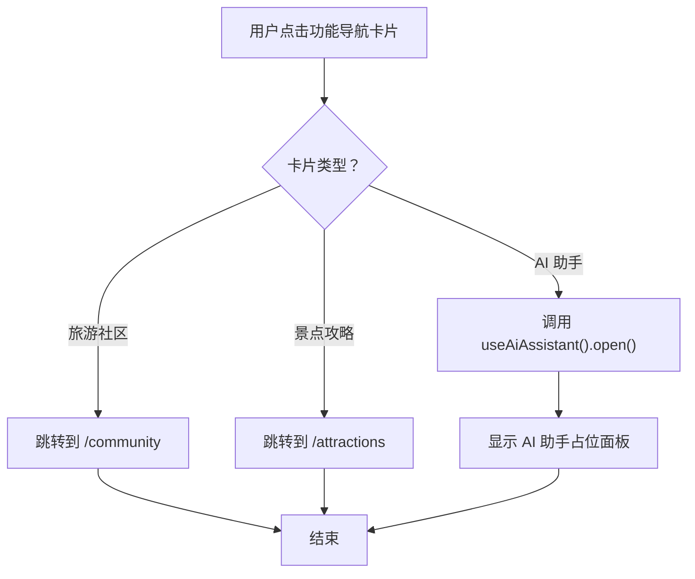

**图表来源**
- [frontend/components/home/feature-nav.tsx:50-115](file://frontend/components/home/feature-nav.tsx#L50-L115)
- [frontend/app/community/page.tsx:9-15](file://frontend/app/community/page.tsx#L9-L15)
- [frontend/app/attractions/page.tsx:9-15](file://frontend/app/attractions/page.tsx#L9-L15)

**章节来源**
- [homepage-u3-feature-nav.md:10-50](file://docs/specs/wanderchain/homepage-u3-feature-nav.md#L10-L50)
- [frontend/components/home/feature-nav.tsx:71-115](file://frontend/components/home/feature-nav.tsx#L71-L115)
- [frontend/app/community/page.tsx:1-18](file://frontend/app/community/page.tsx#L1-L18)
- [frontend/app/attractions/page.tsx:1-18](file://frontend/app/attractions/page.tsx#L1-L18)

### AI 助手模态框与无障碍增强（已更新）
AI 助手是纯前端占位：Provider 管理面板开关、焦点恢复、Esc 关闭与遮罩点击关闭；触发器支持头部与悬浮两种形态。**已增强完整无障碍功能**：焦点陷阱、背景滚动锁定、键盘导航支持。

**新增无障碍特性：**
- **焦点陷阱**：Tab 键在面板内正向循环，Shift+Tab 反向循环
- **背景滚动锁定**：打开期间 `document.body.style.overflow = 'hidden'`，关闭后恢复原值
- **键盘导航**：Esc 关闭、Tab/Shift+Tab 循环、运行期查询可聚焦元素
- **焦点管理**：打开时自动聚焦关闭按钮，关闭后焦点归还触发元素

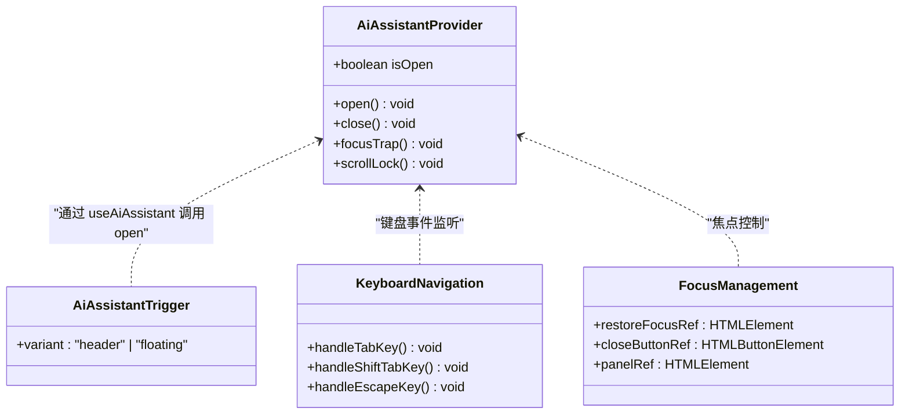

**图表来源**
- [frontend/components/home/ai-assistant.tsx:14-28](file://frontend/components/home/ai-assistant.tsx#L14-L28)
- [frontend/components/home/ai-assistant.tsx:41-120](file://frontend/components/home/ai-assistant.tsx#L41-L120)
- [frontend/components/home/ai-assistant.tsx:123-156](file://frontend/components/home/ai-assistant.tsx#L123-L156)
- [frontend/components/home/ai-assistant.tsx:178-211](file://frontend/components/home/ai-assistant.tsx#L178-L211)
- [frontend/components/home/feature-nav.tsx:71-115](file://frontend/components/home/feature-nav.tsx#L71-L115)

**章节来源**
- [homepage-u4-ai-assistant.md:10-52](file://docs/specs/wanderchain/homepage-u4-ai-assistant.md#L10-L52)
- [homepage-u4-ai-assistant.md:97-110](file://docs/specs/wanderchain/homepage-u4-ai-assistant.md#L97-L110)
- [frontend/components/home/ai-assistant.tsx:41-120](file://frontend/components/home/ai-assistant.tsx#L41-L120)
- [frontend/components/home/ai-assistant.tsx:178-211](file://frontend/components/home/ai-assistant.tsx#L178-L211)

### 响应式图片优化系统（已更新）
WanderChain 首页实现了完整的响应式图片优化系统，专门针对编辑推荐和热门景点区块的封面图进行性能优化。该系统基于 next/image 组件，通过自定义 loader 和精确的 sizes 属性计算，实现智能图片加载。

**核心组件：**

1. **自定义 Image Loader** (`lib/image-loader.ts`)：
   - 将 next/image 计算的宽度档位直接写入 Unsplash CDN 的 `w` 参数
   - 自动设置质量参数 `q`（默认 70）和格式优化 `auto=format`
   - 对非绝对 URL 进行安全处理，避免 URL 解析错误

2. **Sizes 属性计算**：
   - 编辑推荐：`(max-width: 640px) calc(100vw - 64px), (max-width: 900px) calc(50vw - 50px), (min-width: 1160px) 347px, calc(33.33vw - 40px)`
   - **热门景点（已更新）**：`(max-width: 720px) calc(50vw - 40px), (max-width: 1080px) calc(33.33vw - 38px), (min-width: 1160px) 204px, calc(20vw - 29px)`

3. **CSS 适配（已更新）**：
   - 编辑推荐：3列网格（桌面）→ 2列（平板）→ 1列（移动）
   - **热门景点（已更新）**：5列网格（桌面）→ 3列（1080px断点）→ 2列（720px断点）

**更新** 热门景点区块的响应式设计已从移动优先策略调整为桌面优先策略，断点从原来的640px/1024px调整为1080px/720px，提供更优的桌面端体验。

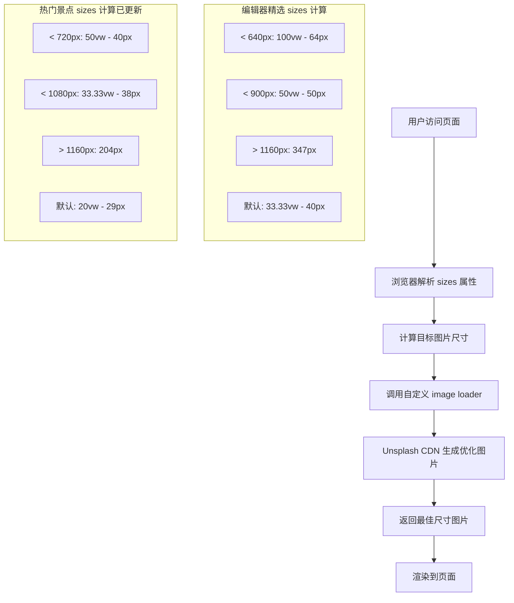

**图表来源**
- [frontend/lib/image-loader.ts:8-18](file://frontend/lib/image-loader.ts#L8-L18)
- [frontend/components/home/editor-picks.tsx:40-49](file://frontend/components/home/editor-picks.tsx#L40-L49)
- [frontend/components/home/hot-attractions.tsx:45-54](file://frontend/components/home/hot-attractions.tsx#L45-L54)
- [frontend/components/home/editor-picks.module.css:68-78](file://frontend/components/home/editor-picks.module.css#L68-L78)
- [frontend/components/home/hot-attractions.module.css:54-64](file://frontend/components/home/hot-attractions.module.css#L54-L64)

**章节来源**
- [frontend/lib/image-loader.ts:1-20](file://frontend/lib/image-loader.ts#L1-L20)
- [frontend/lib/image-loader.test.ts:1-24](file://frontend/lib/image-loader.test.ts#L1-L24)
- [frontend/next.config.ts:6-10](file://frontend/next.config.ts#L6-L10)
- [frontend/components/home/editor-picks.tsx:40-49](file://frontend/components/home/editor-picks.tsx#L40-L49)
- [frontend/components/home/hot-attractions.tsx:45-54](file://frontend/components/home/hot-attractions.tsx#L45-L54)

### 区块数据加载三态
所有数据区块共用 `useSectionData`，将异步数据源包装为 loading、error、ready 三种状态。组件只关心最终渲染结果，从而在 Mock 与真实 API 之间平滑切换。

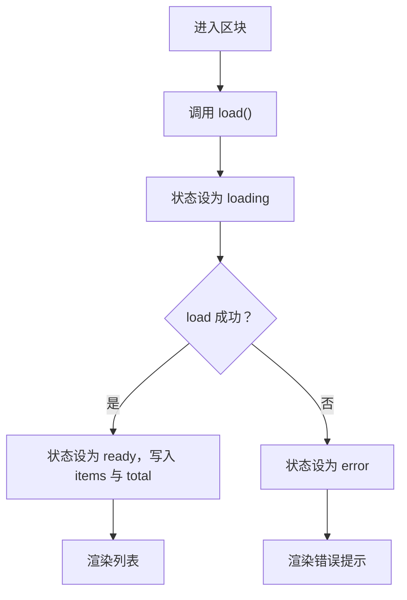

**图表来源**
- [frontend/components/home/use-section-data.ts:6-43](file://frontend/components/home/use-section-data.ts#L6-L43)

**章节来源**
- [frontend/components/home/use-section-data.ts:1-44](file://frontend/components/home/use-section-data.ts#L1-L44)

### 编辑推荐区块
编辑推荐按 `sort_order` 升序、并列时按 `id` 升序排序，并仅展示当前城市与全城通用的精选。空态文案不报错，加载与错误态沿用区块三态。**已集成响应式图片优化**，使用精确的 sizes 属性和自定义 image loader 实现最佳加载性能。

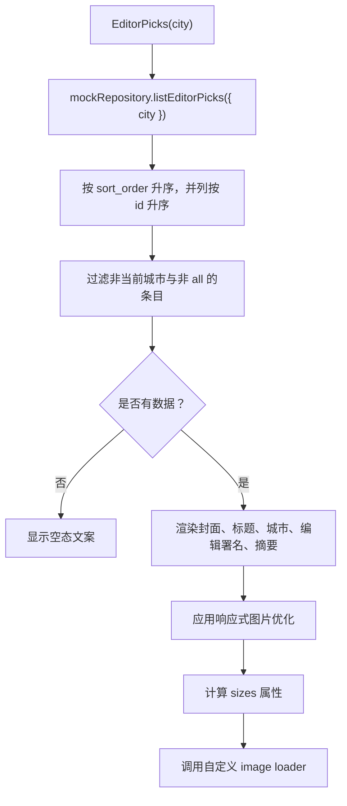

**图表来源**
- [frontend/components/home/editor-picks.tsx:10-61](file://frontend/components/home/editor-picks.tsx#L10-L61)
- [frontend/components/home/editor-picks.tsx:40-49](file://frontend/components/home/editor-picks.tsx#L40-L49)
- [frontend/lib/image-loader.ts:8-18](file://frontend/lib/image-loader.ts#L8-L18)

**章节来源**
- [homepage-u6-editor-picks.md:10-54](file://docs/specs/wanderchain/homepage-u6-editor-picks.md#L10-L54)
- [frontend/components/home/editor-picks.tsx:1-66](file://frontend/components/home/editor-picks.tsx#L1-L66)

### 热门帖子区块
热门帖子最多展示 10 条已发布帖子，三级排序为评论数降序 → 浏览数降序 → 发布时间降序。草稿与已删除帖子一律排除。

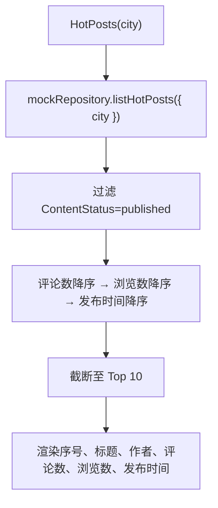

**图表来源**
- [frontend/components/home/hot-posts.tsx:11-58](file://frontend/components/home/hot-posts.tsx#L11-L58)

**章节来源**
- [homepage-u7-hot-posts.md:10-56](file://docs/specs/wanderchain/homepage-u7-hot-posts.md#L10-L56)
- [frontend/components/home/hot-posts.tsx:1-59](file://frontend/components/home/hot-posts.tsx#L1-L59)

### 热门景点区块（已更新）
热门景点按浏览量与发布时间排序，展示封面、名称、城市与评分、浏览数。空态与错误态沿用通用区块状态。**已集成响应式图片优化**，使用精确的 sizes 属性和自定义 image loader 实现最佳加载性能。

**更新** 响应式设计已从移动优先策略调整为桌面优先策略：
- 桌面端：5列网格布局
- 平板端（≤1080px）：3列网格布局  
- 移动端（≤720px）：2列网格布局

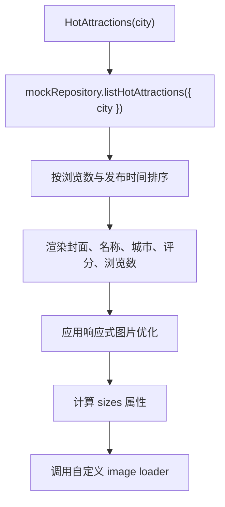

**图表来源**
- [frontend/components/home/hot-attractions.tsx:11-65](file://frontend/components/home/hot-attractions.tsx#L11-L65)
- [frontend/components/home/hot-attractions.tsx:45-54](file://frontend/components/home/hot-attractions.tsx#L45-L54)
- [frontend/lib/image-loader.ts:8-18](file://frontend/lib/image-loader.ts#L8-L18)

**章节来源**
- [frontend/components/home/hot-attractions.tsx:1-70](file://frontend/components/home/hot-attractions.tsx#L1-L70)

### 契约与 Mock 数据层
U0 明确类型定义、城市白名单、Mock 数据规模与 `HomeRepository` 接口边界。它是其余区块的地基，组件与单元测试应通过替换 `mockRepository` 来验证未来真实 API 的兼容性。

- 类型与常量：`CitySlug`、`EditorPick`、`Post`、`Attraction`、`ContentStatus`、`ListQuery`、`ListResult<T>`。
- 城市白名单：`all` 加北京、上海、广州、成都、西安、杭州、三亚。
- 行为约束：`parseCity` 对非法或缺失值归一化为 `all`；Mock 数据覆盖全部 7 城，并包含草稿与已删除样本。
- 验收重点：重复调用顺序一致、非法城市 slug 归一、替换数据源时组件与测试无需修改。

**章节来源**
- [homepage-u0-contract-mock.md:10-53](file://docs/specs/wanderchain/homepage-u0-contract-mock.md#L10-L53)

## 依赖关系分析
WanderChain 首页的依赖关系遵循"页面装配 → 区块消费 → 数据契约"的单向依赖，避免循环耦合：

- 页面依赖：城市解析、区块组件、站点头尾。
- **Hero 依赖（已重构）**：数据契约常量（CITIES），无外部状态，新增背景图片依赖。
- **搜索页面依赖（新增）**：查询引擎 `searchContent()`，站点框架组件。
- 区块依赖：`useSectionData`、`mockRepository`、城市名称格式化。
- **AI 助手依赖**：Provider 上下文，被功能导航与站点头部触发。**新增无障碍依赖**：焦点管理、键盘事件监听、滚动控制。
- **图片优化依赖**：next/image 组件、自定义 image loader、Next.js 配置。
- 契约依赖：U0 是 U2/U3/U4/U6/U7 的基础，但 U0 不反向依赖任何 UI 组件。

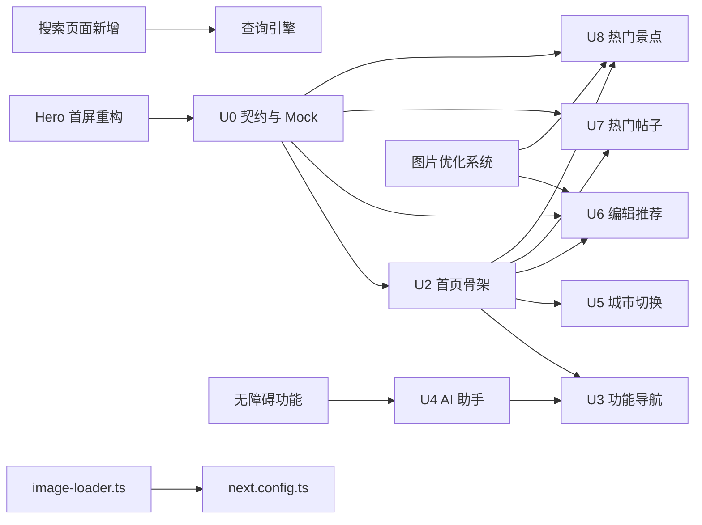

**图表来源**
- [homepage-u0-contract-mock.md:34-40](file://docs/specs/wanderchain/homepage-u0-contract-mock.md#L34-L40)
- [homepage-u3-feature-nav.md:32-36](file://docs/specs/wanderchain/homepage-u3-feature-nav.md#L32-L36)
- [homepage-u4-ai-assistant.md:33-38](file://docs/specs/wanderchain/homepage-u4-ai-assistant.md#L33-L38)
- [homepage-u6-editor-picks.md:35-40](file://docs/specs/wanderchain/homepage-u6-editor-picks.md#L35-L40)
- [homepage-u7-hot-posts.md:36-41](file://docs/specs/wanderchain/homepage-u7-hot-posts.md#L36-L41)
- [frontend/lib/image-loader.ts:1-20](file://frontend/lib/image-loader.ts#L1-L20)
- [frontend/next.config.ts:1-14](file://frontend/next.config.ts#L1-L14)

**章节来源**
- [homepage-u0-contract-mock.md:34-40](file://docs/specs/wanderchain/homepage-u0-contract-mock.md#L34-L40)
- [homepage-u3-feature-nav.md:32-36](file://docs/specs/wanderchain/homepage-u3-feature-nav.md#L32-L36)
- [homepage-u4-ai-assistant.md:33-38](file://docs/specs/wanderchain/homepage-u4-ai-assistant.md#L33-L38)
- [homepage-u6-editor-picks.md:35-40](file://docs/specs/wanderchain/homepage-u6-editor-picks.md#L35-L40)
- [homepage-u7-hot-posts.md:36-41](file://docs/specs/wanderchain/homepage-u7-hot-posts.md#L36-L41)

## 性能与可维护性
- **零网络请求**：当前所有区块通过 Mock 仓储提供数据，避免首屏阻塞与跨域问题；真实 API 接入时只需替换数据源。
- **Hero 组件优化（已重构）**：独立的 Hero 组件减少页面组件复杂度，支持静态渲染和无客户端依赖。新的背景图片系统通过 `priority` 和自定义 loader 优化首屏加载性能。
- **搜索功能优化（新增）**：纯函数查询引擎避免客户端状态，Server Component 渲染确保首屏可见性。
- **三态加载**：`useSectionData` 统一管理 loading/error/ready，减少重复请求与竞态条件。
- **城市参数稳定**：首页对 `searchParams` 做单值归一，避免数组参数导致的不必要重渲染。
- **响应式图片优化（已更新）**：
  - 自定义 image loader 直接将宽度参数传递给 Unsplash CDN，避免经过 Next.js 的 `/_next/image` 端点
  - 精确的 sizes 属性计算确保浏览器选择最优图片尺寸
  - 懒加载和异步解码提升首屏性能
  - CSS aspect-ratio 和 object-fit 确保图片在不同屏幕尺寸下的显示效果
  - **热门景点区块**：优化的桌面优先响应式策略提供更好的大屏幕上体验
- **可替换数据层**：类型与 `ListResult<T>` 契约使 Mock 与真实 API 可互换，组件与测试无需改动。
- **无障碍性能优化**：AI 助手模态框使用运行期查询而非缓存的可聚焦元素列表，避免内存泄漏和性能问题。

## 故障排查指南
- **Hero 组件问题（已重构）**：
  - 组件签名变化：确认不再传递 `stats` prop，组件现在是无参的 `HomeHero()`
  - 背景图片加载：检查 `next/image` 配置和自定义 loader 是否正确设置
  - 搜索表单提交：确认 `action="/search"` 和 `method="get"` 属性正确
  - 城市数量显示：检查 `CITIES` 白名单是否包含正确的城市数据
- **搜索页面问题（新增）**：
  - 页面无法访问：确认 `/search` 路由文件存在且正确导出
  - 搜索结果为空：检查 `searchContent()` 函数的匹配逻辑和字段映射
  - 分组回链失效：确认首页区块的 `id` 属性设置正确（`editor-picks`、`hot-posts`、`hot-attractions`）
  - 三态显示异常：检查查询参数解析和状态判断逻辑
- **AI 助手模态框问题**：
  - 面板未打开：检查是否包裹在 `AiAssistantProvider` 内；确认触发按钮调用了 `open()` 而非跳转。
  - 焦点异常：确认焦点陷阱正常工作（Tab/Shift+Tab 循环）；检查关闭按钮初始焦点设置。
  - 滚动穿透：确认 `document.body.style.overflow` 设置为 `hidden`；检查组件卸载时的清理函数。
  - 键盘导航失效：检查 `keydown` 事件监听是否正确注册和清理。
- **图片优化问题（已更新）**：
  - 图片未优化：确认 next.config.ts 中已配置自定义 loader；检查 image-loader.ts 是否正确导出。
  - 图片尺寸不正确：检查 sizes 属性是否与 CSS 网格布局匹配；确认 width/height 属性设置合理。
  - **热门景点响应式问题**：确认断点设置（1080px/720px）与 CSS 媒体查询一致；检查桌面优先策略是否正确应用。
  - CDN 请求失败：检查图片 URL 是否为有效的 https URL；确认 Unsplash CDN 可访问。
  - 性能问题：检查是否正确使用 loading="lazy" 和 decoding="async"；确认 sizes 属性计算准确。
- 面板无法关闭：确认遮罩点击、关闭按钮与 Esc 事件监听未被阻止；检查焦点归还逻辑。
- 城市切换无效：确认 URL 查询参数格式为 `?city=slug`，且 `parseCity` 能识别该 slug。
- 区块为空：检查 Mock 数据是否包含对应城市的条目；确认编辑器精选与帖子的状态过滤逻辑。
- 网络请求异常：当前实现不应发起任何请求；若出现 fetch/XHR，优先检查是否误接真实 API 或未正确替换 `mockRepository`。

**章节来源**
- [homepage-hero.md:79-87](file://docs/specs/wanderchain/homepage-hero.md#L79-L87)
- [search-page.md:40-52](file://docs/specs/wanderchain/search-page.md#L40-L52)
- [homepage-u4-ai-assistant.md:40-52](file://docs/specs/wanderchain/homepage-u4-ai-assistant.md#L40-L52)
- [homepage-u4-ai-assistant.md:97-110](file://docs/specs/wanderchain/homepage-u4-ai-assistant.md#L97-L110)
- [frontend/components/home/ai-assistant.tsx:60-75](file://frontend/components/home/ai-assistant.tsx#L60-L75)
- [frontend/components/home/ai-assistant.tsx:86-122](file://frontend/components/home/ai-assistant.tsx#L86-L122)
- [frontend/components/home/city-switcher.tsx:17-31](file://frontend/components/home/city-switcher.tsx#L17-L31)
- [frontend/lib/image-loader.ts:8-18](file://frontend/lib/image-loader.ts#L8-L18)
- [frontend/next.config.ts:6-10](file://frontend/next.config.ts#L6-L10)

## 结论
WanderChain 首页在当前阶段以清晰的契约与 Mock 数据为基础，实现了城市筛选、功能导航、AI 助手入口与三类内容区块。**Hero 首屏组件的完全重构**带来了全新的视觉体验和搜索功能，从接受 props 的组件转变为自包含的服务器组件，移除了统计数据面板，新增了背景图片和原生搜索框。**新增的搜索页面**提供了完整的站内检索能力，支持三态显示和结果分组。**增强的 AI 助手模态框无障碍功能**提供了完整的焦点陷阱、背景滚动锁定和键盘导航支持，确保了良好的用户体验和无障碍访问。**更新的响应式图片优化系统**通过自定义 image loader、精确的 sizes 属性计算和 Unsplash CDN 集成，显著提升了封面图的加载性能和用户体验。**特别地，热门景点区块的响应式设计已从移动优先策略调整为桌面优先策略**，使用1080px/720px断点提供更好的桌面端体验。架构上坚持"UI 与数据解耦、Mock 与真实 API 可替换"，并通过三态加载、无障碍设计和图片优化提升可维护性与可用性。后续接入真实后端时，应优先替换 `mockRepository`，并保持类型与响应形状不变，以确保最小改动成本与最大回归安全性。