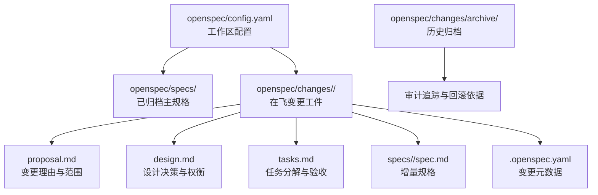
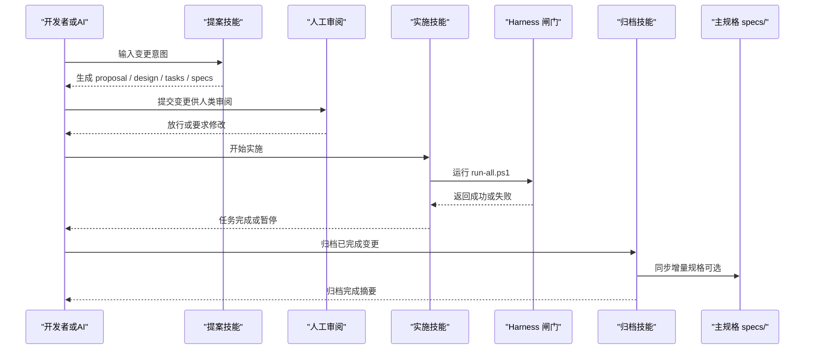
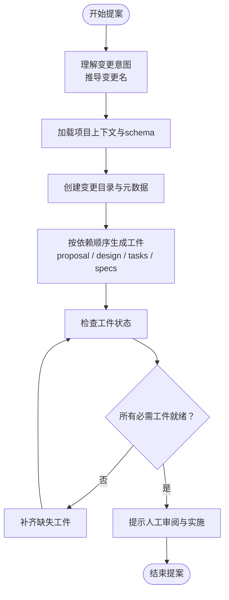
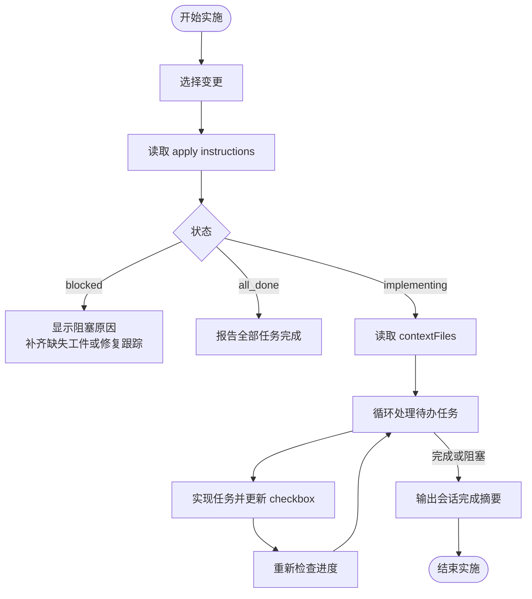
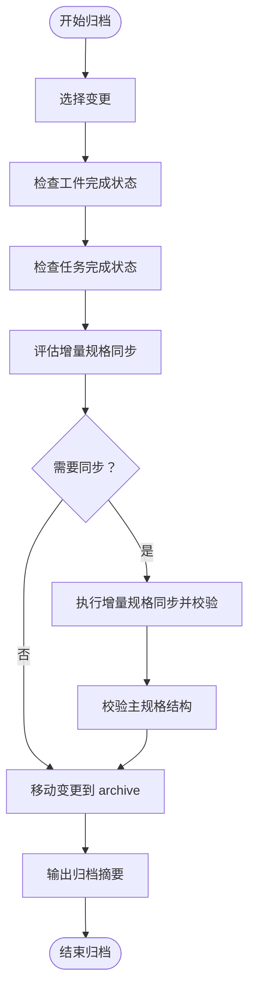
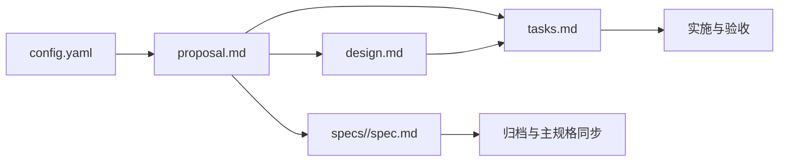
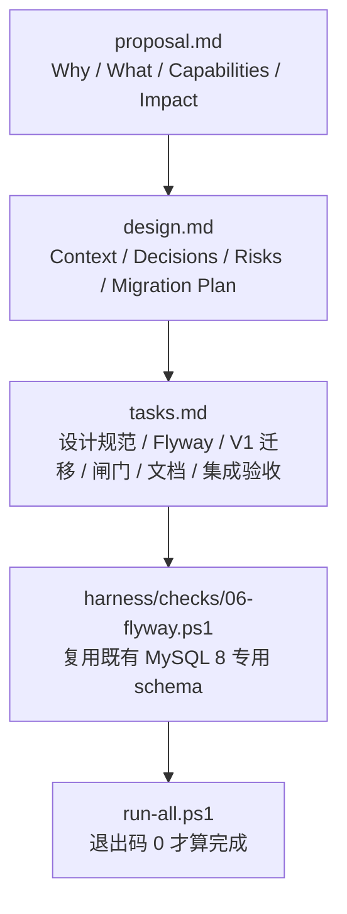

# 变更管理流程

<cite>
**本文引用的文件**   
- [AGENTS.md](file://AGENTS.md)
- [config.yaml](file://openspec/config.yaml)
- [SKILL.md（提案）](file://.agents/skills/openspec-propose/SKILL.md)
- [SKILL.md（实施）](file://.agents/skills/openspec-apply-change/SKILL.md)
- [SKILL.md（归档）](file://.agents/skills/openspec-archive-change/SKILL.md)
- [proposal.md（数据库基线变更）](file://openspec/changes/add-db-baseline-and-flyway-gate/proposal.md)
- [design.md（数据库基线变更）](file://openspec/changes/add-db-baseline-and-flyway-gate/design.md)
- [tasks.md（数据库基线变更）](file://openspec/changes/add-db-baseline-and-flyway-gate/tasks.md)
</cite>

## 目录
1. [引言](#引言)
2. [项目结构](#项目结构)
3. [核心组件](#核心组件)
4. [架构总览](#架构总览)
5. [详细组件分析](#详细组件分析)
6. [依赖关系分析](#依赖关系分析)
7. [性能与可维护性考虑](#性能与可维护性考虑)
8. [故障排查指南](#故障排查指南)
9. [结论](#结论)
10. [附录：变更记录示例](#附录变更记录示例)

## 引言
本指南面向所有参与代码变更的开发者与 AI Agent，说明仓库中基于 OpenSpec 的变更管理流程。该流程以“先规格后实现”为核心，贯穿四个阶段：

- propose（定规格）：产出变更工件，明确要做什么、为什么做、怎么做、如何验收。
- 人工审阅：唯一不可省略的强制卡点，由人确认“方向正确”。
- apply（实施）：按任务逐项落地，遇到异常触发系统化调试。
- archive（归档）：将已完成的变更移入归档，并同步主规格，形成可审计的历史。

本仓库强调三层分工：工件层（openspec/）、能力层（harness/）、行为层（.agents/skills/）。任何超过“改个拼写”的改动，都必须在 openspec/changes/<change-id>/ 下拥有 proposal 与 tasks；没有变更的编码视为越权。完成判定只看 harness\run-all.ps1 的退出码，不以自我声明为准。

**章节来源**
- [AGENTS.md:16-35](file://AGENTS.md#L16-L35)
- [AGENTS.md:37-58](file://AGENTS.md#L37-L58)

## 项目结构
OpenSpec 相关结构位于 openspec/ 目录：

- openspec/config.yaml：定义 schema、上下文语言与可选操作建议。
- openspec/specs/：已归档能力的当前真相（主规格）。
- openspec/changes/：在飞变更；每个变更一个目录，包含 .openspec.yaml、proposal.md、design.md、tasks.md 与 specs/ 增量规格。
- openspec/changes/archive/：历史归档变更，用于审计与回滚依据。

**图表来源**
- [config.yaml:1-29](file://openspec/config.yaml#L1-L29)
- [proposal.md:1-33](file://openspec/changes/add-db-baseline-and-flyway-gate/proposal.md#L1-L33)
- [design.md:1-103](file://openspec/changes/add-db-baseline-and-flyway-gate/design.md#L1-L103)
- [tasks.md:1-40](file://openspec/changes/add-db-baseline-and-flyway-gate/tasks.md#L1-L40)

**章节来源**
- [AGENTS.md:97-101](file://AGENTS.md#L97-L101)
- [AGENTS.md:165-166](file://AGENTS.md#L165-L166)

## 核心组件
变更管理的核心由三类技能驱动：

- 提案技能 openspec-propose：负责创建变更目录与全部规划工件，不直接修改业务代码。
- 实施技能 openspec-apply-change：读取变更上下文，按 tasks.md 推进实现，标记任务完成状态。
- 归档技能 openspec-archive-change：检查工件与任务完成度，必要时合并增量规格到主规格，再将变更移入归档。

这些技能通过 OpenSpec CLI 与仓库中的 config.yaml、status/instructions 等命令协作，确保变更从“想法”到“可执行契约”再到“可审计历史”的一致性。

**章节来源**
- [SKILL.md（提案）:13-25](file://.agents/skills/openspec-propose/SKILL.md#L13-L25)
- [SKILL.md（实施）:13-28](file://.agents/skills/openspec-apply-change/SKILL.md#L13-L28)
- [SKILL.md（归档）:13-30](file://.agents/skills/openspec-archive-change/SKILL.md#L13-L30)

## 架构总览
下图展示变更生命周期中各角色与工件的交互：

**图表来源**
- [AGENTS.md:37-58](file://AGENTS.md#L37-L58)
- [SKILL.md（提案）:150-156](file://.agents/skills/openspec-propose/SKILL.md#L150-L156)
- [SKILL.md（实施）:145-160](file://.agents/skills/openspec-apply-change/SKILL.md#L145-L160)
- [SKILL.md（归档）:186-206](file://.agents/skills/openspec-archive-change/SKILL.md#L186-L206)

## 详细组件分析

### 提案阶段：propose（定规格）
提案阶段的目标是“把模糊想法变成可执行的规划工件”，而不是直接写代码。提案技能会：

1. 理解用户意图，推导 kebab-case 变更名。
2. 加载项目上下文与 schema。
3. 创建变更目录与 .openspec.yaml。
4. 按依赖顺序生成 proposal.md、design.md、tasks.md 与 specs/ 增量规格。
5. 输出变更位置、工件清单与下一步提示。

关键约束：

- 仅做规划，不编辑业务代码。
- 必须生成实施所需的全部工件，不只是 apply.requires 列出的最小集合。
- 若存在歧义，应先提问，再记录假设。
- 完成后应提示进入人工审阅与 apply 阶段。

**图表来源**
- [SKILL.md（提案）:42-139](file://.agents/skills/openspec-propose/SKILL.md#L42-L139)
- [SKILL.md（提案）:150-156](file://.agents/skills/openspec-propose/SKILL.md#L150-L156)

**章节来源**
- [SKILL.md（提案）:13-25](file://.agents/skills/openspec-propose/SKILL.md#L13-L25)
- [SKILL.md（提案）:42-139](file://.agents/skills/openspec-propose/SKILL.md#L42-L139)
- [SKILL.md（提案）:150-176](file://.agents/skills/openspec-propose/SKILL.md#L150-L176)

### 人工审阅：唯一不可省略的环节
AGENTS.md 明确指出：第②步是整条链路里唯一不可省略的人工节点。其余环节可以自动化，但“想做的东西对不对”不能由 AI 自己拍板。

人工审阅应关注：

- proposal 是否说清 Why、What Changes、Capabilities、Impact、不在范围。
- design 是否列出 Goals、Non-Goals、Decisions、Risks、Migration Plan。
- tasks 是否可执行、可验证，且与 proposal/design 一致。
- specs 增量是否与现有主规格冲突，是否需要新增或退役能力。
- 是否引入破坏性变更，例如环境依赖、API 变化、构建脚本变化。

如果审阅未通过，应退回 propose 阶段补充或修正工件；只有审阅通过后，才允许进入 apply。

**章节来源**
- [AGENTS.md:37-58](file://AGENTS.md#L37-L58)

### 实施阶段：apply（实施）
实施阶段由 openspec-apply-change 技能驱动，核心职责是按 tasks.md 逐项实现，并保持变更最小化、可追踪。

实施流程要点：

1. 选择变更：支持显式命名、上下文推断或列表选择。
2. 读取 schema 与 apply instructions：获取 contextFiles、任务进度、动态指令。
3. 读取上下文文件：proposal、specs、design、tasks。
4. 逐条实现任务：定位 sourcePath 与 line，修改代码后标记任务为完成。
5. 遇到阻塞时暂停：任务不清、设计问题、超出 spec 范围、错误与阻断都应上报。
6. 完成后提示 review 或 verification，再考虑归档。

**图表来源**
- [SKILL.md（实施）:30-70](file://.agents/skills/openspec-apply-change/SKILL.md#L30-L70)
- [SKILL.md（实施）:87-129](file://.agents/skills/openspec-apply-change/SKILL.md#L87-L129)
- [SKILL.md（实施）:131-199](file://.agents/skills/openspec-apply-change/SKILL.md#L131-L199)

**章节来源**
- [SKILL.md（实施）:13-28](file://.agents/skills/openspec-apply-change/SKILL.md#L13-L28)
- [SKILL.md（实施）:30-129](file://.agents/skills/openspec-apply-change/SKILL.md#L30-L129)
- [SKILL.md（实施）:131-207](file://.agents/skills/openspec-apply-change/SKILL.md#L131-L207)

### 归档阶段：archive（归档）
归档阶段将已完成变更移入 openspec/changes/archive/，并可把增量规格合并到主规格。归档前会检查：

- 工件完成状态：done 或 skipped 才算满足。
- 任务完成状态：根据 totalTasks 与 completedTasks 计算未完成数量。
- 增量规格同步状态：比较 delta spec 与主规格，判断是否需要新建、修改、移除或重命名能力。
- 同步结果校验：新主规格标题、Purpose 保留、Requirement/Scenario 结构正确，delta 风格标题不应残留。

归档成功后，变更目录被移动到 archive，并输出变更名、schema、归档路径、是否同步规格以及警告信息。

**图表来源**
- [SKILL.md（归档）:32-71](file://.agents/skills/openspec-archive-change/SKILL.md#L32-L71)
- [SKILL.md（归档）:73-167](file://.agents/skills/openspec-archive-change/SKILL.md#L73-L167)
- [SKILL.md（归档）:169-206](file://.agents/skills/openspec-archive-change/SKILL.md#L169-L206)

**章节来源**
- [SKILL.md（归档）:13-30](file://.agents/skills/openspec-archive-change/SKILL.md#L13-L30)
- [SKILL.md（归档）:32-167](file://.agents/skills/openspec-archive-change/SKILL.md#L32-L167)
- [SKILL.md（归档）:169-222](file://.agents/skills/openspec-archive-change/SKILL.md#L169-L222)

## 依赖关系分析
变更工件之间存在明确的依赖关系：

- proposal 是起点，描述 What 与 Why。
- design 解释 How，记录决策、风险与迁移计划。
- tasks 把设计拆成可执行步骤，并与验收标准绑定。
- specs 提供增量规格，归档时可合并为主规格。
- config.yaml 决定 schema、上下文与可选操作建议。

**图表来源**
- [config.yaml:1-29](file://openspec/config.yaml#L1-L29)
- [proposal.md:1-33](file://openspec/changes/add-db-baseline-and-flyway-gate/proposal.md#L1-L33)
- [design.md:1-103](file://openspec/changes/add-db-baseline-and-flyway-gate/design.md#L1-L103)
- [tasks.md:1-40](file://openspec/changes/add-db-baseline-and-flyway-gate/tasks.md#L1-L40)

**章节来源**
- [SKILL.md（提案）:92-139](file://.agents/skills/openspec-propose/SKILL.md#L92-L139)
- [SKILL.md（归档）:111-167](file://.agents/skills/openspec-archive-change/SKILL.md#L111-L167)

## 性能与可维护性考虑
- 变更粒度：尽量保持单个变更聚焦单一目标，避免一个大 change 包揽多个无关能力。
- 任务拆分：tasks.md 中的任务应可独立验证，避免跨任务强耦合。
- 规格收敛：增量规格应尽量只表达新增、修改、移除、重命名的需求，减少漂移。
- 闸门优先：任何影响构建、测试、前端、子模块的行为，都应通过 harness/checks/ 暴露为自动检查。
- 文档与实现一致性：design.md 与 docs/ 中的规范应与迁移脚本、主规格保持一致，否则应在同一变更中修复。

[本节为通用指导，不直接分析具体文件]

## 故障排查指南
常见故障与处理建议：

- 子模块未初始化：00 闸门会在编译前失败，需先执行 git submodule update --init --recursive。
- 数据库不可达：Flyway 闸门依赖 127.0.0.1:8806 的 MySQL 8，凭据缺失或连接失败会整体失败。
- 静态红线：Java TODO、System.out、@Disabled，以及前端 TODO 与跳过写法会被拦截。
- 测试被跳过：禁止使用 @Disabled、it.skip 等伪造绿灯方式。
- 完成判定错误：不要以“我写了注释”或“我觉得完成了”作为证据，必须以 harness\run-all.ps1 退出码为准。

**章节来源**
- [AGENTS.md:30-35](file://AGENTS.md#L30-L35)
- [AGENTS.md:160-167](file://AGENTS.md#L160-L167)

## 结论
OpenSpec 在本仓库中不是“写文档的工具”，而是“让变更可提议、可审阅、可实施、可归档”的流程骨架。其中，人工审阅是唯一不可省略的环节；其他环节可以由工具辅助，但不能替代人对“方向是否正确”的判断。

最佳实践总结：

- 先 proposal，再 design，再 tasks，最后实现。
- 用 specs 表达可验收的行为契约，用 design 记录决策与权衡。
- 用 tasks 绑定实现与验证，避免模糊交付。
- 用 harness 闸门保证编译、测试、前端、迁移等行为可自动化验证。
- 用 archive 沉淀历史，使每次变更都可审计、可回滚。

[本节为总结性内容，不直接分析具体文件]

## 附录：变更记录示例
以下以 `add-db-baseline-and-flyway-gate` 为例，展示一次完整变更的生命周期。

### 变更记录概览
- 变更名：add-db-baseline-and-flyway-gate
- 目的：引入 Flyway 迁移工具与第一条数据库迁移，建立 AI 会话核心表基线，并通过 Harness 闸门验证迁移。
- 主要产物：
  - proposal.md：说明 Why、What Changes、Capabilities、Impact、不在范围。
  - design.md：说明 Context、Goals/Non-Goals、Decisions、Risks、Migration Plan。
  - tasks.md：按数据库设计规范、Flyway 接入、第一条迁移、Harness 闸门、入口文档更新、集成验收拆分任务。
  - specs/database-baseline/spec.md：增量规格（由提案技能生成）。

**图表来源**
- [proposal.md:1-33](file://openspec/changes/add-db-baseline-and-flyway-gate/proposal.md#L1-L33)
- [design.md:1-103](file://openspec/changes/add-db-baseline-and-flyway-gate/design.md#L1-L103)
- [tasks.md:1-40](file://openspec/changes/add-db-baseline-and-flyway-gate/tasks.md#L1-L40)

### 编写建议
- proposal.md 应清晰回答：
  - 为什么要做这个变更。
  - 会改变什么，不影响什么。
  - 新增或修改哪些能力。
  - 对代码、依赖、API、环境的冲击。
  - 明确不在范围，防止范围蔓延。
- design.md 应记录：
  - 背景与约束。
  - 目标与非目标。
  - 关键决策及备选方案为何被拒绝。
  - 风险与缓解措施。
  - 迁移计划与回滚策略。
- tasks.md 应做到：
  - 每个任务有明确动作与验证方式。
  - 与 proposal/design 保持一致。
  - 不出现“后续再说”的模糊任务。
  - 实施完成后逐项打勾，并以 harness 退出码作为最终证据。

**章节来源**
- [proposal.md:1-33](file://openspec/changes/add-db-baseline-and-flyway-gate/proposal.md#L1-L33)
- [design.md:1-103](file://openspec/changes/add-db-baseline-and-flyway-gate/design.md#L1-L103)
- [tasks.md:1-40](file://openspec/changes/add-db-baseline-and-flyway-gate/tasks.md#L1-L40)

### 命名约定与依赖管理
- 变更名建议使用 kebab-case，如 add-db-baseline-and-flyway-gate。
- 能力路径遵循 specs/<capability-path>/spec.md，新增能力时保留完整路径。
- 依赖管理应区分：
  - 构建期依赖：如 Flyway Maven 插件。
  - 运行期依赖：本变更明确不引入运行期数据源与 JPA。
  - 环境依赖：Harness 新增既有 MySQL 8 实例依赖，但不新建容器。

**章节来源**
- [SKILL.md（提案）:42-51](file://.agents/skills/openspec-propose/SKILL.md#L42-L51)
- [proposal.md:26-33](file://openspec/changes/add-db-baseline-and-flyway-gate/proposal.md#L26-L33)
- [design.md:37-53](file://openspec/changes/add-db-baseline-and-flyway-gate/design.md#L37-L53)

### 回滚策略
- 对于本类变更，回滚通常包括：
  - 删除新增的 Harness 闸门。
  - 删除迁移脚本。
  - 撤销 pom.xml 插件与依赖变更。
  - 撤销文档与 AGENTS.md/README.md 的边界说明。
- 如需清理专用 schema，可手工删除对应数据库 schema，但这不属于自动归档流程。

**章节来源**
- [design.md:93-102](file://openspec/changes/add-db-baseline-and-flyway-gate/design.md#L93-L102)