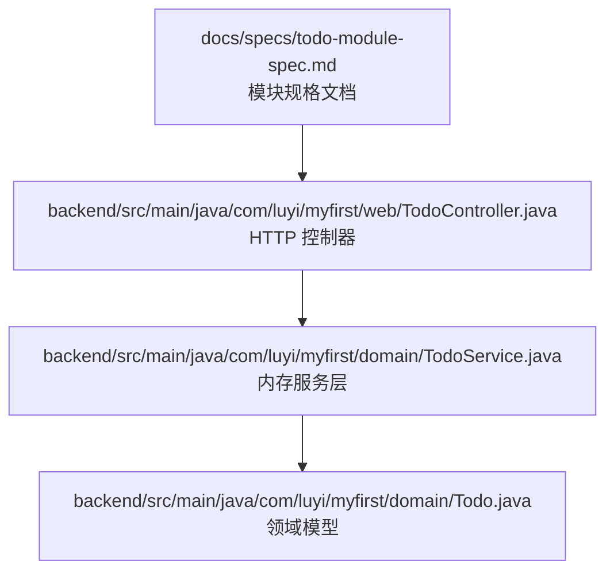
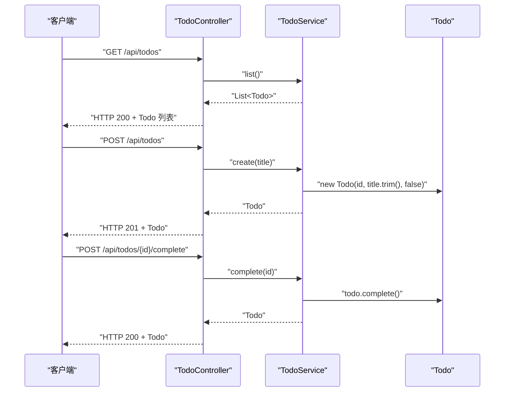
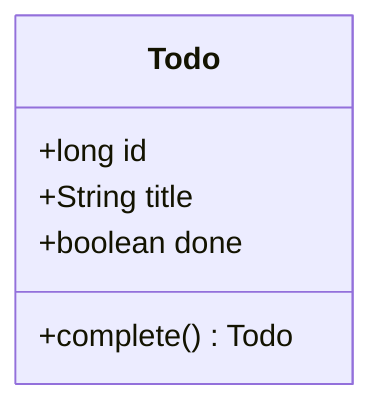
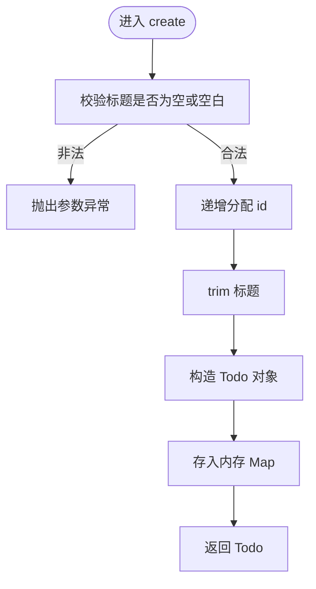
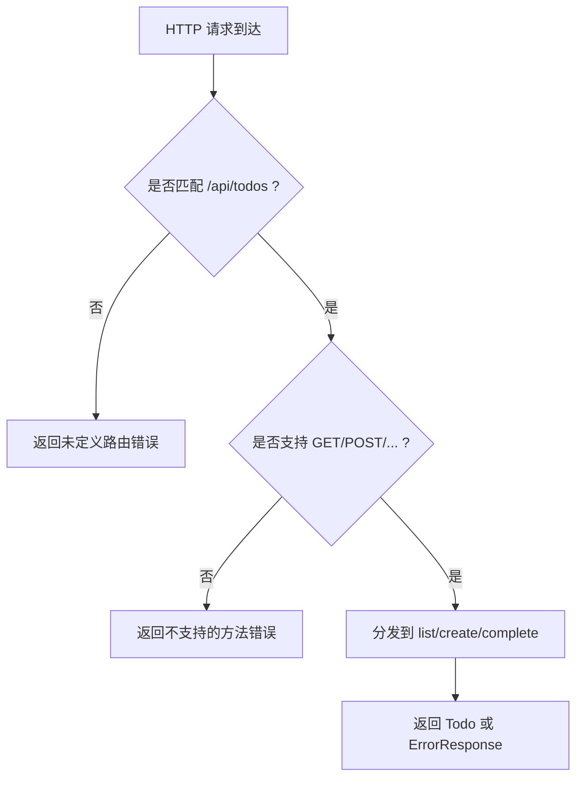
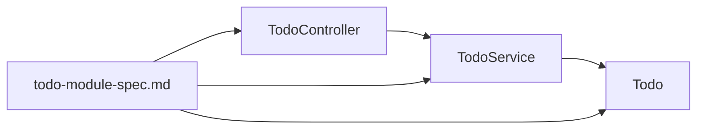
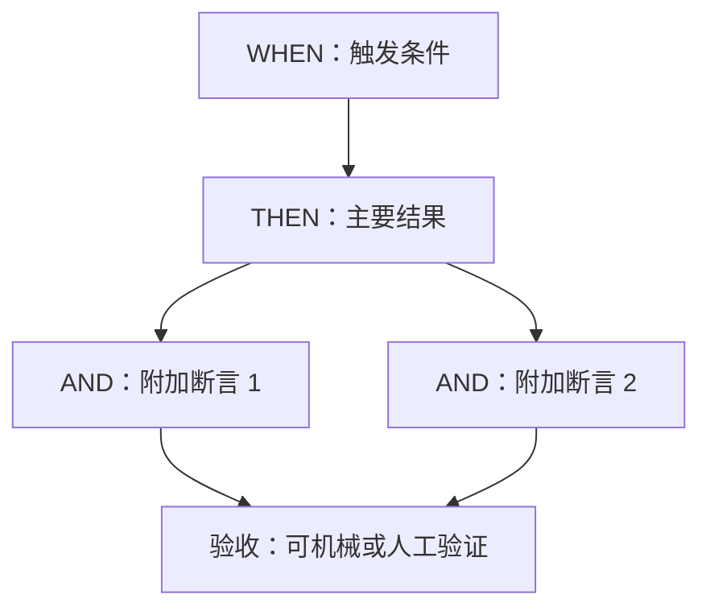
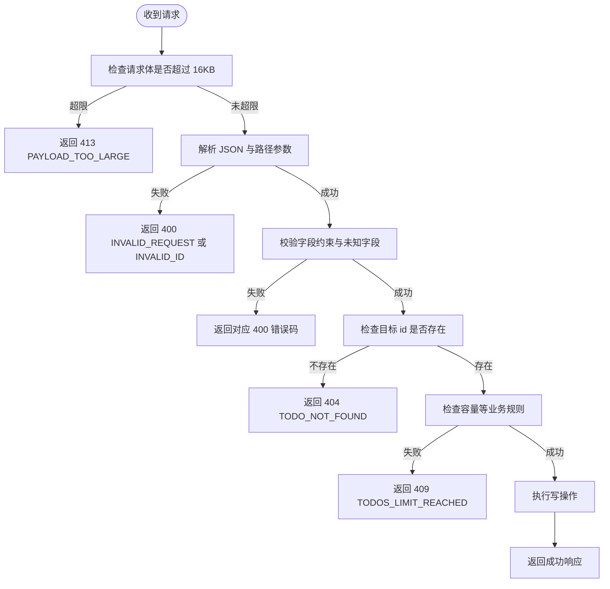

# 规格文档编写

<cite>
**本文引用的文件**   
- [todo-module-spec.md](file://docs/specs/todo-module-spec.md)
- [Todo.java](file://backend/src/main/java/com/luyi/myfirst/domain/Todo.java)
- [TodoService.java](file://backend/src/main/java/com/luyi/myfirst/domain/TodoService.java)
- [TodoController.java](file://backend/src/main/java/com/luyi/myfirst/web/TodoController.java)
</cite>

## 目录
1. [引言](#引言)
2. [项目结构](#项目结构)
3. [核心组件](#核心组件)
4. [架构总览](#架构总览)
5. [详细组件分析](#详细组件分析)
6. [依赖关系分析](#依赖关系分析)
7. [性能与并发特性](#性能与并发特性)
8. [验收标准编写指南](#验收标准编写指南)
9. [场景描述最佳实践（WHEN/THEN/AND）](#场景描述最佳实践whenthenand)
10. [数据约束与业务规则定义](#数据约束与业务规则定义)
11. [版本管理与变更记录](#版本管理与变更记录)
12. [常见错误与排障](#常见错误与排障)
13. [结论](#结论)
14. [附录：规格文档模板](#附录规格文档模板)

## 引言
本指南以仓库中的 `docs/specs/todo-module-spec.md` 为范例，系统化说明如何编写一份高质量、可验证的模块规格文档。重点包括：
- 明确模块边界：哪些能力在本期范围内，哪些明确不做。
- 覆盖正常路径与异常路径的核心应用场景。
- 精确定义数据结构、字段语义、校验顺序和错误码。
- 制定可机械验证或人工复核的验收标准。
- 强调规格文档是“目标契约”，应使用 should be 表达期望行为，而不是对当前实现的 is 描述。

该文档的目标读者既包括后端、前端、测试工程师，也包括产品与评审人员；因此需要在技术精确性与可读性之间取得平衡。

## 项目结构
本仓库中与规格文档编写直接相关的代码位于后端模块，而规格文档本身位于 `docs/specs/todo-module-spec.md`。后端实现目前仅包含待办清单的基础能力，规格文档则在此基础上定义了更完整的目标契约。

**图示来源**
- [todo-module-spec.md:1-13](file://docs/specs/todo-module-spec.md#L1-L13)
- [TodoController.java:16-44](file://backend/src/main/java/com/luyi/myfirst/web/TodoController.java#L16-L44)
- [TodoService.java:14-43](file://backend/src/main/java/com/luyi/myfirst/domain/TodoService.java#L14-L43)
- [Todo.java:7-11](file://backend/src/main/java/com/luyi/myfirst/domain/Todo.java#L7-L11)

**章节来源**
- [todo-module-spec.md:1-13](file://docs/specs/todo-module-spec.md#L1-L13)
- [TodoController.java:16-44](file://backend/src/main/java/com/luyi/myfirst/web/TodoController.java#L16-L44)
- [TodoService.java:14-43](file://backend/src/main/java/com/luyi/myfirst/domain/TodoService.java#L14-L43)
- [Todo.java:7-11](file://backend/src/main/java/com/luyi/myfirst/domain/Todo.java#L7-L11)

## 核心组件
从规格文档的角度看，Todo 模块的核心由三层组成：
- HTTP 接口层：对外暴露查询、创建、完成等端点。
- 服务层：封装内存存储、ID 分配、状态变更等逻辑。
- 领域模型：表示一条待办记录及其基本操作。

规格文档不仅描述这些组件的职责，还通过场景、数据结构、错误码和验收标准，把“应该怎么做”变成“可以被测试验证”。

**章节来源**
- [TodoController.java:16-44](file://backend/src/main/java/com/luyi/myfirst/web/TodoController.java#L16-L44)
- [TodoService.java:14-43](file://backend/src/main/java/com/luyi/myfirst/domain/TodoService.java#L14-L43)
- [Todo.java:7-11](file://backend/src/main/java/com/luyi/myfirst/domain/Todo.java#L7-L11)

## 架构总览
Todo 模块的调用链可以概括为：客户端发起 HTTP 请求 → TodoController 接收并转发 → TodoService 执行业务逻辑 → Todo 作为领域对象返回。规格文档在此基础上扩展了更多字段、校验、错误处理和并发语义。

**图示来源**
- [TodoController.java:26-40](file://backend/src/main/java/com/luyi/myfirst/web/TodoController.java#L26-L40)
- [TodoService.java:20-38](file://backend/src/main/java/com/luyi/myfirst/domain/TodoService.java#L20-L38)
- [Todo.java:7-11](file://backend/src/main/java/com/luyi/myfirst/domain/Todo.java#L7-L11)

## 详细组件分析

### 领域模型 Todo
Todo 是一个不可变 record，包含 id、title、done 三个基础字段，并提供 complete 方法用于生成已完成的新实例。规格文档在此基础上扩展了 tags、dueDate、priority 等字段，并明确了只读字段、默认值、长度计量方式以及进程内 ID 生命周期。

**图示来源**
- [Todo.java:7-11](file://backend/src/main/java/com/luyi/myfirst/domain/Todo.java#L7-L11)

**章节来源**
- [Todo.java:7-11](file://backend/src/main/java/com/luyi/myfirst/domain/Todo.java#L7-L11)
- [todo-module-spec.md:418-434](file://docs/specs/todo-module-spec.md#L418-L434)

### 服务层 TodoService
TodoService 使用 LinkedHashMap 作为内存存储，维护一个递增 sequence 分配 id。当前实现只做最基础的 create、complete、list，且没有全局异常处理、容量上限、体积上限、并发安全等机制。规格文档将这些缺失能力纳入目标契约，并通过场景和验收标准约束最终行为。

**图示来源**
- [TodoService.java:20-28](file://backend/src/main/java/com/luyi/myfirst/domain/TodoService.java#L20-L28)

**章节来源**
- [TodoService.java:14-43](file://backend/src/main/java/com/luyi/myfirst/domain/TodoService.java#L14-L43)
- [todo-module-spec.md:615-635](file://docs/specs/todo-module-spec.md#L615-L635)

### 控制器层 TodoController
TodoController 暴露 GET、POST、POST/{id}/complete 三个端点，并使用 Spring 注解绑定路径、状态码和请求体。规格文档要求后续补充 PATCH 更新端点、统一错误响应体、路由与方法不匹配的错误码，以及前端错误码映射。

**图示来源**
- [TodoController.java:16-40](file://backend/src/main/java/com/luyi/myfirst/web/TodoController.java#L16-L40)
- [todo-module-spec.md:264-270](file://docs/specs/todo-module-spec.md#L264-L270)

**章节来源**
- [TodoController.java:16-44](file://backend/src/main/java/com/luyi/myfirst/web/TodoController.java#L16-L44)
- [todo-module-spec.md:248-270](file://docs/specs/todo-module-spec.md#L248-L270)

## 依赖关系分析
TodoController 依赖 TodoService；TodoService 依赖 Todo。规格文档进一步引入外部契约：JSON 命名约定、错误响应结构、HTTP 状态码与错误码映射、前端类型定义一致性。

**图示来源**
- [TodoController.java:3-10](file://backend/src/main/java/com/luyi/myfirst/web/TodoController.java#L3-L10)
- [TodoService.java:1-8](file://backend/src/main/java/com/luyi/myfirst/domain/TodoService.java#L1-L8)
- [Todo.java:1-7](file://backend/src/main/java/com/luyi/myfirst/domain/Todo.java#L1-L7)
- [todo-module-spec.md:1-13](file://docs/specs/todo-module-spec.md#L1-L13)

**章节来源**
- [TodoController.java:3-10](file://backend/src/main/java/com/luyi/myfirst/web/TodoController.java#L3-L10)
- [TodoService.java:1-8](file://backend/src/main/java/com/luyi/myfirst/domain/TodoService.java#L1-L8)
- [todo-module-spec.md:1-13](file://docs/specs/todo-module-spec.md#L1-L13)

## 性能与并发特性
规格文档明确 Todo 模块采用内存存储，适合 Harness 的可重复执行需求，但不提供持久化、分页、搜索、索引等能力。并发方面，规格要求：
- id 唯一且单请求原子。
- 不同字段并发写入不得互相覆盖。
- 总条数达到 10,000 时拒绝新创建。
- 单个请求体不超过 16KB。

当前实现尚未满足这些并发与容量约束，属于“实现差距”，应在落地 change 中补齐。

**章节来源**
- [todo-module-spec.md:55-73](file://docs/specs/todo-module-spec.md#L55-L73)
- [todo-module-spec.md:615-635](file://docs/specs/todo-module-spec.md#L615-L635)

## 验收标准编写指南
验收标准应遵循以下原则：
- 每条验收对应明确的场景编号（如 S-xx、E-xx、B-xx）。
- 区分可机械验证 `[M]` 与需人工复核 `[H]`。
- 断言必须具体：HTTP 状态码、响应体字段集合、错误码、消息长度、前后端类型一致性等。
- 避免模糊表述，例如“应该能处理错误”应改为“返回 400，code 为 TITLE_BLANK，message ≤ 200 字符且不包含堆栈”。

示例参考：
- AC-01 对应 S-01：空清单返回 200 且 body 为 []。
- AC-36 对应 E-07/E-08：所有 4xx/5xx 响应体恰含 code 与 message，不包含内部实现细节。
- AC-49 对应工程闸门：harness\run-all.ps1 退出码为 0。

**章节来源**
- [todo-module-spec.md:545-612](file://docs/specs/todo-module-spec.md#L545-L612)

## 场景描述最佳实践（WHEN/THEN/AND）
规格文档中的场景统一采用 WHEN/THEN/AND 格式：
- WHEN：触发条件，包括请求、前置状态、系统环境。
- THEN：可观察结果，包括 HTTP 状态码、响应体、副作用。
- AND：附加断言，必须同时成立，常用于顺序、幂等、并发、字段不变性等。

编写建议：
- 正常路径优先写 S-xx，异常路径写 E-xx，边界与默认值写 B-xx。
- 每个场景只聚焦一个主行为，但可用 AND 补充多个必要断言。
- 对并发、幂等、重启、容量等关键性质单独建模，不要混入普通成功场景。
- 对错误路径要写明“无副作用”，例如不写库、不新增记录、列表长度不变。

**图示来源**
- [todo-module-spec.md:76-79](file://docs/specs/todo-module-spec.md#L76-L79)
- [todo-module-spec.md:83-197](file://docs/specs/todo-module-spec.md#L83-L197)
- [todo-module-spec.md:199-367](file://docs/specs/todo-module-spec.md#L199-L367)

**章节来源**
- [todo-module-spec.md:76-79](file://docs/specs/todo-module-spec.md#L76-L79)
- [todo-module-spec.md:83-197](file://docs/specs/todo-module-spec.md#L83-L197)
- [todo-module-spec.md:199-367](file://docs/specs/todo-module-spec.md#L199-L367)

## 数据约束与业务规则定义
规格文档的数据结构部分应明确：
- JSON 字段名与类型。
- Java/TS 对应类型。
- 必填性与默认值。
- 业务约束：长度、枚举、日期格式、数量上限、大小写敏感等。
- 显式 null 与字段缺席的区别。
- 校验顺序与多错并存时的优先级。

Todo 模块的关键规则包括：
- 标题 trim 后必须在 10..100 个 Unicode code point 之间。
- tags 最多 5 个，每个 trim 后 1..20 个 code point，trim 后不得重复。
- dueDate 为 YYYY-MM-DD，必须是真实日期，年份在 1970..2100。
- priority 为 LOW/MEDIUM/HIGH，大小写敏感，缺省为 MEDIUM。
- id 与 done 出现在任何请求体中均视为不可更新字段。
- 未知字段严格拒绝。
- 校验顺序：体积 → 解析 → 字段约束 → 资源存在性 → 业务规则 → 执行。

**图示来源**
- [todo-module-spec.md:499-520](file://docs/specs/todo-module-spec.md#L499-L520)
- [todo-module-spec.md:418-462](file://docs/specs/todo-module-spec.md#L418-L462)

**章节来源**
- [todo-module-spec.md:418-542](file://docs/specs/todo-module-spec.md#L418-L542)

## 版本管理与变更记录
规格文档应具备清晰的版本信息、变更记录和落地路径：
- 版本号：v1.0、v1.1、v1.2、v1.2.1 等。
- 状态：目标契约、已评审、已归档等。
- 变更记录：每次修改的日期、版本、改动内容、原因。
- 落地路径：如何将规格转化为 change、delta spec、任务清单和测试覆盖。

todo-module-spec.md 的变更记录体现了规格逐步收敛的过程：从基础三操作扩展到标签、截止日期、优先级、PATCH 更新，再到安全、并发、容量、体积、错误码、前端契约等维度。

**章节来源**
- [todo-module-spec.md:1-13](file://docs/specs/todo-module-spec.md#L1-L13)
- [todo-module-spec.md:643-651](file://docs/specs/todo-module-spec.md#L643-L651)

## 常见错误与排障
编写规格文档时常见的排障点包括：
- 场景描述不够可验证：缺少 HTTP 状态码、错误码、响应体字段集合。
- 异常路径遗漏：只写正常路径，忽略 400/404/405/409/413/500。
- 校验顺序不明确：同一请求多个字段非法时，无法确定返回哪个错误码。
- 显式 null 与字段缺席混淆：导致 PATCH 清空字段与保持原值的语义不一致。
- 实现差距未立项：用“当前代码就是这样”改写规格，违背契约性质。
- 验收标准不可自动化：大量使用“应该”“尽量”等模糊词。

对照 todo-module-spec.md，推荐排查清单：
- 是否覆盖 E-01 ~ E-22 与 B-01 ~ B-06。
- 是否明确 3.5 的 HTTP 状态码与错误码映射。
- 是否明确 3.6 的校验顺序与多错优先级。
- 是否明确 3.8 的显式 null 与字段缺席语义表。
- 是否将“目标契约”与“当前实现差距”分开。

**章节来源**
- [todo-module-spec.md:199-367](file://docs/specs/todo-module-spec.md#L199-L367)
- [todo-module-spec.md:472-542](file://docs/specs/todo-module-spec.md#L472-L542)
- [todo-module-spec.md:615-635](file://docs/specs/todo-module-spec.md#L615-L635)

## 结论
一份好的规格文档不是代码注释，也不是需求草稿，而是模块的“目标契约”。它应当：
- 明确模块边界，区分包含与不包含的能力。
- 用 WHEN/THEN/AND 描述清晰、可验证的场景。
- 用结构化表格定义数据结构、约束、默认值和校验顺序。
- 用验收标准连接设计与实现，确保测试可判定。
- 用版本与变更记录管理演进，用实现差距表指导落地。
- 始终使用 should be 表达期望，而不是 is 描述现状。

todo-module-spec.md 展示了从简单待办清单到完整契约的演进过程，适合作为团队编写规格文档的参考样板。

## 附录：规格文档模板
以下为基于 todo-module-spec.md 的结构化模板，可直接复用：

- 文档头
  - 版本
  - 状态
  - 适用模块
  - 基线
  - 命名约定
  - 契约声明：本文档定义 should be，不是 is。

- 模块边界
  - 包含：列出本期能力编号与说明。
  - 不包含：列出不做能力与原因。
  - 运行约束：部署边界、单实例共享、数据生命周期、并发语义、容量与体积上限等。

- 核心应用场景
  - 正常路径：S-01、S-02、...
  - 异常路径：E-01、E-02、...
  - 边界与默认值：B-01、B-02、...

- 数据结构
  - Todo 响应实体字段表。
  - CreateTodoRequest 请求体字段表。
  - UpdateTodoRequest 更新请求体字段表。
  - ErrorResponse 错误响应字段表。
  - HTTP 状态码与错误码映射表。
  - 校验顺序与多错优先级。
  - 命名与一致性规则。
  - 显式 null 与字段缺席语义表。

- 验收标准
  - 功能（正常路径）
  - 异常路径
  - 契约一致性
  - 边界与工程闸门

- 附录
  - 与当前实现的差距
  - 落地路径
  - 变更记录

**章节来源**
- [todo-module-spec.md:1-13](file://docs/specs/todo-module-spec.md#L1-L13)
- [todo-module-spec.md:16-73](file://docs/specs/todo-module-spec.md#L16-L73)
- [todo-module-spec.md:76-414](file://docs/specs/todo-module-spec.md#L76-L414)
- [todo-module-spec.md:416-542](file://docs/specs/todo-module-spec.md#L416-L542)
- [todo-module-spec.md:545-612](file://docs/specs/todo-module-spec.md#L545-L612)
- [todo-module-spec.md:615-651](file://docs/specs/todo-module-spec.md#L615-L651)