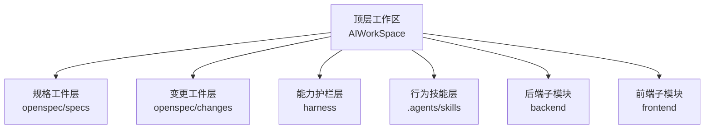
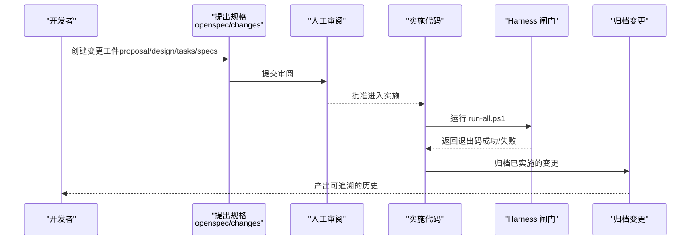
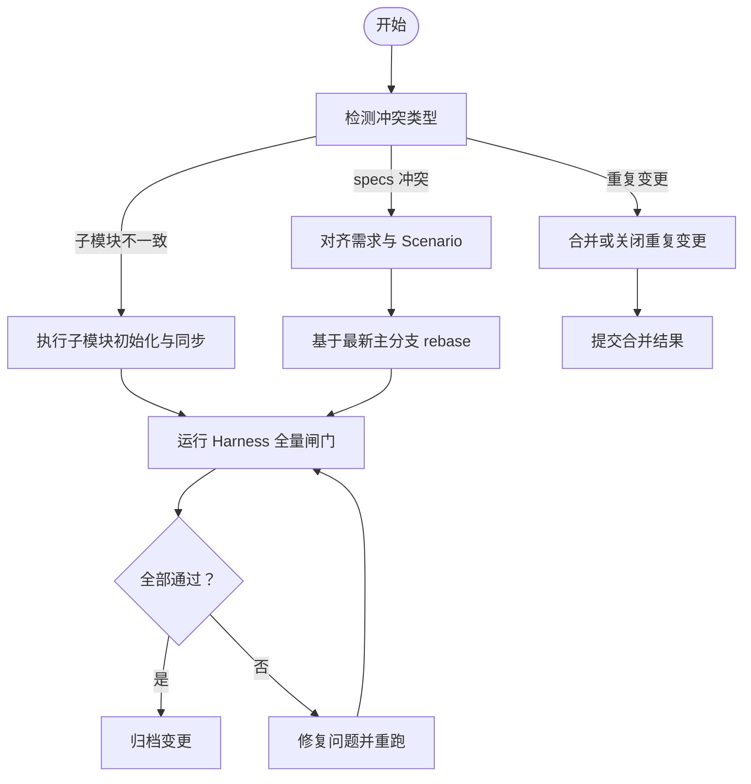
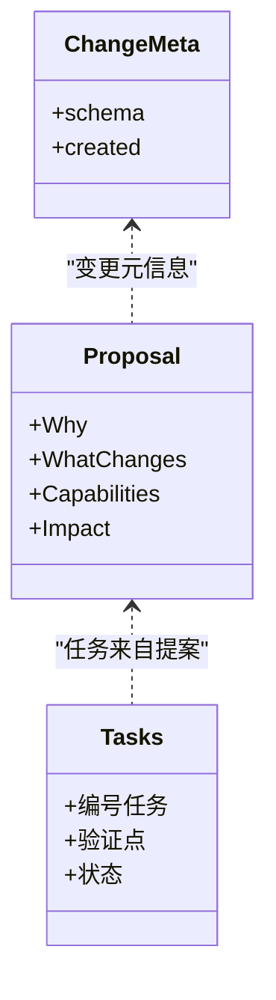
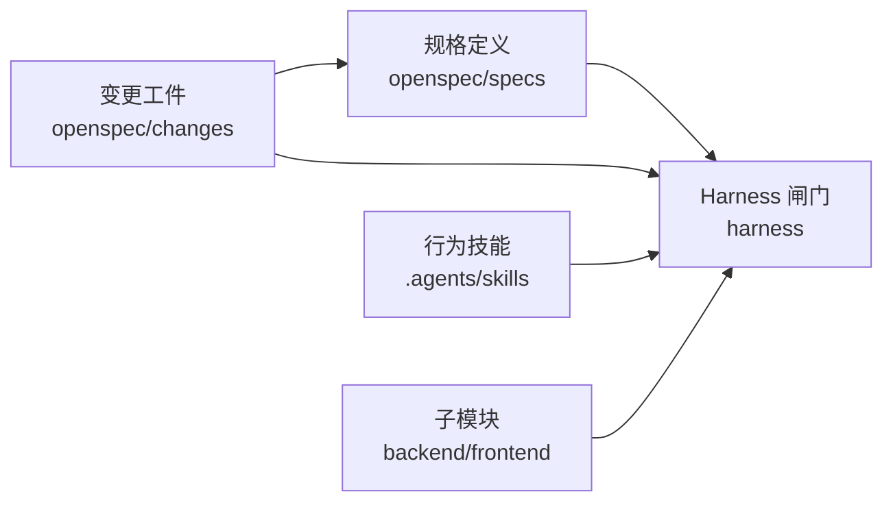

# 规格版本管理策略

<cite>
**本文引用的文件**   
- [README.md](file://README.md)
- [config.yaml](file://openspec/config.yaml)
- [frontend-nextjs/spec.md](file://openspec/specs/frontend-nextjs/spec.md)
- [skill-distribution/spec.md](file://openspec/specs/skill-distribution/spec.md)
- [workspace-layout/spec.md](file://openspec/specs/workspace-layout/spec.md)
- [workspace-scaffold/spec.md](file://openspec/specs/workspace-scaffold/spec.md)
- [.openspec.yaml](file://openspec/changes/add-db-baseline-and-flyway-gate/.openspec.yaml)
- [proposal.md](file://openspec/changes/add-db-baseline-and-flyway-gate/proposal.md)
- [tasks.md](file://openspec/changes/add-db-baseline-and-flyway-gate/tasks.md)
</cite>

## 目录
1. [引言](#引言)
2. [项目结构](#项目结构)
3. [核心组件](#核心组件)
4. [架构总览](#架构总览)
5. [详细组件分析](#详细组件分析)
6. [依赖分析](#依赖分析)
7. [性能考虑](#性能考虑)
8. [故障排查指南](#故障排查指南)
9. [结论](#结论)
10. [附录](#附录)

## 引言
本指南面向 AIWorkSpace 工作区中的“规格版本管理”，目标是建立一套可演进、可审计、可回滚的规格治理体系。仓库采用“规格驱动”的工作流：先以规格固定意图，再实施、验收与归档；同时通过 Harness 闸门把规格约束落到构建、测试与迁移等工程实践中。

本指南覆盖以下主题：
- 版本号规范（如 v1.2.1）及其语义化含义与升级规则
- 规格演进与向后兼容性、废弃字段处理、迁移策略
- 规格基线的概念与作用，以及开发过程中的一致性维护
- 版本冲突解决与合并策略，确保多人协作一致性
- 变更记录最佳实践：变更原因、影响范围、回滚方案

## 项目结构
AIWorkSpace 将“规格工件层”“能力护栏层”“行为技能层”与工作区编排分离，前后端作为独立子模块挂载，便于各自发布与版本锁定。

**图示来源**
- [README.md:9-19](file://README.md#L9-L19)
- [README.md:74-85](file://README.md#L74-L85)

**章节来源**
- [README.md:1-111](file://README.md#L1-L111)

## 核心组件
围绕规格版本管理的核心构件如下：
- 规格定义：位于 openspec/specs，描述系统应满足的需求与场景断言
- 变更流程：位于 openspec/changes，承载 proposal/design/tasks/specs 等工件
- 配置与上下文：openspec/config.yaml 声明 schema 为 spec-driven，并规定语言与关键词约定
- 验收闸门：harness 脚本对子模块、编译、测试、静态红线与数据库迁移进行统一验证
- 技能契约：.agents/skills 固化执行方法，保证不同 AI 工具的行为一致

这些构件共同构成“规格驱动”的最小闭环：提出 → 审阅 → 实施 → 验收 → 归档。

**章节来源**
- [config.yaml:1-29](file://openspec/config.yaml#L1-L29)
- [README.md:65-85](file://README.md#L65-L85)

## 架构总览
下图展示规格从提出到归档的全链路，以及与 Harness 闸门的耦合关系。

**图示来源**
- [README.md:65-69](file://README.md#L65-L69)
- [README.md:74-85](file://README.md#L74-L85)

## 详细组件分析

### 版本号规范与语义化升级规则
建议采用语义化版本 vMAJOR.MINOR.PATCH：
- MAJOR：破坏性变更或不可兼容的演进
- MINOR：新增能力且保持向后兼容
- PATCH：缺陷修复与无影响的改进

结合仓库现状，建议将“规格版本”与“实现版本”解耦：
- 规格版本：用于标识 specs 与变更工件的演进阶段（例如 v1.2.1）
- 实现版本：由 backend 与 frontend 各自维护（Maven artifactId / npm package.json）

升级规则要点：
- 仅修改文档或纯内部重构时，优先使用 PATCH
- 新增需求、新增能力但兼容旧接口时，使用 MINOR
- 破坏 API、破坏数据模型或破坏 Harness 闸门行为时，使用 MAJOR，并在 proposal 中标注 BREAKING

参考仓库中已有变更的 BREAKING 标注方式，可在 proposal 明确标注影响面与环境差异。

**章节来源**
- [proposal.md:1-33](file://openspec/changes/add-db-baseline-and-flyway-gate/proposal.md#L1-L33)

### 规格演进与向后兼容性
- 新增字段/能力：在 specs 中补充 Requirement 与 Scenario，并通过 Harness 增加对应检查
- 废弃字段/能力：先在 specs 中标记废弃，保留兼容路径至少一个版本周期，再在下一个 MAJOR 移除
- 接口兼容：对外 API 不得在未公告的情况下改变请求/响应结构；如需调整，提供过渡期兼容层
- 数据兼容：数据库迁移必须幂等、可回滚，禁止直接删除列或表；新增列允许默认值，删除列需迁移策略

示例参考：
- workspace-layout/spec.md 中对子模块 gitlink 与独立构建身份的断言，体现了“边界清晰、互不污染”的兼容原则
- skill-distribution/spec.md 强调同名技能在各适配层内容一致，避免静默去重导致的不一致

**章节来源**
- [workspace-layout/spec.md:9-75](file://openspec/specs/workspace-layout/spec.md#L9-L75)
- [skill-distribution/spec.md:9-44](file://openspec/specs/skill-distribution/spec.md#L9-L44)

### 废弃字段处理与迁移策略
建议遵循“先弃后删”的渐进式迁移：
1. 标记废弃：在 specs 与相关文档中标注废弃字段/能力，并给出替代方案
2. 兼容期：在 MINOR 版本保留旧字段/能力，同时支持新字段/能力
3. 清理期：在下一个 MAJOR 版本移除废弃项，并在 migration 中完成数据迁移
4. 验证：通过 Harness 闸门验证迁移结果与元数据断言

数据库迁移方面，仓库已引入 Flyway 与第 6 道闸门，复用既有 MySQL 实例专用 schema 进行迁移校验，这为后续数据演进提供了可靠基础。

**章节来源**
- [proposal.md:1-33](file://openspec/changes/add-db-baseline-and-flyway-gate/proposal.md#L1-L33)
- [tasks.md:1-40](file://openspec/changes/add-db-baseline-and-flyway-gate/tasks.md#L1-L40)

### 规格基线的作用与维护
规格基线是某一时间点的“稳定快照”，用于：
- 对齐团队对需求的理解
- 作为回归测试与门禁的依据
- 支撑版本发布与回滚决策

维护基线的关键做法：
- 每个 MAJOR/MINOR 发布前冻结 specs，形成基线
- 基线变更后，更新 tasks 与 design，确保实施与验收一致
- 通过 Harness 持续验证基线是否被破坏

当前仓库的 specs 按能力域拆分（如 frontend-nextjs、workspace-layout 等），有利于分域演进与基线管理。

**章节来源**
- [frontend-nextjs/spec.md:1-127](file://openspec/specs/frontend-nextjs/spec.md#L1-L127)
- [workspace-layout/spec.md:1-75](file://openspec/specs/workspace-layout/spec.md#L1-L75)

### 版本冲突解决与合并策略
多人协作时的常见冲突类型：
- 同一 specs 被多分支并行修改
- 同一变更工件重复提出
- 子模块指针不一致导致 Harness 失败

解决策略：
- 单一负责人制：每个 specs 指定 Owner，合并前需 Owner 审阅
- 变更唯一性：同功能变更只保留一个 active change，其余归档或关闭
- 子模块一致性：Harness 在编译前校验子模块初始化与 gitlink 一致性，避免隐式漂移
- 合并顺序：先合并 specs 与 design，再合并实施代码，最后归档

**图示来源**
- [workspace-layout/spec.md:34-49](file://openspec/specs/workspace-layout/spec.md#L34-L49)
- [README.md:65-69](file://README.md#L65-L69)

**章节来源**
- [workspace-layout/spec.md:34-49](file://openspec/specs/workspace-layout/spec.md#L34-L49)
- [README.md:65-69](file://README.md#L65-L69)

### 变更记录最佳实践
变更记录应包含：
- Why：变更动机与业务背景
- What Changes：具体改动清单，区分新增/修改/废弃/破坏性变更
- Capabilities：新增或修改的能力域
- Impact：代码/配置/依赖/API/环境的影响范围
- Tasks：可执行的步骤与验证点
- Rollback：回滚方案与风险

参考仓库现有变更工件的结构与写法，proposal.md 与 tasks.md 展示了如何结构化记录变更原因、影响面与任务拆解。

**图示来源**
- [proposal.md:1-33](file://openspec/changes/add-db-baseline-and-flyway-gate/proposal.md#L1-L33)
- [tasks.md:1-40](file://openspec/changes/add-db-baseline-and-flyway-gate/tasks.md#L1-L40)
- [.openspec.yaml:1-3](file://openspec/changes/add-db-baseline-and-flyway-gate/.openspec.yaml#L1-L3)

**章节来源**
- [proposal.md:1-33](file://openspec/changes/add-db-baseline-and-flyway-gate/proposal.md#L1-L33)
- [tasks.md:1-40](file://openspec/changes/add-db-baseline-and-flyway-gate/tasks.md#L1-L40)
- [.openspec.yaml:1-3](file://openspec/changes/add-db-baseline-and-flyway-gate/.openspec.yaml#L1-L3)

## 依赖分析
规格工件与 Harness 之间存在强依赖：specs 定义行为，Harness 验证行为。

**图示来源**
- [README.md:74-85](file://README.md#L74-L85)
- [README.md:104-111](file://README.md#L104-L111)

**章节来源**
- [README.md:74-85](file://README.md#L74-L85)
- [README.md:104-111](file://README.md#L104-L111)

## 性能考虑
- 规格评审与变更归档应在 CI 之外进行，避免阻塞流水线
- Harness 闸门应尽量短平快，数据库相关闸门复用既有实例，减少启动开销
- 前端与后端构建尽量离线依赖安装，提升本地与 CI 的可复现性

[本节为通用指导，不涉及具体文件分析]

## 故障排查指南
常见问题与定位思路：
- 子模块未初始化或未同步：查看 Harness 输出提示，执行子模块初始化命令
- 子模块检出提交与 gitlink 不一致：确认父仓库记录的 SHA 与子模块工作树一致
- 数据库迁移失败：检查凭据、MySQL 连通性与专用 schema 权限，查看失败迁移文件名
- 前端构建/测试失败：确认 Node 环境与依赖安装，检查代理配置与端口占用

**章节来源**
- [workspace-layout/spec.md:34-49](file://openspec/specs/workspace-layout/spec.md#L34-L49)
- [tasks.md:18-22](file://openspec/changes/add-db-baseline-and-flyway-gate/tasks.md#L18-L22)

## 结论
通过“规格驱动 + Harness 闸门 + 行为技能”的组合，AIWorkSpace 建立了可演进、可审计、可回滚的规格版本管理体系。建议在后续演进中：
- 严格遵循语义化版本与 BREAKING 标注
- 坚持“先弃后删”的数据与接口迁移策略
- 以基线为抓手推进发布与回滚
- 用变更记录与任务清单保障团队协作一致性

[本节为总结性内容，不涉及具体文件分析]

## 附录
- 快速上手命令与前置环境说明见 README
- 各 specs 的 Requirement 与 Scenario 可作为回归用例来源
- Harness 闸门命名与执行顺序见 README 与 tasks

**章节来源**
- [README.md:21-46](file://README.md#L21-L46)
- [README.md:87-103](file://README.md#L87-L103)