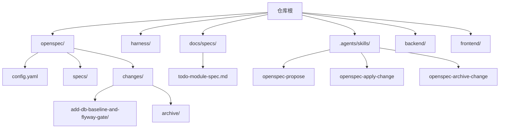
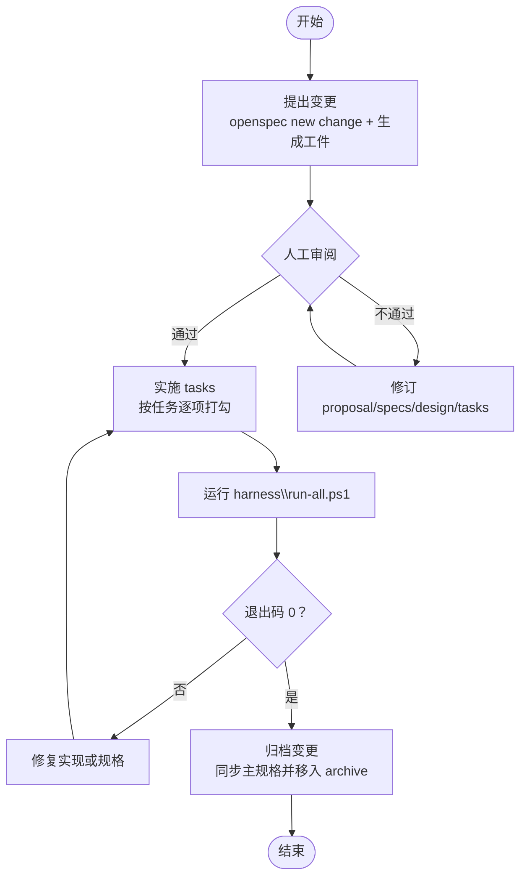
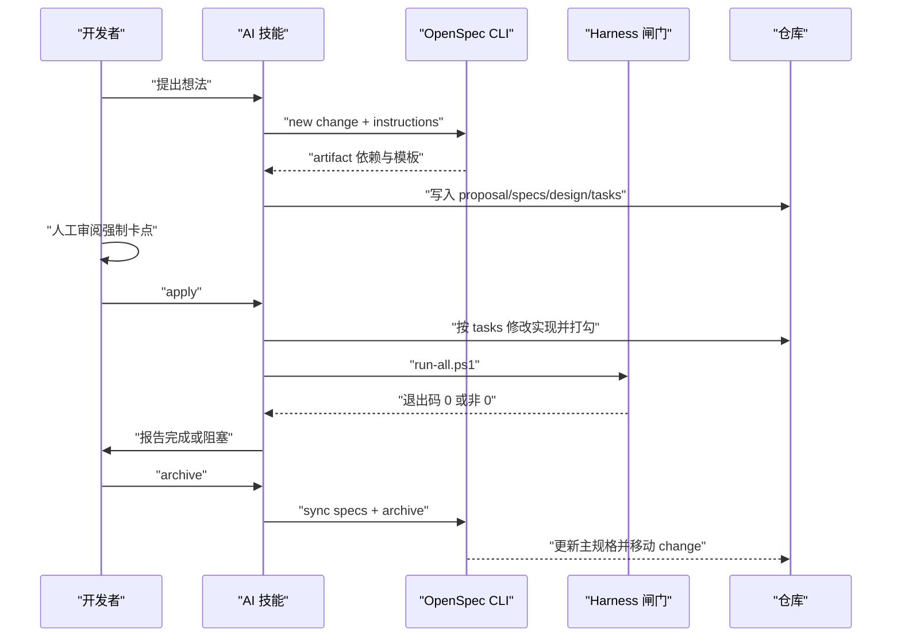
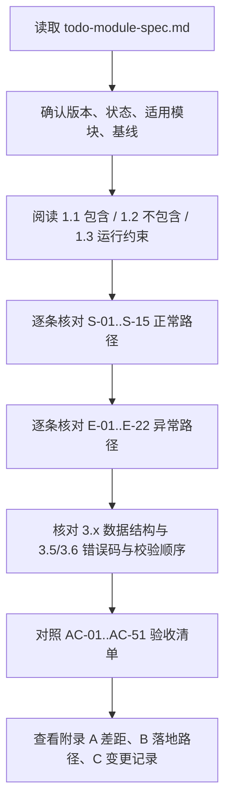
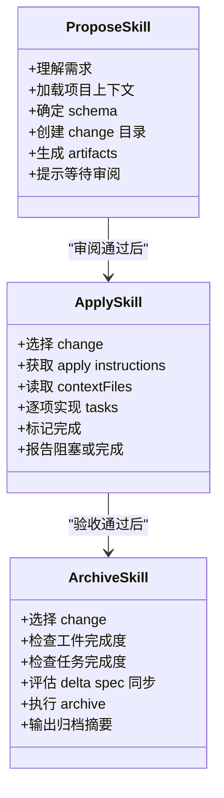
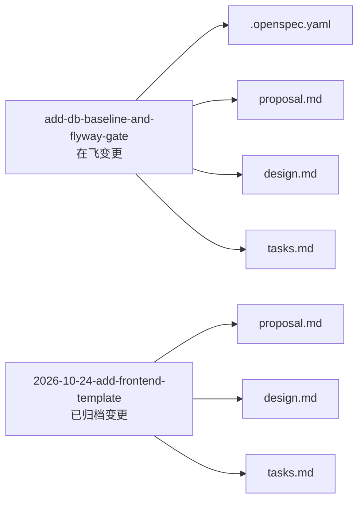
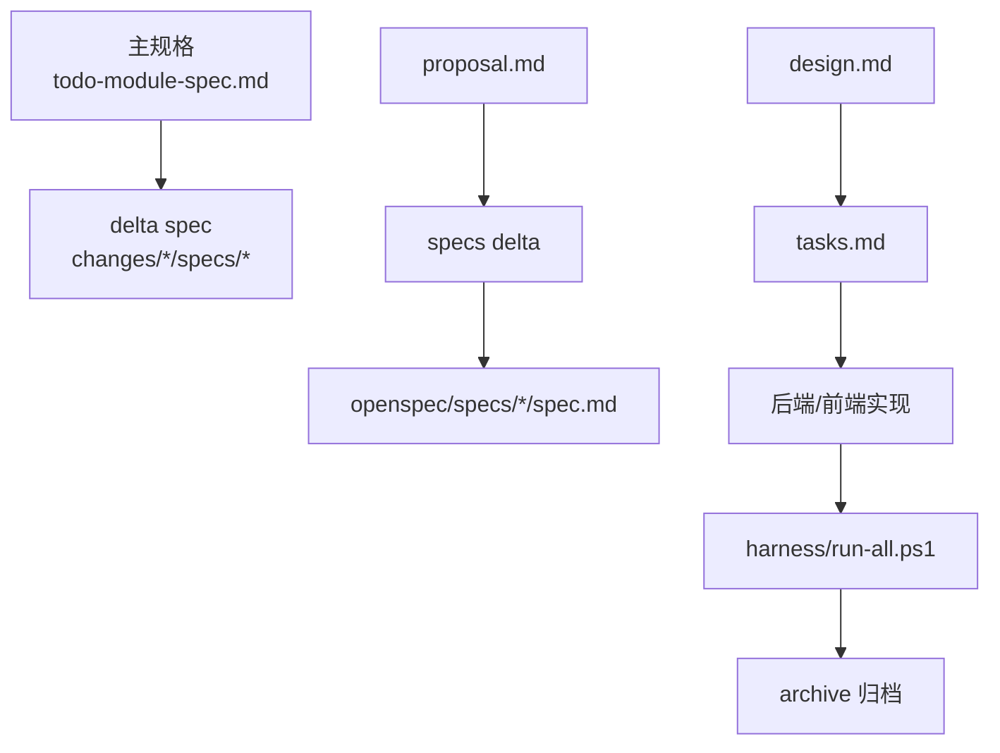

# 规格驱动开发

<cite>
**本文引用的文件**   
- [AGENTS.md](file://AGENTS.md)
- [config.yaml](file://openspec/config.yaml)
- [todo-module-spec.md](file://docs/specs/todo-module-spec.md)
- [SKILL.md（openspec-propose）](file://.agents/skills/openspec-propose/SKILL.md)
- [SKILL.md（openspec-apply-change）](file://.agents/skills/openspec-apply-change/SKILL.md)
- [SKILL.md（openspec-archive-change）](file://.agents/skills/openspec-archive-change/SKILL.md)
- [.openspec.yaml（add-db-baseline-and-flyway-gate）](file://openspec/changes/add-db-baseline-and-flyway-gate/.openspec.yaml)
- [tasks.md（add-db-baseline-and-flyway-gate）](file://openspec/changes/add-db-baseline-and-flyway-gate/tasks.md)
- [proposal.md（2026-10-24-add-frontend-template）](file://openspec/changes/archive/2026-10-24-add-frontend-template/proposal.md)
- [design.md（2026-10-24-add-frontend-template）](file://openspec/changes/archive/2026-10-24-add-frontend-template/design.md)
- [tasks.md（2026-10-24-add-frontend-template）](file://openspec/changes/archive/2026-10-24-add-frontend-template/tasks.md)
</cite>

## 目录
1. [引言](#引言)
2. [项目结构](#项目结构)
3. [核心组件](#核心组件)
4. [架构总览](#架构总览)
5. [详细组件分析](#详细组件分析)
6. [依赖关系分析](#依赖关系分析)
7. [性能与可维护性考虑](#性能与可维护性考虑)
8. [故障排查指南](#故障排查指南)
9. [结论](#结论)
10. [附录：模板、命名约定与版本策略](#附录模板命名约定与版本策略)

## 引言
本指南面向使用 OpenSpec 的“规格驱动开发”实践，目标是让团队用“先写规格、再实施、最后归档”的方式控制需求漂移。仓库采用 spec-driven 工作流，把“工件层（openspec/）—能力层（harness/）—行为层（.agents/skills/）”作为三层护栏：spec 定义要做什么，harness 验证是否合格，skills 规定怎么干才专业。

关键原则：
- 先规格后代码；任何超过拼写级改动都必须有 change。
- 规格不能由实现者单方面修改；发现错误应改 proposal 并说明理由。
- 完成判定以 harness 退出码为准，不以 AI 自述为准。
- 第 ② 步“定规格后的审阅”是整条链路唯一不可省略的人工节点。

**章节来源**
- [AGENTS.md:28-56](file://AGENTS.md#L28-L56)

## 项目结构
仓库围绕 OpenSpec 形成以下关键区域：
- `openspec/config.yaml`：声明 schema 为 spec-driven，并给出语言与结构约束。
- `openspec/specs/`：已归档能力的当前真相（主规格）。
- `openspec/changes/<change-id>/`：在飞变更，包含 proposal、specs delta、design、tasks。
- `openspec/changes/archive/`：历史归档变更，用于审计与回滚依据。
- `docs/specs/todo-module-spec.md`：Todo 模块的目标契约示例，展示完整规格写法。
- `.agents/skills/openspec-*`：propose / apply / archive / sync / update / explore 等行为技能。
- `harness/`：编译、测试、前端、静态红线等闸门脚本。

**图示来源**
- [config.yaml:1-6](file://openspec/config.yaml#L1-L6)
- [todo-module-spec.md:1-14](file://docs/specs/todo-module-spec.md#L1-L14)
- [AGENTS.md:97-119](file://AGENTS.md#L97-L119)

**章节来源**
- [AGENTS.md:97-119](file://AGENTS.md#L97-L119)
- [config.yaml:1-29](file://openspec/config.yaml#L1-L29)

## 核心组件
OpenSpec 在本仓库的核心组件包括：
- 配置：`openspec/config.yaml` 指定 schema 为 spec-driven，并要求所有工件使用中文，但保留英文结构标题与 SHALL/MUST。
- 行为技能：`.agents/skills/openspec-propose`、`openspec-apply-change`、`openspec-archive-change` 分别对应 propose → apply → archive 三阶段。
- 工件：每个 change 至少产出 proposal、specs delta、design、tasks；归档后 specs delta 合并到 `openspec/specs/<capability>/spec.md`。
- 验收：`harness/run-all.ps1` 返回 0 才算完成。

**图示来源**
- [SKILL.md（openspec-propose）:13-25](file://.agents/skills/openspec-propose/SKILL.md#L13-L25)
- [SKILL.md（openspec-apply-change）:105-129](file://.agents/skills/openspec-apply-change/SKILL.md#L105-L129)
- [SKILL.md（openspec-archive-change）:169-206](file://.agents/skills/openspec-archive-change/SKILL.md#L169-L206)
- [AGENTS.md:37-56](file://AGENTS.md#L37-L56)

**章节来源**
- [config.yaml:1-6](file://openspec/config.yaml#L1-L6)
- [SKILL.md（openspec-propose）:13-25](file://.agents/skills/openspec-propose/SKILL.md#L13-L25)
- [SKILL.md（openspec-apply-change）:105-129](file://.agents/skills/openspec-apply-change/SKILL.md#L105-L129)
- [SKILL.md（openspec-archive-change）:169-206](file://.agents/skills/openspec-archive-change/SKILL.md#L169-L206)
- [AGENTS.md:37-56](file://AGENTS.md#L37-L56)

## 架构总览
从“规格驱动”的角度看，仓库不是单纯的前后端工程，而是“规格—实现—验收—归档”的可追溯流水线。

**图示来源**
- [SKILL.md（openspec-propose）:44-156](file://.agents/skills/openspec-propose/SKILL.md#L44-L156)
- [SKILL.md（openspec-apply-change）:32-129](file://.agents/skills/openspec-apply-change/SKILL.md#L32-L129)
- [SKILL.md（openspec-archive-change）:34-206](file://.agents/skills/openspec-archive-change/SKILL.md#L34-L206)
- [AGENTS.md:37-56](file://AGENTS.md#L37-L56)

## 详细组件分析

### Todo 模块规格示例：todo-module-spec.md
该文档是一个完整的“目标契约型规格”，适合用作编写新模块规格的样板。它强调：
- 明确“包含”和“不包含”的能力边界。
- 用 WHEN/THEN/AND 描述正常路径与异常路径。
- 用表格定义数据结构、HTTP 状态码、错误码、校验顺序。
- 用 AC-xx 验收清单区分机械验证 `[M]` 与人工复核 `[H]`。
- 用附录列出“与当前实现的差距”和“变更记录”。

建议阅读顺序：
1. 表头元数据与模块边界。
2. 核心场景 S-xx 与异常场景 E-xx。
3. 数据结构 3.1–3.8。
4. 验收标准 AC-xx。
5. 附录 A/B/C。

**图示来源**
- [todo-module-spec.md:1-14](file://docs/specs/todo-module-spec.md#L1-L14)
- [todo-module-spec.md:16-73](file://docs/specs/todo-module-spec.md#L16-L73)
- [todo-module-spec.md:76-543](file://docs/specs/todo-module-spec.md#L76-L543)
- [todo-module-spec.md:545-651](file://docs/specs/todo-module-spec.md#L545-L651)

**章节来源**
- [todo-module-spec.md:1-14](file://docs/specs/todo-module-spec.md#L1-L14)
- [todo-module-spec.md:16-73](file://docs/specs/todo-module-spec.md#L16-L73)
- [todo-module-spec.md:76-543](file://docs/specs/todo-module-spec.md#L76-L543)
- [todo-module-spec.md:545-651](file://docs/specs/todo-module-spec.md#L545-L651)

### 变更管理流程：propose → 人工审阅 → apply → archive
OpenSpec 的行为技能定义了四个阶段的职责与边界：

- propose：创建 change 目录，生成 proposal、specs delta、design、tasks；只负责规划，不直接改业务代码。
- 人工审阅：AGENTS.md 明确这是唯一不可省略的人工节点。
- apply：读取 tasks，逐项实现并打勾；遇到歧义或设计问题必须暂停。
- archive：检查工件与任务完成度，评估 delta spec 是否需要同步到主规格，然后归档 move 到 archive。

**图示来源**
- [SKILL.md（openspec-propose）:44-156](file://.agents/skills/openspec-propose/SKILL.md#L44-L156)
- [SKILL.md（openspec-apply-change）:32-129](file://.agents/skills/openspec-apply-change/SKILL.md#L32-L129)
- [SKILL.md（openspec-archive-change）:34-206](file://.agents/skills/openspec-archive-change/SKILL.md#L34-L206)
- [AGENTS.md:37-56](file://AGENTS.md#L37-L56)

**章节来源**
- [SKILL.md（openspec-propose）:44-156](file://.agents/skills/openspec-propose/SKILL.md#L44-L156)
- [SKILL.md（openspec-apply-change）:32-129](file://.agents/skills/openspec-apply-change/SKILL.md#L32-L129)
- [SKILL.md（openspec-archive-change）:34-206](file://.agents/skills/openspec-archive-change/SKILL.md#L34-L206)
- [AGENTS.md:37-56](file://AGENTS.md#L37-L56)

### 实际变更记录示例
仓库中既有在飞变更，也有已归档变更，可作为参考：

- 在飞变更：`add-db-baseline-and-flyway-gate`
  - 包含 `.openspec.yaml`、`proposal.md`、`design.md`、`tasks.md`。
  - tasks 明确数据库设计规范、Flyway 接入、第一条迁移、Harness 闸门、入口文档更新与集成验收。
- 已归档变更：`2026-10-24-add-frontend-template`
  - 包含 proposal、design、tasks，体现前端模板引入、vite 代理、前端测试与 04 闸门。

**图示来源**
- [.openspec.yaml（add-db-baseline-and-flyway-gate）:1-3](file://openspec/changes/add-db-baseline-and-flyway-gate/.openspec.yaml#L1-L3)
- [tasks.md（add-db-baseline-and-flyway-gate）:1-40](file://openspec/changes/add-db-baseline-and-flyway-gate/tasks.md#L1-L40)
- [proposal.md（2026-10-24-add-frontend-template）:1-35](file://openspec/changes/archive/2026-10-24-add-frontend-template/proposal.md#L1-L35)
- [design.md（2026-10-24-add-frontend-template）:1-60](file://openspec/changes/archive/2026-10-24-add-frontend-template/design.md#L1-L60)
- [tasks.md（2026-10-24-add-frontend-template）:1-39](file://openspec/changes/archive/2026-10-24-add-frontend-template/tasks.md#L1-L39)

**章节来源**
- [.openspec.yaml（add-db-baseline-and-flyway-gate）:1-3](file://openspec/changes/add-db-baseline-and-flyway-gate/.openspec.yaml#L1-L3)
- [tasks.md（add-db-baseline-and-flyway-gate）:1-40](file://openspec/changes/add-db-baseline-and-flyway-gate/tasks.md#L1-L40)
- [proposal.md（2026-10-24-add-frontend-template）:1-35](file://openspec/changes/archive/2026-10-24-add-frontend-template/proposal.md#L1-L35)
- [design.md（2026-10-24-add-frontend-template）:1-60](file://openspec/changes/archive/2026-10-24-add-frontend-template/design.md#L1-L60)
- [tasks.md（2026-10-24-add-frontend-template）:1-39](file://openspec/changes/archive/2026-10-24-add-frontend-template/tasks.md#L1-L39)

## 依赖关系分析
OpenSpec 工件之间存在明确的依赖关系：
- `apply` 依赖 `tasks` 以及 `tasks` 所依赖的其他 artifact。
- `archive` 依赖 change 的所有 artifact 完成，并可能触发 delta spec 同步到主规格。
- `todo-module-spec.md` 作为主规格示例，其“附录 A 差距”会驱动新的 change。

**图示来源**
- [todo-module-spec.md:615-651](file://docs/specs/todo-module-spec.md#L615-L651)
- [SKILL.md（openspec-propose）:92-139](file://.agents/skills/openspec-propose/SKILL.md#L92-L139)
- [SKILL.md（openspec-apply-change）:41-70](file://.agents/skills/openspec-apply-change/SKILL.md#L41-L70)
- [SKILL.md（openspec-archive-change）:111-167](file://.agents/skills/openspec-archive-change/SKILL.md#L111-L167)

**章节来源**
- [todo-module-spec.md:615-651](file://docs/specs/todo-module-spec.md#L615-L651)
- [SKILL.md（openspec-propose）:92-139](file://.agents/skills/openspec-propose/SKILL.md#L92-L139)
- [SKILL.md（openspec-apply-change）:41-70](file://.agents/skills/openspec-apply-change/SKILL.md#L41-L70)
- [SKILL.md（openspec-archive-change）:111-167](file://.agents/skills/openspec-archive-change/SKILL.md#L111-L167)

## 性能与可维护性考虑
- 规格粒度：一个 change 聚焦一个能力，避免 proposal 过大导致审阅困难。
- 验收优先：每条 Scenario 都应对应 AC-xx，尽量写成 `[M]`，减少主观判断。
- 错误码收敛：如 Todo 规格所示，统一 ErrorResponse，避免框架默认错误泄露内部细节。
- 容量与体积上限：规格提前定义 10,000 条与 16KB 上限，便于 Harness 做断言。
- 并发语义：规格明确 id 唯一、单请求原子、不同字段并发不覆盖，避免实现者自行解释。
- 主规格稳定：只有归档后才合并 delta spec，防止在飞变更污染当前真相。

[本节为通用指导，不直接分析具体文件]

## 故障排查指南
常见故障与处理建议：

- 没有 openspec 根目录
  - 现象：CLI 报 no_openspec_root 或 root 为 null。
  - 处理：仅在用户明确要求时初始化；不要自动创建 openspec/。
- 通过 store 声明但未注册
  - 现象：status 报错 Declared in 或 Invalid store declaration。
  - 处理：停止写入，向用户展示错误 message 与 fix。
- 工件未齐全
  - 现象：apply 指令 state=blocked，missingArtifacts 非空。
  - 处理：先补齐缺失 artifact，再继续实施。
- 任务未完成就归档
  - 现象：archive 检测到 incomplete tasks。
  - 处理：询问用户确认；若确认则带警告归档，否则继续完成。
- delta spec 无法同步
  - 现象：仅有 REMOVED 且无 ADDED，或需要新建主规格但 delta 缺少 Purpose。
  - 处理：根据 archive skill 的规则提示 blocker，不擅自补写需求。

**章节来源**
- [SKILL.md（openspec-propose）:31-40](file://.agents/skills/openspec-propose/SKILL.md#L31-L40)
- [SKILL.md（openspec-apply-change）:65-70](file://.agents/skills/openspec-apply-change/SKILL.md#L65-L70)
- [SKILL.md（openspec-archive-change）:73-109](file://.agents/skills/openspec-archive-change/SKILL.md#L73-L109)
- [SKILL.md（openspec-archive-change）:111-167](file://.agents/skills/openspec-archive-change/SKILL.md#L111-L167)

## 结论
规格驱动开发的核心不是“多写文档”，而是用 OpenSpec 把“想做的东西”变成可审阅、可实施、可验收、可归档的工程工件。Todo 模块规格展示了如何写出边界清晰、异常完备、验收可判定的契约；三个行为技能则把 propose → 审阅 → apply → archive 固化为可重复流程。只要坚持“人工审阅不可省略”“完成只看 harness 退出码”“规格不由实现者单方面改写”，就能有效抑制需求漂移。

[本节为总结，不直接分析具体文件]

## 附录：模板、命名约定与版本策略

### 规格文档结构模板
建议新规格遵循以下结构：
- 表头：版本、状态、适用模块、基线、命名约定。
- 模块边界：包含 / 不包含 / 运行约束。
- 核心场景：正常路径 S-xx，异常路径 E-xx，边界 B-xx。
- 数据结构：实体、请求体、错误响应、HTTP 状态码、错误码、校验顺序。
- 验收标准：AC-xx，标注 [M]/[H]。
- 附录：与实现差距、落地路径、变更记录。

**章节来源**
- [todo-module-spec.md:1-14](file://docs/specs/todo-module-spec.md#L1-L14)
- [todo-module-spec.md:16-73](file://docs/specs/todo-module-spec.md#L16-L73)
- [todo-module-spec.md:76-543](file://docs/specs/todo-module-spec.md#L76-L543)
- [todo-module-spec.md:545-651](file://docs/specs/todo-module-spec.md#L545-L651)

### 命名约定
- JSON 字段名一律 lowerCamelCase。
- 枚举值大写，如 LOW / MEDIUM / HIGH。
- 前后端 Todo 字段逐字一致。
- ErrorResponse 的 code、message 也遵循同一命名规则。

**章节来源**
- [todo-module-spec.md:522-528](file://docs/specs/todo-module-spec.md#L522-L528)

### 版本管理策略
- 规格版本号放在文档表头，例如 v1.0、v1.1、v1.2、v1.2.1。
- 每次重大语义变化升级次版本或补丁版本。
- 变更记录表记录日期、版本、改了什么、为什么。
- 主规格只在归档后由 OpenSpec 同步更新，不在飞变更里直接改主规格。

**章节来源**
- [todo-module-spec.md:3-9](file://docs/specs/todo-module-spec.md#L3-L9)
- [todo-module-spec.md:643-651](file://docs/specs/todo-module-spec.md#L643-L651)

### 审查清单
建议在人工审阅阶段逐项核对：
- 是否明确包含与不包含。
- 是否正常路径与异常路径都覆盖。
- 数据结构是否完整、可空性与默认值是否明确。
- HTTP 状态码与错误码是否一一对应。
- 校验顺序是否唯一、可测试。
- 验收标准是否可机械验证或明确人工复核人。
- 是否与现有实现存在差距，并以 change 形式落地。
- 是否违反 AGENTS.md 硬规则。

**章节来源**
- [AGENTS.md:28-56](file://AGENTS.md#L28-L56)
- [todo-module-spec.md:545-612](file://docs/specs/todo-module-spec.md#L545-L612)