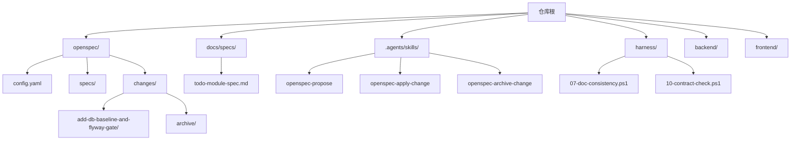
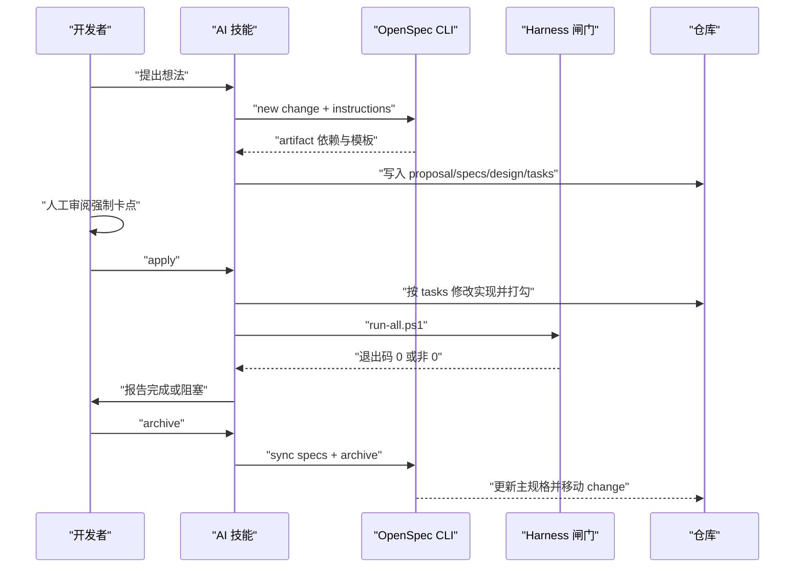
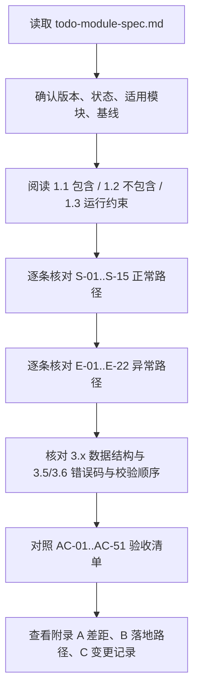
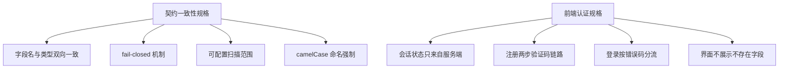
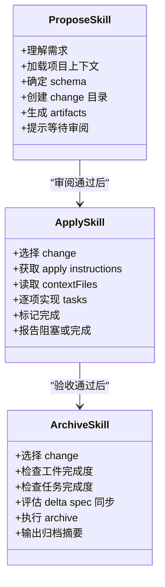
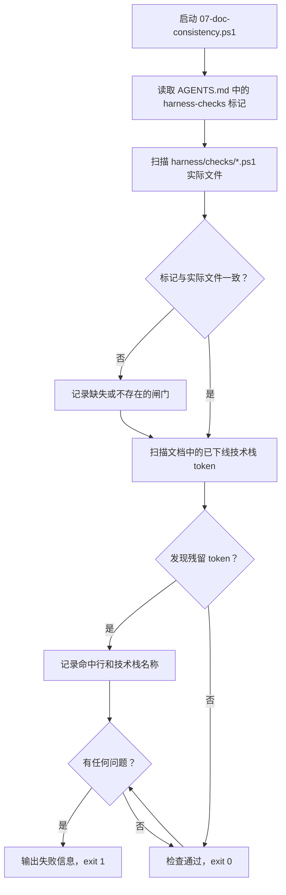
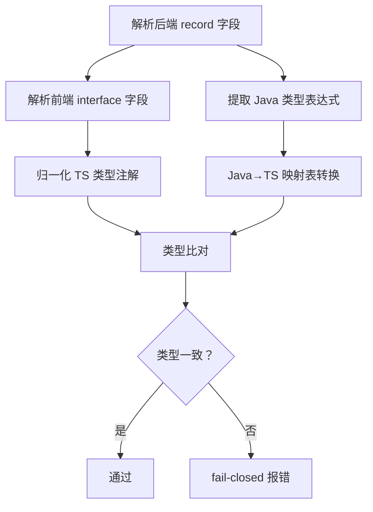
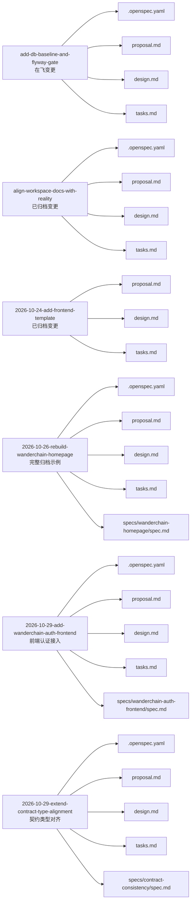
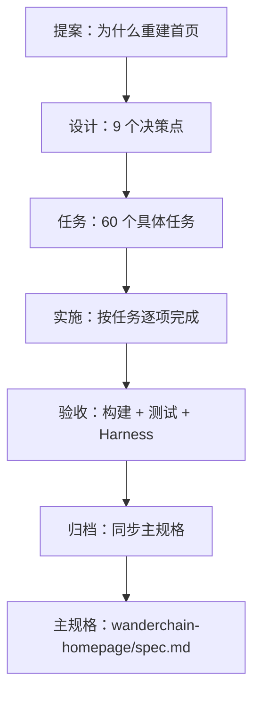
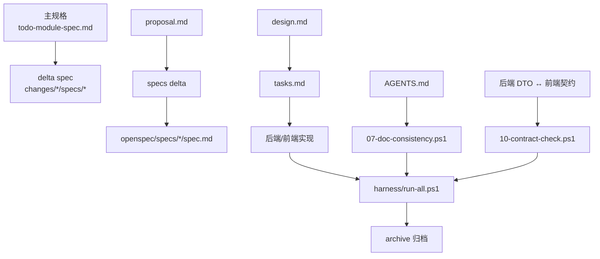

# 规格驱动开发

<cite>
**本文引用的文件**   
- [AGENTS.md](file://AGENTS.md)
- [config.yaml](file://openspec/config.yaml)
- [todo-module-spec.md](file://docs/specs/todo-module-spec.md)
- [SKILL.md（openspec-propose）](file://.agents/skills/openspec-propose/SKILL.md)
- [SKILL.md（openspec-apply-change）](file://.agents/skills/openspec-apply-change/SKILL.md)
- [SKILL.md（openspec-archive-change）](file://.agents/skills/openspec-archive-change/SKILL.md)
- [.openspec.yaml（add-db-baseline-and-flyway-gate）](file://openspec/changes/add-db-baseline-and-flyway-gate/.openspec.yaml)
- [tasks.md（add-db-baseline-and-flyway-gate）](file://openspec/changes/add-db-baseline-and-flyway-gate/tasks.md)
- [proposal.md（2026-10-24-add-frontend-template）](file://openspec/changes/archive/2026-10-24-add-frontend-template/proposal.md)
- [design.md（2026-10-24-add-frontend-template）](file://openspec/changes/archive/2026-10-24-add-frontend-template/design.md)
- [tasks.md（2026-10-24-add-frontend-template）](file://openspec/changes/archive/2026-10-24-add-frontend-template/tasks.md)
- [.openspec.yaml（2026-10-26-rebuild-wanderchain-homepage）](file://openspec/changes/archive/2026-10-26-rebuild-wanderchain-homepage/.openspec.yaml)
- [proposal.md（2026-10-26-rebuild-wanderchain-homepage）](file://openspec/changes/archive/2026-10-26-rebuild-wanderchain-homepage/proposal.md)
- [design.md（2026-10-26-rebuild-wanderchain-homepage）](file://openspec/changes/archive/2026-10-26-rebuild-wanderchain-homepage/design.md)
- [tasks.md（2026-10-26-rebuild-wanderchain-homepage）](file://openspec/changes/archive/2026-10-26-rebuild-wanderchain-homepage/tasks.md)
- [spec.md（wanderchain-homepage）](file://openspec/specs/wanderchain-homepage/spec.md)
- [spec.md（frontend-nextjs）](file://openspec/specs/frontend-nextjs/spec.md)
- [.openspec.yaml（align-workspace-docs-with-reality）](file://openspec/changes/archive/2026-10-26-align-workspace-docs-with-reality/.openspec.yaml)
- [proposal.md（align-workspace-docs-with-reality）](file://openspec/changes/archive/2026-10-26-align-workspace-docs-with-reality/proposal.md)
- [design.md（align-workspace-docs-with-reality）](file://openspec/changes/archive/2026-10-26-align-workspace-docs-with-reality/design.md)
- [tasks.md（align-workspace-docs-with-reality）](file://openspec/changes/archive/2026-10-26-align-workspace-docs-with-reality/tasks.md)
- [07-doc-consistency.ps1](file://harness/checks/07-doc-consistency.ps1)
- [spec.md（contract-consistency）](file://openspec/specs/contract-consistency/spec.md)
- [spec.md（wanderchain-auth-frontend）](file://openspec/specs/wanderchain-auth-frontend/spec.md)
- [.openspec.yaml（2026-10-29-add-wanderchain-auth-frontend）](file://openspec/changes/archive/2026-10-29-add-wanderchain-auth-frontend/.openspec.yaml)
- [proposal.md（2026-10-29-add-wanderchain-auth-frontend）](file://openspec/changes/archive/2026-10-29-add-wanderchain-auth-frontend/proposal.md)
- [design.md（2026-10-29-add-wanderchain-auth-frontend）](file://openspec/changes/archive/2026-10-29-add-wanderchain-auth-frontend/design.md)
- [tasks.md（2026-10-29-add-wanderchain-auth-frontend）](file://openspec/changes/archive/2026-10-29-add-wanderchain-auth-frontend/tasks.md)
- [.openspec.yaml（2026-10-29-extend-contract-type-alignment）](file://openspec/changes/archive/2026-10-29-extend-contract-type-alignment/.openspec.yaml)
- [proposal.md（2026-10-29-extend-contract-type-alignment）](file://openspec/changes/archive/2026-10-29-extend-contract-type-alignment/proposal.md)
- [design.md（2026-10-29-extend-contract-type-alignment）](file://openspec/changes/archive/2026-10-29-extend-contract-type-alignment/design.md)
- [tasks.md（2026-10-29-extend-contract-type-alignment）](file://openspec/changes/archive/2026-10-29-extend-contract-type-alignment/tasks.md)
- [10-contract-check.ps1](file://harness/checks/10-contract-check.ps1)
</cite>

## 更新摘要
**所做更改**   
- 新增契约一致性规格文档（contract-consistency/spec.md）与前端认证规格文档（wanderchain-auth-frontend/spec.md）作为规格驱动开发的实践案例
- 完善了变更管理流程示例，增加两个重要的归档变更：添加前端认证和扩展契约类型对齐
- 增强了闸门体系说明，新增第10道契约一致性闸门，实现字段名与类型的双向静态比对
- 强化了规格模板和最佳实践，展示跨模块工作区级护栏行为的编写方式

## 目录
1. [引言](#引言)
2. [项目结构](#项目结构)
3. [核心组件](#核心组件)
4. [架构总览](#架构总览)
5. [详细组件分析](#详细组件分析)
6. [依赖关系分析](#依赖关系分析)
7. [性能与可维护性考虑](#性能与可维护性考虑)
8. [故障排查指南](#故障排查指南)
9. [结论](#结论)
10. [附录：模板、命名约定与版本策略](#附录模板命名约定与版本策略)

## 引言
本指南面向使用 OpenSpec 的"规格驱动开发"实践，目标是让团队用"先写规格、再实施、最后归档"的方式控制需求漂移。仓库采用 spec-driven 工作流，把"工件层（openspec/）—能力层（harness/）—行为层（.agents/skills/）"作为三层护栏：spec 定义要做什么，harness 验证是否合格，skills 规定怎么干才专业。

关键原则：
- 先规格后代码；任何超过拼写级改动都必须有 change。
- 规格不能由实现者单方面修改；发现错误应改 proposal 并说明理由。
- 完成判定以 harness 退出码为准，不以 AI 自述为准。
- 第 ② 步"定规格后的审阅"是整条链路唯一不可省略的人工节点。
- **文档必须与实现保持同步**：通过自动化闸门检测文档漂移，防止 AI 按错误地图行动。

**章节来源**
- [AGENTS.md:28-56](file://AGENTS.md#L28-L56)

## 项目结构
仓库围绕 OpenSpec 形成以下关键区域：
- `openspec/config.yaml`：声明 schema 为 spec-driven，并给出语言与结构约束。
- `openspec/specs/`：已归档能力的当前真相（主规格），包括新增的契约一致性和前端认证规格。
- `openspec/changes/<change-id>/`：在飞变更，包含 proposal、specs delta、design、tasks。
- `openspec/changes/archive/`：历史归档变更，用于审计与回滚依据。
- `docs/specs/todo-module-spec.md`：Todo 模块的目标契约示例，展示完整规格写法。
- `.agents/skills/openspec-*`：propose / apply / archive / sync / update / explore 等行为技能。
- `harness/`：编译、测试、前端、静态红线等闸门脚本，包括新增的文档一致性闸门和契约一致性闸门。

**图示来源**
- [config.yaml:1-6](file://openspec/config.yaml#L1-L6)
- [todo-module-spec.md:1-14](file://docs/specs/todo-module-spec.md#L1-L14)
- [AGENTS.md:97-119](file://AGENTS.md#L97-L119)
- [07-doc-consistency.ps1:1-79](file://harness/checks/07-doc-consistency.ps1#L1-L79)
- [10-contract-check.ps1:1-6](file://harness/checks/10-contract-check.ps1#L1-L6)

**章节来源**
- [AGENTS.md:97-119](file://AGENTS.md#L97-L119)
- [config.yaml:1-29](file://openspec/config.yaml#L1-L29)

## 核心组件
OpenSpec 在本仓库的核心组件包括：
- 配置：`openspec/config.yaml` 指定 schema 为 spec-driven，并要求所有工件使用中文，但保留英文结构标题与 SHALL/MUST。
- 行为技能：`.agents/skills/openspec-propose`、`openspec-apply-change`、`openspec-archive-change` 分别对应 propose → apply → archive 三阶段。
- 工件：每个 change 至少产出 proposal、specs delta、design、tasks；归档后 specs delta 合并到 `openspec/specs/<capability>/spec.md`。
- 验收：`harness/run-all.ps1` 返回 0 才算完成，包括新增的文档一致性检查和契约一致性检查。

**图示来源**
- [SKILL.md（openspec-propose）:13-25](file://.agents/skills/openspec-propose/SKILL.md#L13-L25)
- [SKILL.md（openspec-apply-change）:105-129](file://.agents/skills/openspec-apply-change/SKILL.md#L105-L129)
- [SKILL.md（openspec-archive-change）:169-206](file://.agents/skills/openspec-archive-change/SKILL.md#L169-L206)
- [AGENTS.md:37-56](file://AGENTS.md#L37-L56)

**章节来源**
- [config.yaml:1-6](file://openspec/config.yaml#L1-L6)
- [SKILL.md（openspec-propose）:13-25](file://.agents/skills/openspec-propose/SKILL.md#L13-L25)
- [SKILL.md（openspec-apply-change）:105-129](file://.agents/skills/openspec-apply-change/SKILL.md#L105-L129)
- [SKILL.md（openspec-archive-change）:169-206](file://.agents/skills/openspec-archive-change/SKILL.md#L169-L206)
- [AGENTS.md:37-56](file://AGENTS.md#L37-L56)

## 架构总览
从"规格驱动"的角度看，仓库不是单纯的前后端工程，而是"规格—实现—验收—归档"的可追溯流水线。

**图示来源**
- [SKILL.md（openspec-propose）:44-156](file://.agents/skills/openspec-propose/SKILL.md#L44-L156)
- [SKILL.md（openspec-apply-change）:32-129](file://.agents/skills/openspec-apply-change/SKILL.md#L32-L129)
- [SKILL.md（openspec-archive-change）:34-206](file://.agents/skills/openspec-archive-change/SKILL.md#L34-L206)
- [AGENTS.md:37-56](file://AGENTS.md#L37-L56)

## 详细组件分析

### Todo 模块规格示例：todo-module-spec.md
该文档是一个完整的"目标契约型规格"，适合用作编写新模块规格的样板。它强调：
- 明确"包含"和"不包含"的能力边界。
- 用 WHEN/THEN/AND 描述正常路径与异常路径。
- 用表格定义数据结构、HTTP 状态码、错误码、校验顺序。
- 用 AC-xx 验收清单区分机械验证 `[M]` 与人工复核 `[H]`。
- 用附录列出"与当前实现的差距"和"变更记录"。

建议阅读顺序：
1. 表头元数据与模块边界。
2. 核心场景 S-xx 与异常场景 E-xx。
3. 数据结构 3.1–3.8。
4. 验收标准 AC-xx。
5. 附录 A/B/C。

**图示来源**
- [todo-module-spec.md:1-14](file://docs/specs/todo-module-spec.md#L1-L14)
- [todo-module-spec.md:16-73](file://docs/specs/todo-module-spec.md#L16-L73)
- [todo-module-spec.md:76-543](file://docs/specs/todo-module-spec.md#L76-L543)
- [todo-module-spec.md:545-651](file://docs/specs/todo-module-spec.md#L545-L651)

**章节来源**
- [todo-module-spec.md:1-14](file://docs/specs/todo-module-spec.md#L1-L14)
- [todo-module-spec.md:16-73](file://docs/specs/todo-module-spec.md#L16-L73)
- [todo-module-spec.md:76-543](file://docs/specs/todo-module-spec.md#L76-L543)
- [todo-module-spec.md:545-651](file://docs/specs/todo-module-spec.md#L545-L651)

### 新增规格文档：契约一致性与前端认证

#### 契约一致性规格（contract-consistency/spec.md）
这是仓库中新增的工作区级护栏规格，专门保证前后端出站契约的一致性：

- **Purpose**：保证前后端出站契约在字段名与字段类型两个维度上始终一致，以后端 DTO 为真源，前端契约文件逐字镜像。
- **Requirements**：包含字段名与类型双向一致、未覆盖类型 fail-closed、受管范围可配置、字段命名风格强制 camelCase 等核心要求。
- **Scenarios**：每个 Requirement 都有具体的 WHEN/THEN 场景，如两侧完全一致时通过、字段类型漂移被判失败等。

#### 前端认证规格（wanderchain-auth-frontend/spec.md）
这是前端认证接入的完整规格，定义了会话管理、注册登录流程等前端行为：

- **Purpose**：TBD - created by archiving change add-wanderchain-auth-frontend
- **Requirements**：会话状态只来自服务端、注册走两步验证码链路、登录按错误码分流、界面不展示后端不存在的字段等。
- **Scenarios**：详细的用户交互场景，如已登录用户刷新页面仍是登录态、无会话时展示登录入口等。

**图示来源**
- [spec.md（contract-consistency）:3-68](file://openspec/specs/contract-consistency/spec.md#L3-L68)
- [spec.md（wanderchain-auth-frontend）:3-108](file://openspec/specs/wanderchain-auth-frontend/spec.md#L3-L108)

**章节来源**
- [spec.md（contract-consistency）:1-68](file://openspec/specs/contract-consistency/spec.md#L1-L68)
- [spec.md（wanderchain-auth-frontend）:1-108](file://openspec/specs/wanderchain-auth-frontend/spec.md#L1-L108)

### 变更管理流程：propose → 人工审阅 → apply → archive
OpenSpec 的行为技能定义了四个阶段的职责与边界：

- propose：创建 change 目录，生成 proposal、specs delta、design、tasks；只负责规划，不直接改业务代码。
- 人工审阅：AGENTS.md 明确这是唯一不可省略的人工节点。
- apply：读取 tasks，逐项实现并打勾；遇到歧义或设计问题必须暂停。
- archive：检查工件与任务完成度，评估 delta spec 是否需要同步到主规格，然后归档 move 到 archive。

**图示来源**
- [SKILL.md（openspec-propose）:44-156](file://.agents/skills/openspec-propose/SKILL.md#L44-L156)
- [SKILL.md（openspec-apply-change）:32-129](file://.agents/skills/openspec-apply-change/SKILL.md#L32-L129)
- [SKILL.md（openspec-archive-change）:34-206](file://.agents/skills/openspec-archive-change/SKILL.md#L34-L206)
- [AGENTS.md:37-56](file://AGENTS.md#L37-L56)

**章节来源**
- [SKILL.md（openspec-propose）:44-156](file://.agents/skills/openspec-propose/SKILL.md#L44-L156)
- [SKILL.md（openspec-apply-change）:32-129](file://.agents/skills/openspec-apply-change/SKILL.md#L32-L129)
- [SKILL.md（openspec-archive-change）:34-206](file://.agents/skills/openspec-archive-change/SKILL.md#L34-L206)
- [AGENTS.md:37-56](file://AGENTS.md#L37-L56)

### 文档一致性闸门：确保文档与实现同步
新增的 `07-doc-consistency.ps1` 闸门是规格驱动开发的重要增强，专门解决"文档不会自己跟上代码"的问题。

#### 闸门功能
- **闸门清单验证**：比对 `AGENTS.md` 中的 `<!-- harness-checks: ... -->` 标记与实际 `harness/checks/*.ps1` 文件集合
- **技术栈残留检测**：扫描文档中已下线技术栈的残留 token（如 `App.vue`、`TodoApp`、`Todo 界面`）
- **自动拦截机制**：不一致时退出码 1，全程不交互，符合 AGENTS.md §8 约定

#### 工作原理

**图示来源**
- [07-doc-consistency.ps1:24-51](file://harness/checks/07-doc-consistency.ps1#L24-L51)
- [07-doc-consistency.ps1:53-67](file://harness/checks/07-doc-consistency.ps1#L53-L67)

**章节来源**
- [07-doc-consistency.ps1:1-79](file://harness/checks/07-doc-consistency.ps1#L1-L79)

### 契约一致性闸门：字段名与类型的双重保障
新增的 `10-contract-check.ps1` 闸门实现了前后端契约的双重保护：

#### 核心功能
- **字段名双向比对**：确保后端 record 组件名与前端 interface 字段名完全一致
- **字段类型映射校验**：Java↔TS 类型映射表，表外类型 fail-closed
- **命名风格强制**：双侧 camelCase 命名规范
- **可配置扫描范围**：支持多模块契约对，无需修改比对逻辑

#### 实现机制

**图示来源**
- [10-contract-check.ps1:24-40](file://harness/checks/10-contract-check.ps1#L24-L40)
- [10-contract-check.ps1:42-70](file://harness/checks/10-contract-check.ps1#L42-L70)
- [10-contract-check.ps1:165-185](file://harness/checks/10-contract-check.ps1#L165-L185)

**章节来源**
- [10-contract-check.ps1:1-199](file://harness/checks/10-contract-check.ps1#L1-L199)

### 实际变更记录示例
仓库中既有在飞变更，也有已归档变更，可作为参考：

#### 在飞变更：add-db-baseline-and-flyway-gate
- 包含 `.openspec.yaml`、`proposal.md`、`design.md`、`tasks.md`。
- tasks 明确数据库设计规范、Flyway 接入、第一条迁移、Harness 闸门、入口文档更新与集成验收。

#### 已归档变更：align-workspace-docs-with-reality（文档一致性增强）
这是一个展示规格驱动开发工作流增强的典型案例，现已成功归档：

- **skip_specs 模式**：由于只修正文档与闸门元信息，不改变系统行为，使用 `skip_specs: true`
- **文档对齐**：重写 `AGENTS.md` §6 目录地图，删除已不存在的文件引用，补全现有结构
- **闸门清单机器可读化**：新增 `<!-- harness-checks: ... -->` 标记，供自动化检查
- **新增文档一致性闸门**：`07-doc-consistency.ps1` 自动检测文档漂移
- **清理遗留物**：删除 Vite 构建产物、空目录等未跟踪文件

#### 已归档变更：2026-10-24-add-frontend-template
- 包含 proposal、design、tasks，体现前端模板引入、vite 代理、前端测试与 04 闸门。

#### 已归档变更：2026-10-26-rebuild-wanderchain-homepage（完整归档示例）
这是一个完整的规格驱动开发案例，展示了从提案到归档的全流程：

- **提案阶段**：明确为什么要重建 wanderchain 首页，删除 Todo 示例界面，新增 9 个前端单元。
- **设计决策**：9 个单元共享 Mock 数据契约，城市状态走 URL 参数，认证为前端 Mock，样式用 CSS Modules。
- **任务分解**：60 个具体任务，涵盖契约层、清理旧界面、功能导航、AI 助手、城市切换、内容区块、Mock 认证等。
- **规格同步**：归档后将 `wanderchain-homepage` 能力的主规格同步到 `openspec/specs/wanderchain-homepage/spec.md`。
- **影响范围**：修改了 `frontend-nextjs` 主规格 Purpose，从 Todo 界面改为 wanderchain 首页。

#### 新增归档变更：2026-10-29-add-wanderchain-auth-frontend（前端认证接入）
这是前端认证功能的完整实现，解决了后端认证能力已归档但前端未接入的问题：

- **Why**：后端 `wanderchain-auth` 已归档但前端一行没接，存在生产不可用、端到端链路未验证、字段名漂移等问题。
- **What Changes**：代理层透传认证相关请求头、契约层新增前端认证字段镜像、认证客户端实现真实 API 调用。
- **Capabilities**：新增 `wanderchain-auth-frontend` 能力，修改 `frontend-nextjs` 能力。
- **Impact**：涉及前端代码、测试、闸门与文档的全面更新。

#### 新增归档变更：2026-10-29-extend-contract-type-alignment（契约类型对齐增强）
这是对契约一致性闸门的增强，从字段名比对扩展到字段类型比对：

- **Why**：现有闸门只做字段名比对，不做字段类型比对，导致类型漂移无法被静态检测。
- **What Changes**：扩展闸门增加 Java↔TS 类型映射校验，实现 fail-closed 机制，扫描范围可配置。
- **Capabilities**：新增 `contract-consistency` 能力，提供跨模块的契约一致性保障。
- **Impact**：主要影响 harness 脚本、契约注释与文档，不影响运行时行为。

**图示来源**
- [.openspec.yaml（add-db-baseline-and-flyway-gate）:1-3](file://openspec/changes/add-db-baseline-and-flyway-gate/.openspec.yaml#L1-L3)
- [.openspec.yaml（align-workspace-docs-with-reality）:1-4](file://openspec/changes/archive/2026-10-26-align-workspace-docs-with-reality/.openspec.yaml#L1-L4)
- [.openspec.yaml（2026-10-24-add-frontend-template）:1-3](file://openspec/changes/archive/2026-10-24-add-frontend-template/.openspec.yaml#L1-L3)
- [.openspec.yaml（2026-10-26-rebuild-wanderchain-homepage）:1-3](file://openspec/changes/archive/2026-10-26-rebuild-wanderchain-homepage/.openspec.yaml#L1-L3)
- [.openspec.yaml（2026-10-29-add-wanderchain-auth-frontend）:1-3](file://openspec/changes/archive/2026-10-29-add-wanderchain-auth-frontend/.openspec.yaml#L1-L3)
- [.openspec.yaml（2026-10-29-extend-contract-type-alignment）:1-3](file://openspec/changes/archive/2026-10-29-extend-contract-type-alignment/.openspec.yaml#L1-L3)

**章节来源**
- [.openspec.yaml（add-db-baseline-and-flyway-gate）:1-3](file://openspec/changes/add-db-baseline-and-flyway-gate/.openspec.yaml#L1-L3)
- [.openspec.yaml（align-workspace-docs-with-reality）:1-4](file://openspec/changes/archive/2026-10-26-align-workspace-docs-with-reality/.openspec.yaml#L1-L4)
- [.openspec.yaml（2026-10-24-add-frontend-template）:1-3](file://openspec/changes/archive/2026-10-24-add-frontend-template/.openspec.yaml#L1-L3)
- [.openspec.yaml（2026-10-26-rebuild-wanderchain-homepage）:1-3](file://openspec/changes/archive/2026-10-26-rebuild-wanderchain-homepage/.openspec.yaml#L1-L3)
- [.openspec.yaml（2026-10-29-add-wanderchain-auth-frontend）:1-3](file://openspec/changes/archive/2026-10-29-add-wanderchain-auth-frontend/.openspec.yaml#L1-L3)
- [.openspec.yaml（2026-10-29-extend-contract-type-alignment）:1-3](file://openspec/changes/archive/2026-10-29-extend-contract-type-alignment/.openspec.yaml#L1-L3)

### Wanderchain 首页重建：完整归档流程示例
wanderchain 首页重建变更展示了规格驱动开发的完整工作流程：

#### 提案阶段（Proposal）
- **Why**：前端仍是脚手架自带的 Todo 示例界面，与 wanderchain 产品形态无关，且后端 API 尚未立项。
- **What Changes**：删除 Todo 示例界面，新增 9 个前端单元，全部以 Mock 数据为唯一数据源。
- **Capabilities**：新增 `wanderchain-homepage` 能力，修改 `frontend-nextjs` 能力。
- **Impact**：明确影响范围，保留基础设施，指定验收路径。

#### 设计阶段（Design）
- **Context**：Next.js 16.4.3 + React 19.3.1，无 UI 库，测试链为 vitest + jsdom + Testing Library。
- **Goals/Non-Goals**：9 个单元独立开发测试交付，不新增 npm 依赖，不实现真实 API。
- **Decisions**：9 个决策点，包括能力划分、Mock 仓储、URL 参数、Mock 认证、CSS Modules 等。
- **Risks/Trade-offs**：Mock 与真实 API 形状漂移、外链图片不可达、Mock 认证虚假安全感等风险。

#### 任务阶段（Tasks）
- **60 个具体任务**：从契约层到规格维护，每个任务都有明确的完成标准。
- **单元化组织**：按功能单元分组，便于独立开发和测试。
- **验收标准**：构建成功、测试通过、Harness 全绿、规格验证有效。

#### 规格同步（Spec Sync）
归档后自动生成 `wanderchain-homepage` 主规格，包含：
- Purpose：为 wanderchain 提供可独立开发、独立测试、独立交付的首页。
- Requirements：契约与 Mock 数据层、Mock 认证、首页骨架与区块编排等 9 个核心需求。
- Scenarios：每个需求下的具体场景，使用 WHEN/THEN 格式描述。

**图示来源**
- [proposal.md（2026-10-26-rebuild-wanderchain-homepage）:1-39](file://openspec/changes/archive/2026-10-26-rebuild-wanderchain-homepage/proposal.md#L1-L39)
- [design.md（2026-10-26-rebuild-wanderchain-homepage）:1-52](file://openspec/changes/archive/2026-10-26-rebuild-wanderchain-homepage/design.md#L1-L52)
- [tasks.md（2026-10-26-rebuild-wanderchain-homepage）:1-60](file://openspec/changes/archive/2026-10-26-rebuild-wanderchain-homepage/tasks.md#L1-L60)
- [spec.md（wanderchain-homepage）:1-204](file://openspec/specs/wanderchain-homepage/spec.md#L1-L204)

**章节来源**
- [proposal.md（2026-10-26-rebuild-wanderchain-homepage）:1-39](file://openspec/changes/archive/2026-10-26-rebuild-wanderchain-homepage/proposal.md#L1-L39)
- [design.md（2026-10-26-rebuild-wanderchain-homepage）:1-52](file://openspec/changes/archive/2026-10-26-rebuild-wanderchain-homepage/design.md#L1-L52)
- [tasks.md（2026-10-26-rebuild-wanderchain-homepage）:1-60](file://openspec/changes/archive/2026-10-26-rebuild-wanderchain-homepage/tasks.md#L1-L60)
- [spec.md（wanderchain-homepage）:1-204](file://openspec/specs/wanderchain-homepage/spec.md#L1-L204)

## 依赖关系分析
OpenSpec 工件之间存在明确的依赖关系：
- `apply` 依赖 `tasks` 以及 `tasks` 所依赖的其他 artifact。
- `archive` 依赖 change 的所有 artifact 完成，并可能触发 delta spec 同步到主规格。
- `todo-module-spec.md` 作为主规格示例，其"附录 A 差距"会驱动新的 change。
- **文档一致性闸门**依赖 `AGENTS.md` 中的 harness-checks 标记与实际闸门文件集合。
- **契约一致性闸门**依赖后端 DTO 与前端契约文件的配对关系。

**图示来源**
- [todo-module-spec.md:615-651](file://docs/specs/todo-module-spec.md#L615-L651)
- [SKILL.md（openspec-propose）:92-139](file://.agents/skills/openspec-propose/SKILL.md#L92-L139)
- [SKILL.md（openspec-apply-change）:41-70](file://.agents/skills/openspec-apply-change/SKILL.md#L41-L70)
- [SKILL.md（openspec-archive-change）:111-167](file://.agents/skills/openspec-archive-change/SKILL.md#L111-L167)
- [07-doc-consistency.ps1:24-51](file://harness/checks/07-doc-consistency.ps1#L24-L51)
- [10-contract-check.ps1:13-22](file://harness/checks/10-contract-check.ps1#L13-L22)

**章节来源**
- [todo-module-spec.md:615-651](file://docs/specs/todo-module-spec.md#L615-L651)
- [SKILL.md（openspec-propose）:92-139](file://.agents/skills/openspec-propose/SKILL.md#L92-L139)
- [SKILL.md（openspec-apply-change）:41-70](file://.agents/skills/openspec-apply-change/SKILL.md#L41-L70)
- [SKILL.md（openspec-archive-change）:111-167](file://.agents/skills/openspec-archive-change/SKILL.md#L111-L167)
- [07-doc-consistency.ps1:24-51](file://harness/checks/07-doc-consistency.ps1#L24-L51)
- [10-contract-check.ps1:13-22](file://harness/checks/10-contract-check.ps1#L13-L22)

## 性能与可维护性考虑
- 规格粒度：一个 change 聚焦一个能力，避免 proposal 过大导致审阅困难。
- 验收优先：每条 Scenario 都应对应 AC-xx，尽量写成 `[M]`，减少主观判断。
- 错误码收敛：如 Todo 规格所示，统一 ErrorResponse，避免框架默认错误泄露内部细节。
- 容量与体积上限：规格提前定义 10,000 条与 16KB 上限，便于 Harness 做断言。
- 并发语义：规格明确 id 唯一、单请求原子、不同字段并发不覆盖，避免实现者自行解释。
- 主规格稳定：只有归档后才合并 delta spec，防止在飞变更污染当前真相。
- **文档同步自动化**：通过 07-doc-consistency 闸门自动检测文档漂移，防止 AI 按错误地图行动。
- **契约一致性保障**：通过 10-contract-check 闸门确保前后端字段名与类型双重一致，支持可配置的扫描范围。

[本节为通用指导，不直接分析具体文件]

## 故障排查指南
常见故障与处理建议：

- 没有 openspec 根目录
  - 现象：CLI 报 no_openspec_root 或 root 为 null。
  - 处理：仅在用户明确要求时初始化；不要自动创建 openspec/。
- 通过 store 声明但未注册
  - 现象：status 报错 Declared in 或 Invalid store declaration。
  - 处理：停止写入，向用户展示错误 message 与 fix。
- 工件未齐全
  - 现象：apply 指令 state=blocked，missingArtifacts 非空。
  - 处理：先补齐缺失 artifact，再继续实施。
- 任务未完成就归档
  - 现象：archive 检测到 incomplete tasks。
  - 处理：询问用户确认；若确认则带警告归档，否则继续完成。
- delta spec 无法同步
  - 现象：仅有 REMOVED 且无 ADDED，或需要新建主规格但 delta 缺少 Purpose。
  - 处理：根据 archive skill 的规则提示 blocker，不擅自补写需求。
- **文档一致性检查失败**
  - 现象：`07-doc-consistency.ps1` 退出码 1，报告闸门清单不匹配或发现已下线技术栈 token。
  - 处理：更新 `AGENTS.md` 中的 `<!-- harness-checks: ... -->` 标记，或删除文档中的残留 token。
- **契约一致性检查失败**
  - 现象：`10-contract-check.ps1` 退出码 1，报告字段名不匹配、类型不一致或映射表未覆盖。
  - 处理：同步前后端字段名、修正 TypeScript 类型声明、扩充 Java↔TS 映射表。
- **skip_specs 模式误用**
  - 现象：变更实际上改变了系统行为，却使用了 `skip_specs: true`。
  - 处理：移除 skip_specs 标志，补充相应的 specs delta 和主规格更新。

**章节来源**
- [SKILL.md（openspec-propose）:31-40](file://.agents/skills/openspec-propose/SKILL.md#L31-L40)
- [SKILL.md（openspec-apply-change）:65-70](file://.agents/skills/openspec-apply-change/SKILL.md#L65-L70)
- [SKILL.md（openspec-archive-change）:73-109](file://.agents/skills/openspec-archive-change/SKILL.md#L73-L109)
- [SKILL.md（openspec-archive-change）:111-167](file://.agents/skills/openspec-archive-change/SKILL.md#L111-L167)
- [07-doc-consistency.ps1:69-79](file://harness/checks/07-doc-consistency.ps1#L69-L79)
- [10-contract-check.ps1:190-198](file://harness/checks/10-contract-check.ps1#L190-L198)

## 结论
规格驱动开发的核心不是"多写文档"，而是用 OpenSpec 把"想做的东西"变成可审阅、可实施、可验收、可归档的工程工件。Todo 模块规格展示了如何写出边界清晰、异常完备、验收可判定的契约；三个行为技能则把 propose → 审阅 → apply → archive 固化为可重复流程。wanderchain 首页重建变更更是完整展示了从提案到归档的全流程，体现了规格驱动开发的完整工作流程。

**新增的文档一致性闸门和契约一致性闸门**进一步增强了这一流程，通过自动化检查确保文档与实现始终保持同步，防止 AI 按错误的地图行动，同时保证前后端契约的字段名与类型双重一致性。只要坚持"人工审阅不可省略""完成只看 harness 退出码""规格不由实现者单方面改写""文档必须与实现同步""契约必须保持一致性"，就能有效抑制需求漂移，建立真正可靠的规格驱动开发体系。

**章节来源**
- [spec.md（contract-consistency）:1-68](file://openspec/specs/contract-consistency/spec.md#L1-L68)
- [spec.md（wanderchain-auth-frontend）:1-108](file://openspec/specs/wanderchain-auth-frontend/spec.md#L1-L108)
- [10-contract-check.ps1:1-199](file://harness/checks/10-contract-check.ps1#L1-L199)

## 附录：模板、命名约定与版本策略

### 规格文档结构模板
建议新规格遵循以下结构：
- 表头：版本、状态、适用模块、基线、命名约定。
- 模块边界：包含 / 不包含 / 运行约束。
- 核心场景：正常路径 S-xx，异常路径 E-xx，边界 B-xx。
- 数据结构：实体、请求体、错误响应、HTTP 状态码、错误码、校验顺序。
- 验收标准：AC-xx，标注 [M]/[H]。
- 附录：与实现差距、落地路径、变更记录。

**章节来源**
- [todo-module-spec.md:1-14](file://docs/specs/todo-module-spec.md#L1-L14)
- [todo-module-spec.md:16-73](file://docs/specs/todo-module-spec.md#L16-L73)
- [todo-module-spec.md:76-543](file://docs/specs/todo-module-spec.md#L76-L543)
- [todo-module-spec.md:545-651](file://docs/specs/todo-module-spec.md#L545-L651)

### 命名约定
- JSON 字段名一律 lowerCamelCase。
- 枚举值大写，如 LOW / MEDIUM / HIGH。
- 前后端 Todo 字段逐字一致。
- ErrorResponse 的 code、message 也遵循同一命名规则。

**章节来源**
- [todo-module-spec.md:522-528](file://docs/specs/todo-module-spec.md#L522-L528)

### 版本管理策略
- 规格版本号放在文档表头，例如 v1.0、v1.1、v1.2、v1.2.1。
- 每次重大语义变化升级次版本或补丁版本。
- 变更记录表记录日期、版本、改了什么、为什么。
- 主规格只在归档后由 OpenSpec 同步更新，不在在飞变更里直接改主规格。

**章节来源**
- [todo-module-spec.md:3-9](file://docs/specs/todo-module-spec.md#L3-L9)
- [todo-module-spec.md:643-651](file://docs/specs/todo-module-spec.md#L643-L651)

### 审查清单
建议在人工审阅阶段逐项核对：
- 是否明确包含与不包含。
- 是否正常路径与异常路径都覆盖。
- 数据结构是否完整、可空性与默认值是否明确。
- HTTP 状态码与错误码是否一一对应。
- 校验顺序是否唯一、可测试。
- 验收标准是否可机械验证或明确人工复核人。
- 是否与现有实现存在差距，并以 change 形式落地。
- 是否违反 AGENTS.md 硬规则。
- **文档是否与实现保持一致**：检查是否有遗漏的文档更新需求。
- **契约是否保持一致**：检查前后端字段名与类型是否同步。

**章节来源**
- [AGENTS.md:28-56](file://AGENTS.md#L28-L56)
- [todo-module-spec.md:545-612](file://docs/specs/todo-module-spec.md#L545-L612)

### 归档变更最佳实践
基于 wanderchain 首页重建、文档一致性增强、前端认证接入和契约类型对齐的经验，归档变更应遵循以下最佳实践：

#### 变更命名规范
- 使用日期前缀：`YYYY-MM-DD-`
- 动词开头：`rebuild-`、`add-`、`migrate-`、`align-`、`extend-`
- 描述清晰：`rebuild-wanderchain-homepage`、`align-workspace-docs-with-reality`、`add-wanderchain-auth-frontend`、`extend-contract-type-alignment`

#### 工件完整性
- `.openspec.yaml`：schema 和创建日期，必要时设置 `skip_specs: true`
- `proposal.md`：Why、What Changes、Capabilities、Impact
- `design.md`：Context、Goals/Non-Goals、Decisions、Risks/Trade-offs
- `tasks.md`：详细的任务分解，每个任务都有完成标准

#### 规格同步
- 归档后自动生成主规格到 `openspec/specs/<capability>/spec.md`
- 主规格使用 WHEN/THEN 格式描述场景
- 保持规格的可测试性和可验证性

#### 文档一致性保障
- 使用 `<!-- harness-checks: ... -->` 标记维护机器可读的闸门清单
- 及时更新文档中的技术栈引用，避免残留 token
- 通过 07-doc-consistency 闸门自动验证文档与实现的一致性

#### 契约一致性保障
- 维护 Java↔TS 类型映射表，确保表外类型 fail-closed
- 使用可配置的扫描清单支持多模块契约对
- 强制双侧 camelCase 命名风格
- 定期运行 10-contract-check 闸门进行静态验证

**章节来源**
- [.openspec.yaml（2026-10-26-rebuild-wanderchain-homepage）:1-3](file://openspec/changes/archive/2026-10-26-rebuild-wanderchain-homepage/.openspec.yaml#L1-L3)
- [.openspec.yaml（align-workspace-docs-with-reality）:1-4](file://openspec/changes/archive/2026-10-26-align-workspace-docs-with-reality/.openspec.yaml#L1-L4)
- [.openspec.yaml（2026-10-29-add-wanderchain-auth-frontend）:1-3](file://openspec/changes/archive/2026-10-29-add-wanderchain-auth-frontend/.openspec.yaml#L1-L3)
- [.openspec.yaml（2026-10-29-extend-contract-type-alignment）:1-3](file://openspec/changes/archive/2026-10-29-extend-contract-type-alignment/.openspec.yaml#L1-L3)
- [proposal.md（2026-10-26-rebuild-wanderchain-homepage）:1-39](file://openspec/changes/archive/2026-10-26-rebuild-wanderchain-homepage/proposal.md#L1-L39)
- [proposal.md（align-workspace-docs-with-reality）:1-41](file://openspec/changes/archive/2026-10-26-align-workspace-docs-with-reality/proposal.md#L1-L41)
- [proposal.md（2026-10-29-add-wanderchain-auth-frontend）:1-50](file://openspec/changes/archive/2026-10-29-add-wanderchain-auth-frontend/proposal.md#L1-L50)
- [proposal.md（2026-10-29-extend-contract-type-alignment）:1-31](file://openspec/changes/archive/2026-10-29-extend-contract-type-alignment/proposal.md#L1-L31)
- [design.md（2026-10-26-rebuild-wanderchain-homepage）:1-52](file://openspec/changes/archive/2026-10-26-rebuild-wanderchain-homepage/design.md#L1-L52)
- [design.md（align-workspace-docs-with-reality）:1-87](file://openspec/changes/archive/2026-10-26-align-workspace-docs-with-reality/design.md#L1-L87)
- [design.md（2026-10-29-add-wanderchain-auth-frontend）:1-76](file://openspec/changes/archive/2026-10-29-add-wanderchain-auth-frontend/design.md#L1-L76)
- [design.md（2026-10-29-extend-contract-type-alignment）:1-88](file://openspec/changes/archive/2026-10-29-extend-contract-type-alignment/design.md#L1-L88)
- [tasks.md（2026-10-26-rebuild-wanderchain-homepage）:1-60](file://openspec/changes/archive/2026-10-26-rebuild-wanderchain-homepage/tasks.md#L1-L60)
- [tasks.md（align-workspace-docs-with-reality）:1-35](file://openspec/changes/archive/2026-10-26-align-workspace-docs-with-reality/tasks.md#L1-L35)
- [tasks.md（2026-10-29-add-wanderchain-auth-frontend）:1-55](file://openspec/changes/archive/2026-10-29-add-wanderchain-auth-frontend/tasks.md#L1-L55)
- [tasks.md（2026-10-29-extend-contract-type-alignment）:1-32](file://openspec/changes/archive/2026-10-29-extend-contract-type-alignment/tasks.md#L1-L32)
- [spec.md（wanderchain-homepage）:1-204](file://openspec/specs/wanderchain-homepage/spec.md#L1-L204)
- [spec.md（contract-consistency）:1-68](file://openspec/specs/contract-consistency/spec.md#L1-L68)
- [spec.md（wanderchain-auth-frontend）:1-108](file://openspec/specs/wanderchain-auth-frontend/spec.md#L1-L108)
- [07-doc-consistency.ps1:1-79](file://harness/checks/07-doc-consistency.ps1#L1-L79)
- [10-contract-check.ps1:1-199](file://harness/checks/10-contract-check.ps1#L1-L199)