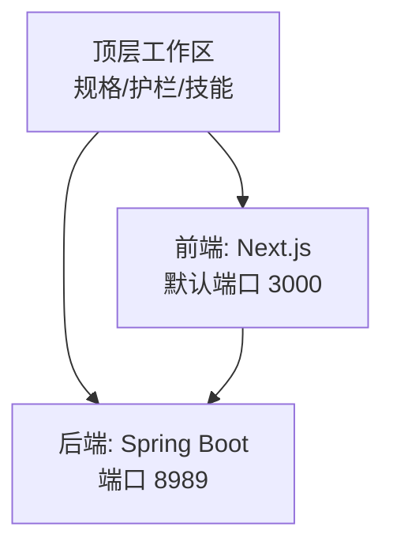
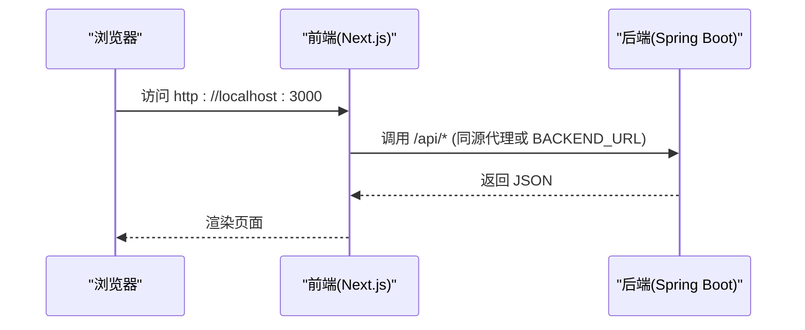
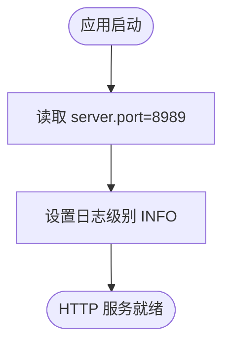
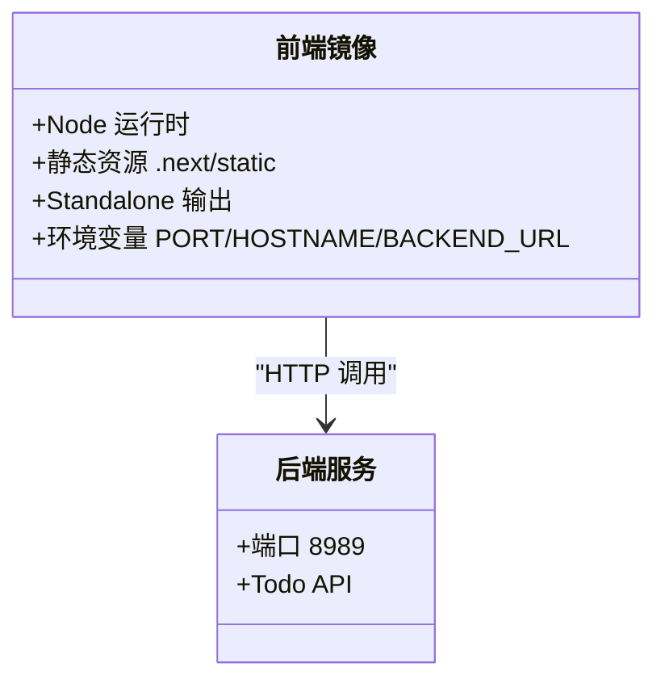
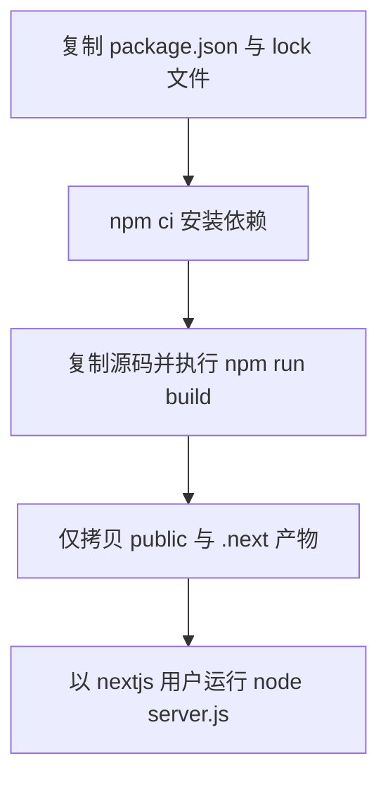
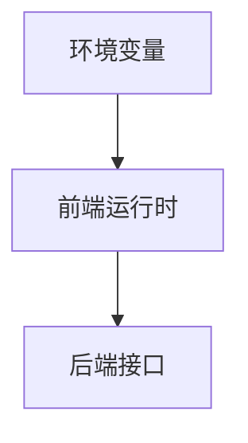
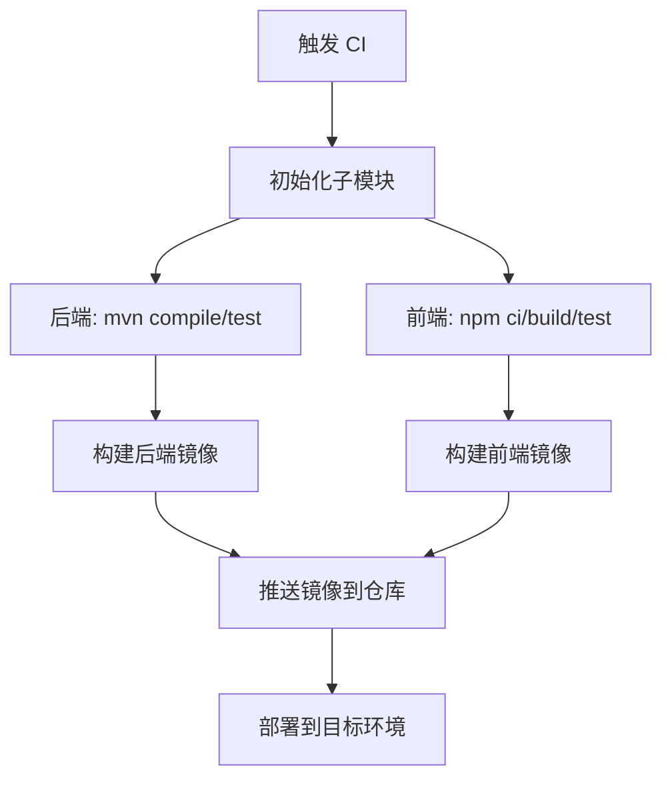

# 部署指南

<cite>
**本文引用的文件**   
- [README.md](file://README.md)
- [backend/pom.xml](file://backend/pom.xml)
- [backend/src/main/resources/application.yml](file://backend/src/main/resources/application.yml)
- [frontend/package.json](file://frontend/package.json)
- [frontend/Dockerfile](file://frontend/Dockerfile)
</cite>

## 目录
1. [简介](#简介)
2. [项目结构](#项目结构)
3. [核心组件](#核心组件)
4. [架构总览](#架构总览)
5. [详细组件分析](#详细组件分析)
6. [依赖与版本要求](#依赖与版本要求)
7. [容器化与编排](#容器化与编排)
8. [环境变量与配置管理](#环境变量与配置管理)
9. [CI/CD 流水线示例](#cicd-流水线示例)
10. [监控、日志与性能调优](#监控日志与性能调优)
11. [安全加固](#安全加固)
12. [故障排除](#故障排除)
13. [结论](#结论)

## 简介
本指南面向生产环境，说明如何在本工作区中部署后端（Spring Boot）与前端（Next.js），并给出 Docker 镜像构建、容器编排与服务发现建议。同时覆盖环境变量与敏感信息管理、CI/CD 自动化、监控日志、性能调优与安全加固等运维最佳实践。

## 项目结构
本仓库采用“顶层工作区 + 子模块”的组织方式：
- 顶层负责规格、护栏与工作流；
- `backend/` 为独立 Spring Boot 应用；
- `frontend/` 为独立 Next.js 应用；
- 两者通过 Git submodule 解耦，便于独立提交、发布与版本锁定。

**图示来源**
- [README.md:1-101](file://README.md#L1-L101)

**章节来源**
- [README.md:1-101](file://README.md#L1-L101)

## 核心组件
- 后端服务：基于 Spring Boot Web，默认监听 8989 端口，提供 Todo 相关接口。
- 前端服务：基于 Next.js，开发模式提供 API 代理到后端；生产模式以 Standalone 输出运行。
- 构建工具：Maven（后端）、npm/Next（前端）。
- 容器化：前端已提供 Dockerfile；后端可参考相同思路构建镜像。

**章节来源**
- [backend/src/main/resources/application.yml:1-13](file://backend/src/main/resources/application.yml#L1-L13)
- [frontend/package.json:1-34](file://frontend/package.json#L1-L34)
- [frontend/Dockerfile:1-27](file://frontend/Dockerfile#L1-L27)

## 架构总览
下图展示本地开发与生产部署的访问路径与组件关系。

**图示来源**
- [frontend/Dockerfile:17-18](file://frontend/Dockerfile#L17-L18)
- [backend/src/main/resources/application.yml:2-3](file://backend/src/main/resources/application.yml#L2-L3)

## 详细组件分析

### 后端服务（Spring Boot）
- 启动端口：8989
- 应用名：my-first-project
- 日志级别：INFO（根日志）
- 构建插件：spring-boot-maven-plugin
- 数据库迁移：Flyway Maven 插件仅作为迁移工具使用，不引入运行期依赖

**图示来源**
- [backend/src/main/resources/application.yml:2-12](file://backend/src/main/resources/application.yml#L2-L12)

**章节来源**
- [backend/src/main/resources/application.yml:1-13](file://backend/src/main/resources/application.yml#L1-L13)
- [backend/pom.xml:39-44](file://backend/pom.xml#L39-L44)
- [backend/pom.xml:45-70](file://backend/pom.xml#L45-L70)

### 前端服务（Next.js）
- 运行时 Node 版本：>=20.9.0
- 开发脚本：next dev
- 构建脚本：next build
- 生产启动：next start
- 测试：vitest run
- 容器镜像：多阶段构建，暴露 3000 端口，通过 BACKEND_URL 指定后端地址

**图示来源**
- [frontend/package.json:6-13](file://frontend/package.json#L6-L13)
- [frontend/Dockerfile:1-27](file://frontend/Dockerfile#L1-L27)

**章节来源**
- [frontend/package.json:1-34](file://frontend/package.json#L1-L34)
- [frontend/Dockerfile:1-27](file://frontend/Dockerfile#L1-L27)

## 依赖与版本要求
- JDK：17+（后端编译与运行）
- Maven：3.9+
- Node.js：20.19+（构建与 CLI），工程最低要求 >=20.9.0
- Git：2.x（子模块）
- 数据库：当前未引入运行期数据库依赖；Flyway 插件仅用于迁移工具链

**章节来源**
- [README.md:83-89](file://README.md#L83-L89)
- [backend/pom.xml:21-25](file://backend/pom.xml#L21-L25)
- [backend/pom.xml:45-70](file://backend/pom.xml#L45-L70)
- [frontend/package.json:6-8](file://frontend/package.json#L6-L8)

## 容器化与编排

### 前端镜像构建
- 基础镜像：node:24-alpine（多阶段构建）
- 构建阶段：安装依赖、执行 next build
- 运行阶段：以非 root 用户 nextjs 运行，暴露 3000 端口
- 关键环境变量：
  - NODE_ENV=production
  - PORT=3000
  - HOSTNAME=0.0.0.0
  - BACKEND_URL=http://localhost:8989（可通过 docker run -e 覆盖）

**图示来源**
- [frontend/Dockerfile:1-27](file://frontend/Dockerfile#L1-L27)

**章节来源**
- [frontend/Dockerfile:1-27](file://frontend/Dockerfile#L1-L27)

### 后端镜像构建（建议）
- 基础镜像：建议使用 OpenJDK 17 官方镜像（如 eclipse-temurin:17-jre-alpine）
- 构建阶段：mvn clean package 生成可执行 jar
- 运行阶段：java -jar 启动，暴露 8989 端口
- 健康检查：可结合 Spring Boot Actuator 或自定义端点

（本节为通用建议，不直接引用具体代码文件）

### 容器编排与服务发现
- 推荐编排：Kubernetes Deployment + Service，或使用 Docker Compose 进行本地集成
- 服务发现：
  - Kubernetes：Service DNS 解析
  - Docker Compose：同网络内凭服务名访问
- 反向代理：Nginx/Traefik 统一入口，按路径路由至前后端服务

（本节为通用建议，不直接引用具体代码文件）

## 环境变量与配置管理

### 前端环境变量
- BACKEND_URL：后端服务地址，容器启动时通过 -e 注入
- PORT：服务监听端口（默认 3000）
- HOSTNAME：绑定地址（默认 0.0.0.0）

**图示来源**
- [frontend/Dockerfile:14-18](file://frontend/Dockerfile#L14-L18)

**章节来源**
- [frontend/Dockerfile:14-18](file://frontend/Dockerfile#L14-L18)

### 后端配置
- application.yml 中定义 server.port、spring.application.name、logging.level.root
- 生产环境建议通过外部配置文件或环境变量覆盖（例如 spring.config.import 或命令行参数）

**章节来源**
- [backend/src/main/resources/application.yml:1-13](file://backend/src/main/resources/application.yml#L1-L13)

### 敏感信息管理
- 不要将密钥硬编码进镜像或源码
- 推荐使用平台提供的 Secret 管理（Kubernetes Secret、Docker Secrets、云厂商密钥管理服务）
- 在容器启动时通过环境变量注入敏感值，并在应用层按需加载

（本节为通用建议，不直接引用具体代码文件）

## CI/CD 流水线示例

### 总体流程
- 拉取代码与子模块
- 后端：Maven 编译与单元测试
- 前端：依赖安装、构建与单元测试
- 构建镜像：后端与前端分别打镜像
- 推送镜像：推送到镜像仓库
- 部署：更新 K8s/Compose 配置并滚动发布

（本节为通用建议，不直接引用具体代码文件）

### 关键步骤说明
- 子模块初始化：确保克隆时包含 backend 与 frontend 子模块
- 后端构建：使用 Maven 3.9+，JDK 17+
- 前端构建：Node.js >=20.9.0，使用 npm ci 保证锁文件一致性
- 镜像构建：复用现有前端 Dockerfile；后端参考建议方案
- 部署策略：蓝绿或金丝雀发布，配合健康检查与回滚机制

（本节为通用建议，不直接引用具体代码文件）

## 监控、日志与性能调优

### 日志
- 后端：根日志级别 INFO，可按需调整包级别日志
- 前端：生产模式下关注 Next.js 标准输出
- 建议：集中采集（如 ELK/Loki），结构化日志，关联请求 ID

**章节来源**
- [backend/src/main/resources/application.yml:10-12](file://backend/src/main/resources/application.yml#L10-L12)

### 指标与健康检查
- 后端：可启用 Actuator 暴露 /actuator/health 等端点
- 前端：可提供简单健康页或依赖反向代理探测
- 编排层：配置 liveness/readiness 探针

（本节为通用建议，不直接引用具体代码文件）

### 性能调优
- JVM：根据容器内存限制设置堆大小与 GC 参数
- Node：合理设置并发线程数与缓存策略
- 静态资源：开启 CDN 与缓存头
- 连接池：数据库连接池参数按负载调优（接入数据库后）

（本节为通用建议，不直接引用具体代码文件）

## 安全加固
- 最小权限：容器以非 root 用户运行（前端已使用 nextjs 用户）
- 镜像安全：定期扫描镜像漏洞，使用精简基础镜像
- 网络安全：仅暴露必要端口，使用 Ingress/网关限流与鉴权
- 配置安全：敏感信息走 Secret 管理，避免明文写入镜像与环境变量清单
- 传输安全：强制 HTTPS，启用 HSTS，校验证书链

**章节来源**
- [frontend/Dockerfile:19-24](file://frontend/Dockerfile#L19-L24)

## 故障排除

- 前端无法访问后端
  - 检查 BACKEND_URL 是否正确指向后端服务
  - 确认后端服务端口与可达性
  - 若使用反向代理，检查路径重写规则

  **章节来源**
  - [frontend/Dockerfile:17-18](file://frontend/Dockerfile#L17-L18)

- 后端端口冲突
  - 修改 application.yml 中的 server.port 或在容器启动时通过配置中心注入

  **章节来源**
  - [backend/src/main/resources/application.yml:2-3](file://backend/src/main/resources/application.yml#L2-L3)

- 子模块为空导致构建失败
  - 重新初始化子模块：git submodule update --init --recursive

  **章节来源**
  - [README.md:23-27](file://README.md#L23-L27)

- 前端构建失败（Node 版本不匹配）
  - 升级 Node.js 至 >=20.9.0，并确保 CI 环境与本地一致

  **章节来源**
  - [frontend/package.json:6-8](file://frontend/package.json#L6-L8)

- 镜像体积过大
  - 使用多阶段构建与精简基础镜像（前端已采用 alpine）
  - 清理不必要的构建中间产物

  **章节来源**
  - [frontend/Dockerfile:1-27](file://frontend/Dockerfile#L1-L27)

## 结论
本指南总结了生产环境下的依赖版本、容器化与编排、配置与敏感信息管理、CI/CD 流水线以及监控、性能与安全等运维要点。请结合团队基础设施与合规要求落地实施，并在变更过程中持续验证与回归。