# 项目概述

<cite>
**本文引用的文件**   
- [README.md](file://README.md)
- [AGENTS.md](file://AGENTS.md)
- [openspec/config.yaml](file://openspec/config.yaml)
- [harness/run-all.ps1](file://harness/run-all.ps1)
- [harness/checks/00-submodule-check.ps1](file://harness/checks/00-submodule-check.ps1)
- [harness/checks/03-static-guard.ps1](file://harness/checks/03-static-guard.ps1)
- [.agents/skills/systematic-debugging/SKILL.md](file://.agents/skills/systematic-debugging/SKILL.md)
- [.agents/skills/verification-before-completion/SKILL.md](file://.agents/skills/verification-before-completion/SKILL.md)
- [openspec/specs/workspace-layout/spec.md](file://openspec/specs/workspace-layout/spec.md)
- [openspec/specs/workspace-scaffold/spec.md](file://openspec/specs/workspace-scaffold/spec.md)
</cite>

## 目录
1. [引言](#引言)
2. [项目结构](#项目结构)
3. [核心组件](#核心组件)
4. [架构总览](#架构总览)
5. [详细组件分析](#详细组件分析)
6. [依赖关系分析](#依赖关系分析)
7. [性能与可重复性](#性能与可重复性)
8. [快速开始指南](#快速开始指南)
9. [常见使用场景](#常见使用场景)
10. [设计取舍说明](#设计取舍说明)
11. [故障排查指南](#故障排查指南)
12. [结论](#结论)

## 引言
AIWorkSpace 是一个顶层工作区，目标不是实现复杂的业务功能，而是把 **SDD（规格驱动开发）+ Harness（验证护栏）+ Skills（技能）** 三层落地为可执行、可验证、可追溯的工程实践。它用 `openspec/` 固定意图，用 `harness/` 行使否决权，用 `.agents/skills/` 固化方法；`backend/` 与 `frontend/` 只是被编排的两个独立 git 子模块，用来承载最小业务载体 Todo，而不是本仓库的核心价值所在。

一句话定位：**这个仓库的价值不在后端和前端代码，在让 AI 编码变得可验证、可追溯、边界清晰。**

**章节来源**
- [README.md:1-19](file://README.md#L1-L19)
- [AGENTS.md:7-15](file://AGENTS.md#L7-L15)

## 项目结构
AIWorkSpace 采用“顶层工作区 + 两个独立子模块”的结构：

| 路径 | 角色 | 关键职责 |
|---|---|---|
| `openspec/` | 工件层 | 固定需求、能力与变更历史 |
| `harness/` | 能力层 | 以退出码提供编译、测试、静态红线、前端构建与工作区改名演练的统一验收 |
| `.agents/skills/` | 行为层 | 固化系统化排障与先证后宣布的方法 |
| `backend/` | 子模块 | Spring Boot 后端，Todo 领域模型与控制器 |
| `frontend/` | 子模块 | Next.js 前端，界面与同源 API 代理 |
| `scaffold/` | 工具 | 分发后第一步的工作区身份改名脚本 |
| `.gitmodules` | 配置 | 锁定两个子模块的远程地址与提交指针 |
| `AGENTS.md` | 契约 | AI 进入仓库的唯一入口规则 |
| `README.md` | 文档 | 面向人的快速上手与设计说明 |

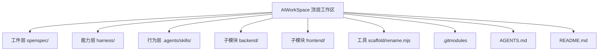

**图表来源**
- [AGENTS.md:72-119](file://AGENTS.md#L72-L119)
- [README.md:70-81](file://README.md#L70-L81)

**章节来源**
- [AGENTS.md:72-119](file://AGENTS.md#L72-L119)
- [README.md:70-81](file://README.md#L70-L81)

## 核心组件
AIWorkSpace 的核心不是某个类或接口，而是三层协作机制：

1. **工件层（openspec/）**  
   用 `config.yaml` 声明 schema 与上下文，用 `specs/` 沉淀已归档能力，用 `changes/` 管理在飞变更。它回答“要做什么、为什么做”，并约束需求漂移与审计缺失。

2. **能力层（harness/）**  
   通过 `run-all.ps1` 按文件名顺序执行六道闸门：子模块检查、后端编译、后端测试、静态红线、前端构建测试、工作区改名演练。任一非零退出码即阻断流程。

3. **行为层（.agents/skills/）**  
   自研技能强制 AI 在报错时走系统化排障四阶段，在宣称完成前跑命令、看退出码、贴证据、写未覆盖项。OpenSpec 相关技能由工具生成，但自研技能以 `.agents/skills/` 为真源，再同步到各 AI 工具适配层。

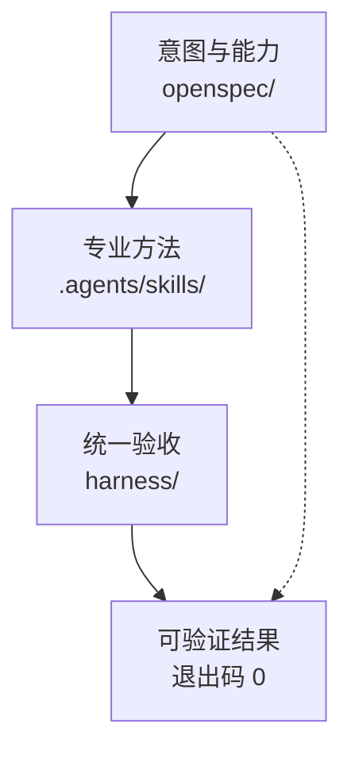

**图表来源**
- [AGENTS.md:16-26](file://AGENTS.md#L16-L26)
- [harness/run-all.ps1:1-20](file://harness/run-all.ps1#L1-L20)
- [.agents/skills/systematic-debugging/SKILL.md:1-6](file://.agents/skills/systematic-debugging/SKILL.md#L1-L6)
- [.agents/skills/verification-before-completion/SKILL.md:1-6](file://.agents/skills/verification-before-completion/SKILL.md#L1-L6)

**章节来源**
- [openspec/config.yaml:1-6](file://openspec/config.yaml#L1-L6)
- [AGENTS.md:16-26](file://AGENTS.md#L16-L26)
- [harness/run-all.ps1:1-20](file://harness/run-all.ps1#L1-L20)

## 架构总览
AIWorkSpace 的整体控制流是“人类定意图 → AI 按技能实施 → 护栏以退出码裁决”。

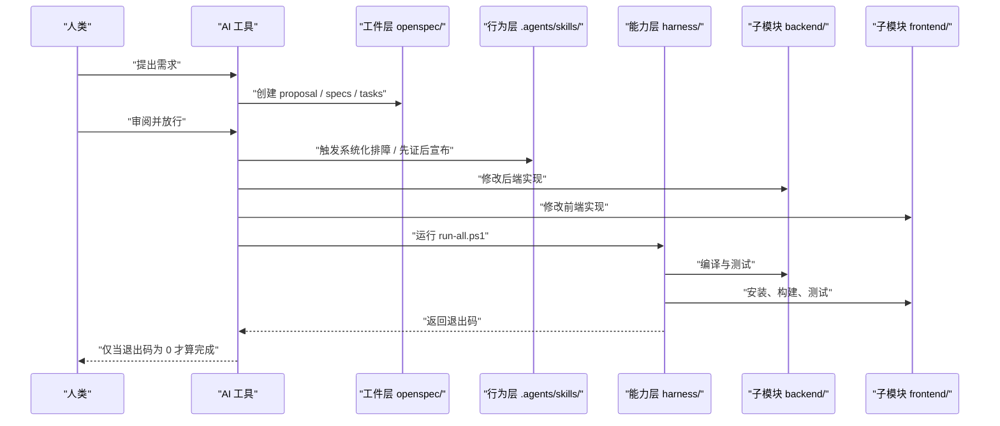

**图表来源**
- [AGENTS.md:37-58](file://AGENTS.md#L37-L58)
- [harness/run-all.ps1:1-20](file://harness/run-all.ps1#L1-L20)
- [README.md:61-68](file://README.md#L61-L68)

## 详细组件分析

### 工件层：openspec/
`openspec/config.yaml` 将工作区规范模式设为 `spec-driven`，并要求所有工件使用中文，同时保留英文结构标题与 SHALL/MUST 关键词。这使 OpenSpec 产物既便于 AI 理解，又保持工程化关键字的可解析性。

当前已归档的能力包括：
- `workspace-layout`：前后端以 submodule 挂载、子模块独立构建身份、未初始化时验收失败、提交边界、远程地址可替换。
- `workspace-scaffold`：工作区改名只改自身展示名与 slug，不改应用身份，且改名结果可被残留扫描验证。

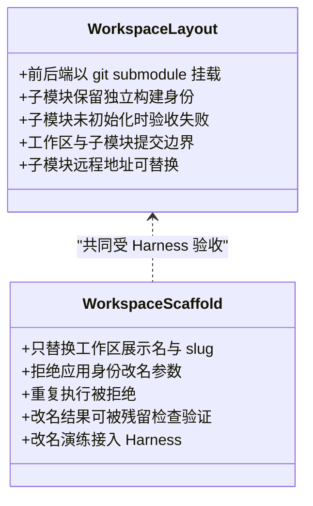

**图表来源**
- [openspec/specs/workspace-layout/spec.md:1-75](file://openspec/specs/workspace-layout/spec.md#L1-L75)
- [openspec/specs/workspace-scaffold/spec.md:1-53](file://openspec/specs/workspace-scaffold/spec.md#L1-L53)

**章节来源**
- [openspec/config.yaml:1-29](file://openspec/config.yaml#L1-L29)
- [openspec/specs/workspace-layout/spec.md:1-75](file://openspec/specs/workspace-layout/spec.md#L1-L75)
- [openspec/specs/workspace-scaffold/spec.md:1-53](file://openspec/specs/workspace-scaffold/spec.md#L1-L53)

### 能力层：harness/
`harness/run-all.ps1` 是整条链路的最终裁决者。它读取 `harness/checks/` 下所有 PowerShell 检查脚本，按文件名排序逐个执行，任一非零退出码立即停止（除非显式传入继续选项），最后汇总 PASS/FAIL 并输出 `RESULT: ALL CHECKS PASSED` 或 `RESULT: BLOCKED`。

六道闸门职责如下：
- `00-submodule-check.ps1`：校验 `.gitmodules`、gitlink、子模块工作树与 HEAD 是否一致。
- `01-compile.ps1`：后端能否编译。
- `02-test.ps1`：后端测试与容器装配契约。
- `03-static-guard.ps1`：拦截 TODO/FIXME/XXX、System.out、@Disabled、前端跳过测试等假绿灯。
- `04-frontend.ps1`：前端 npm ci、build、test。
- `05-scaffold-check.ps1`：工作区改名演练与旧身份残留扫描。

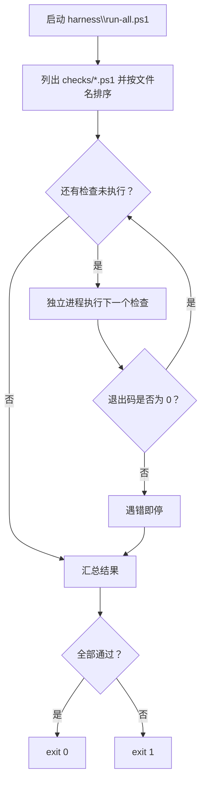

**图表来源**
- [harness/run-all.ps1:21-89](file://harness/run-all.ps1#L21-L89)

**章节来源**
- [harness/run-all.ps1:1-90](file://harness/run-all.ps1#L1-L90)

#### 子模块检查：00-submodule-check.ps1
该检查不联网、不自动初始化、不交互提问，只做只读验证：
- 确认 `.gitmodules` 存在。
- 确认 `backend` 与 `frontend` 的 path 与 url 配置正确。
- 确认父仓库索引中这两个路径是 gitlink。
- 确认子模块工作树存在并可读。
- 比较子模块 HEAD 与父仓库记录的 gitlink。

如果失败，会打印问题列表并提示修复命令。

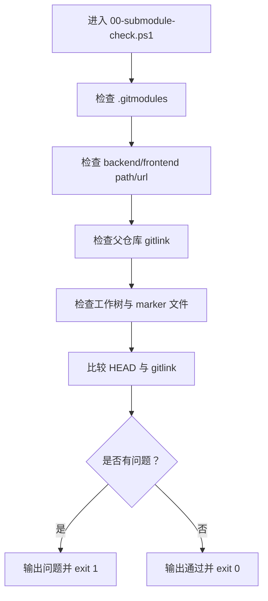

**图表来源**
- [harness/checks/00-submodule-check.ps1:1-94](file://harness/checks/00-submodule-check.ps1#L1-L94)

**章节来源**
- [harness/checks/00-submodule-check.ps1:1-94](file://harness/checks/00-submodule-check.ps1#L1-L94)

#### 静态红线：03-static-guard.ps1
该检查扫描 Java 源码与前端 TypeScript/TSX 源码，拦截四类“假通过”：
- TODO / FIXME / XXX 占位标记。
- Java 中使用 `System.out`。
- Java 中使用 `@Disabled`。
- 前端使用 `it.skip`、`describe.skip`、`test.skip`、`xit`、`xdescribe`。

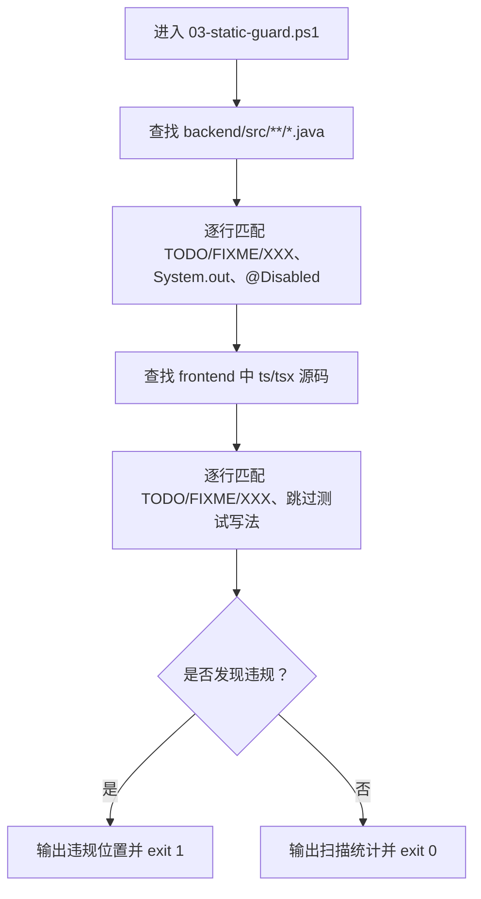

**图表来源**
- [harness/checks/03-static-guard.ps1:1-89](file://harness/checks/03-static-guard.ps1#L1-L89)

**章节来源**
- [harness/checks/03-static-guard.ps1:1-89](file://harness/checks/03-static-guard.ps1#L1-L89)

### 行为层：.agents/skills/
行为层不是普通注释，而是 AI 必须遵循的执行纪律。

#### 系统化排障：systematic-debugging
触发条件包括测试失败、启动报错、行为异常，以及“修一次没好”或“改一处崩三处”。它要求四阶段推进：复现、最小化、定位根因、验证修复，并明确反模式，例如吞异常、调大超时、注释断言、一次改多处、重启解决等。

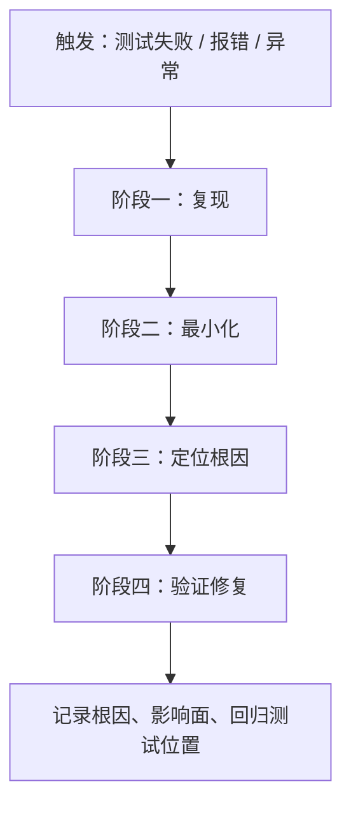

**图表来源**
- [.agents/skills/systematic-debugging/SKILL.md:1-65](file://.agents/skills/systematic-debugging/SKILL.md#L1-L65)

**章节来源**
- [.agents/skills/systematic-debugging/SKILL.md:1-65](file://.agents/skills/systematic-debugging/SKILL.md#L1-L65)

#### 先证后宣布：verification-before-completion
该技能禁止 AI 在没有新鲜证据的情况下宣称完成。它要求写出实际执行的命令、退出码、输出证明与未覆盖部分，并把 `harness\run-all.ps1` 作为标准验证入口。

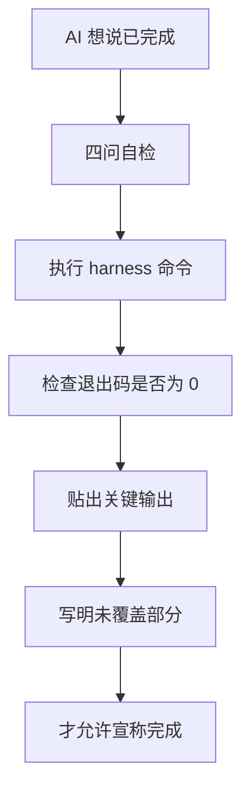

**图表来源**
- [.agents/skills/verification-before-completion/SKILL.md:1-70](file://.agents/skills/verification-before-completion/SKILL.md#L1-L70)

**章节来源**
- [.agents/skills/verification-before-completion/SKILL.md:1-70]

## 依赖关系分析
AIWorkSpace 的依赖关系可以理解为“工作区编排两层子模块，并用三层骨架约束 AI 行为”。

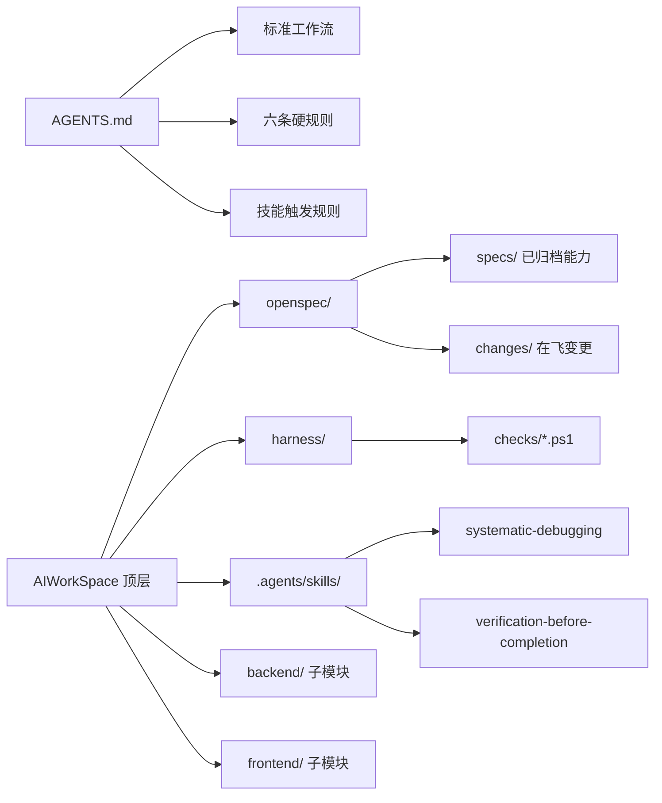

**图表来源**
- [AGENTS.md:28-70](file://AGENTS.md#L28-L70)
- [AGENTS.md:72-119](file://AGENTS.md#L72-L119)
- [README.md:70-81](file://README.md#L70-L81)

**章节来源**
- [AGENTS.md:28-70](file://AGENTS.md#L28-L70)
- [AGENTS.md:72-119](file://AGENTS.md#L72-L119)

## 性能与可重复性
从工程角度，AIWorkSpace 更强调**可重复性**而非极致性能：

- 不连接数据库或缓存，减少外部中间件带来的环境抖动。
- Harness 以幂等的命令行和退出码为准，适合 CI 与 AI 自动化。
- 子模块锁定提交 SHA，保证克隆后可复现。
- 前端构建与测试放在独立子模块，避免工作区脚本污染应用构建身份。
- 若未来接入数据库或缓存，应把“起容器”纳入 Harness，否则会出现护栏空洞。

**章节来源**
- [README.md:94-100](file://README.md#L94-L100)
- [AGENTS.md:154-160](file://AGENTS.md#L154-L160)

## 快速开始指南
以下流程基于仓库提供的快速开始与环境说明：

1. **克隆工作区并初始化子模块**  
   新克隆时使用递归子模块；已有克隆但未初始化时执行子模块更新。

2. **运行一键验收**  
   执行 `powershell -File harness\run-all.ps1`，期望结果为全部检查通过。

3. **启动后端服务**  
   使用 Maven 启动 Spring Boot 后端，并通过浏览器或 curl 访问 `/api/todos`。

4. **启动前端服务**  
   进入 `frontend` 目录安装依赖并启动开发服务器，浏览器访问本地前端端口，前端通过 Route Handler 代理 `/api` 到后端。

5. **提新需求**  
   在 AI 工具中执行 OpenSpec 提议命令，先生成规格，不直接写代码。

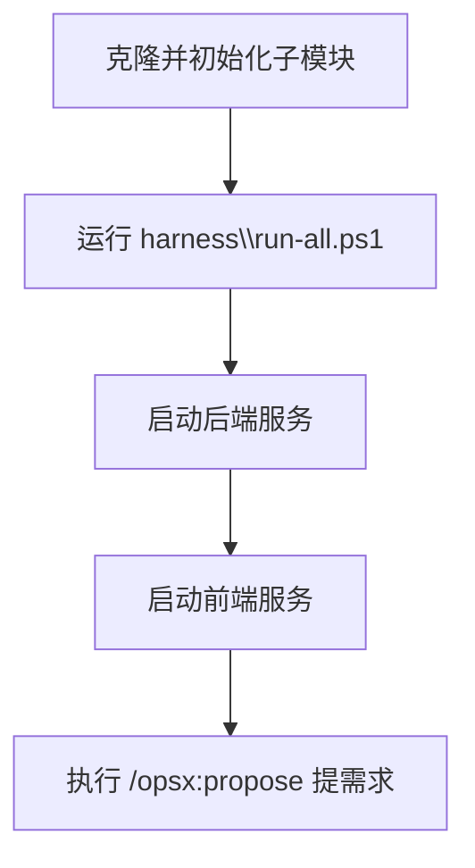

**图表来源**
- [README.md:21-42](file://README.md#L21-L42)

**章节来源**
- [README.md:21-42](file://README.md#L21-L42)
- [README.md:83-92](file://README.md#L83-L92)

## 常见使用场景
| 场景 | 推荐动作 | 依据 |
|---|---|---|
| 新增一个查询条件 | 先 `/opsx:propose`，再生成 proposal 与 specs，人工审阅后再 `/opsx:apply` | 标准工作流要求先规格后代码 |
| 测试失败 | 触发 `systematic-debugging`，按四阶段推进，不要先改代码 | 行为层强制规则 |
| 准备宣称完成 | 触发 `verification-before-completion`，跑 `harness\run-all.ps1` 并贴退出码与输出 | 完成判定只看退出码 |
| 克隆后无法编译 | 先执行子模块初始化，再运行 Harness | 00 闸门在未就绪时主动失败 |
| 想换仓库名称 | 执行 `scaffold/rename.mjs --name --display`，然后跑 Harness | 改名脚本与 05 闸门配合 |
| 想加新检查 | 在 `harness/checks/` 新增 `NN-名字.ps1`，遵守退出码约定 | Harness 自动按文件名排序执行 |

**章节来源**
- [AGENTS.md:37-58](file://AGENTS.md#L37-L58)
- [AGENTS.md:121-152](file://AGENTS.md#L121-L152)
- [README.md:44-59](file://README.md#L44-L59)

## 设计取舍说明
AIWorkSpace 明确了几项重要取舍：

1. **前后端用 submodule 而非普通目录**  
   好处是两个应用可独立提交、独立发布、独立构建；代价是新克隆必须先初始化子模块，因此 00 闸门在编译之前执行。

2. **工作区身份与应用身份分离**  
   工作区改名只改 `AGENTS.md` 与 `README.md`，不改 `backend/`、`frontend/`、`.gitmodules` 与应用包名；应用身份改名应在各自子模块仓库内完成。

3. **不接数据库/缓存**  
   为了 Harness 可重复，外部依赖越少越好；接入后再把“起容器”补进闸门。

4. **业务极简**  
   Todo 只是承载护栏的载体，不需要复杂业务逻辑。

5. **四条红线**  
   TODO 占位、`System.out`、`@Disabled`、前端跳过写法。这些红线由真实事故驱动增补，不预先设想过多规则。

**章节来源**
- [README.md:94-100](file://README.md#L94-L100)
- [AGENTS.md:154-160](file://AGENTS.md#L154-L160)
- [openspec/specs/workspace-scaffold/spec.md:9-29](file://openspec/specs/workspace-scaffold/spec.md#L9-L29)

## 故障排查指南
| 现象 | 可能原因 | 处理建议 |
|---|---|---|
| 运行 Harness 立刻失败 | 子模块未初始化或 HEAD 与 gitlink 不一致 | 执行子模块初始化命令，再运行 Harness |
| 静态红线失败 | 代码中存在 TODO/FIXME/XXX、System.out、@Disabled 或前端跳过测试 | 清理占位标记，改用正式日志与测试，不要跳过断言 |
| 前端构建失败 | Node 版本、依赖缓存或网络镜像问题 | 检查 Node 版本，必要时切换 npm registry 镜像 |
| 后端启动失败 | 端口占用、JDK/Maven 环境问题 | 检查 JDK 与 Maven 版本，确认 8989 端口可用 |
| 宣称完成但被拒绝 | 没有实际执行 Harness 或未贴退出码与证据 | 使用 `verification-before-completion` 重新验证 |
| 改名后仍报旧身份残留 | 改名脚本未执行成功或遗漏文件 | 重新执行改名脚本并运行 `05-scaffold-check.ps1` |

**章节来源**
- [harness/checks/00-submodule-check.ps1:82-93](file://harness/checks/00-submodule-check.ps1#L82-L93)
- [harness/checks/03-static-guard.ps1:79-88](file://harness/checks/03-static-guard.ps1#L79-L88)
- [README.md:83-92](file://README.md#L83-L92)
- [.agents/skills/verification-before-completion/SKILL.md:55-69](file://.agents/skills/verification-before-completion/SKILL.md#L55-L69)

## 结论
AIWorkSpace 的最小工作区示范价值在于：**用 OpenSpec 固定意图，用 Harness 提供否决权，用 Skills 固化方法**。它不追求业务复杂度，而追求让 AI 编码过程具备可验证性、可追溯性与清晰边界。对于团队而言，真正需要维护的不是某个模板页面，而是这三层如何持续约束“AI 知道做什么、怎么做、以及如何证明自己做对了”。